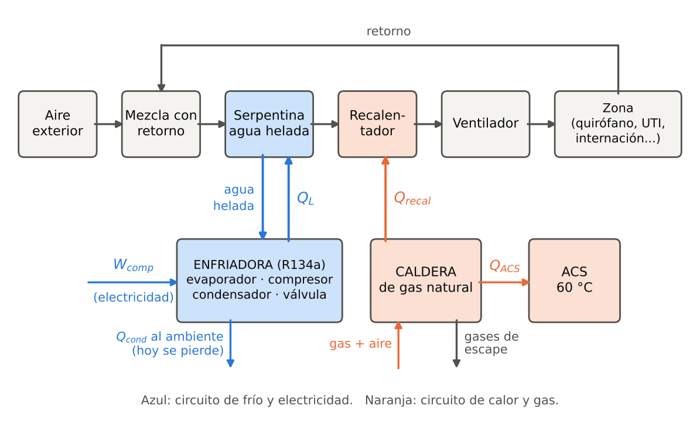
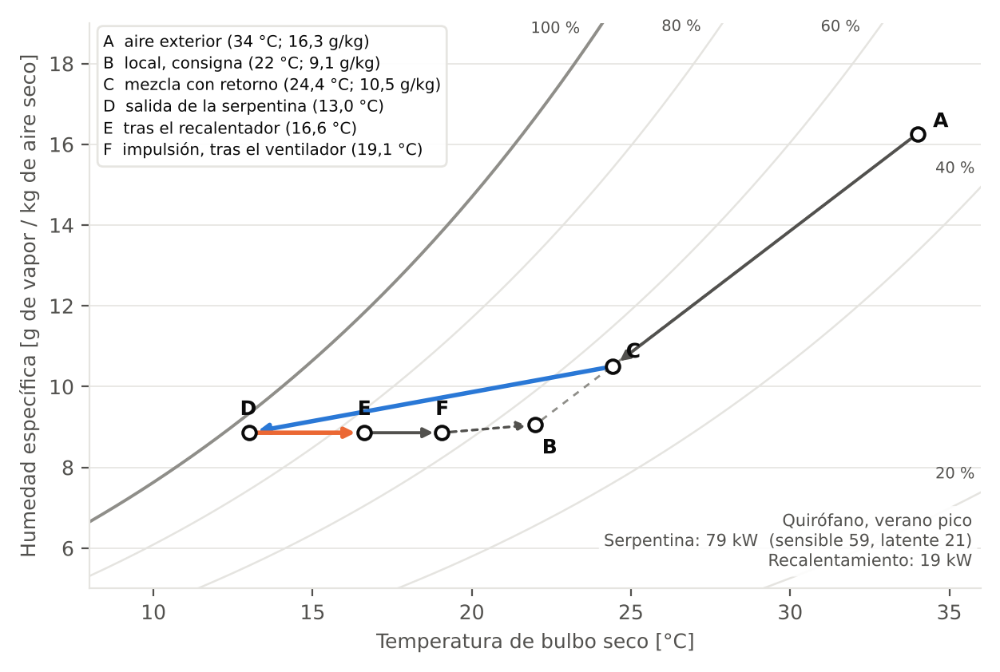
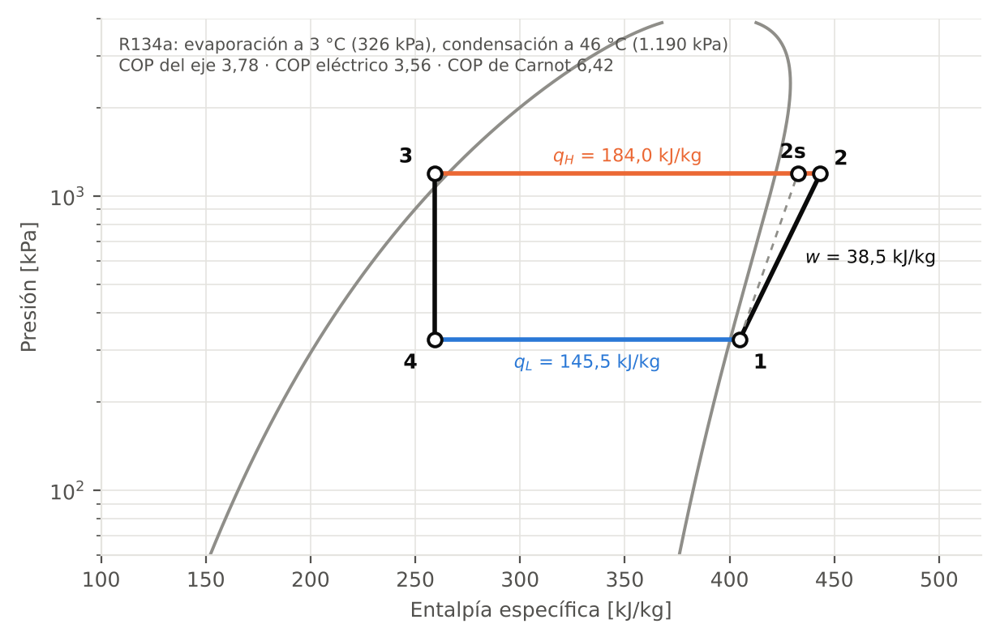
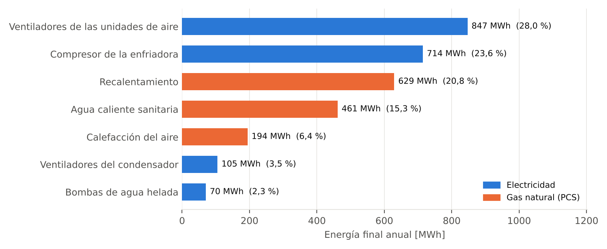
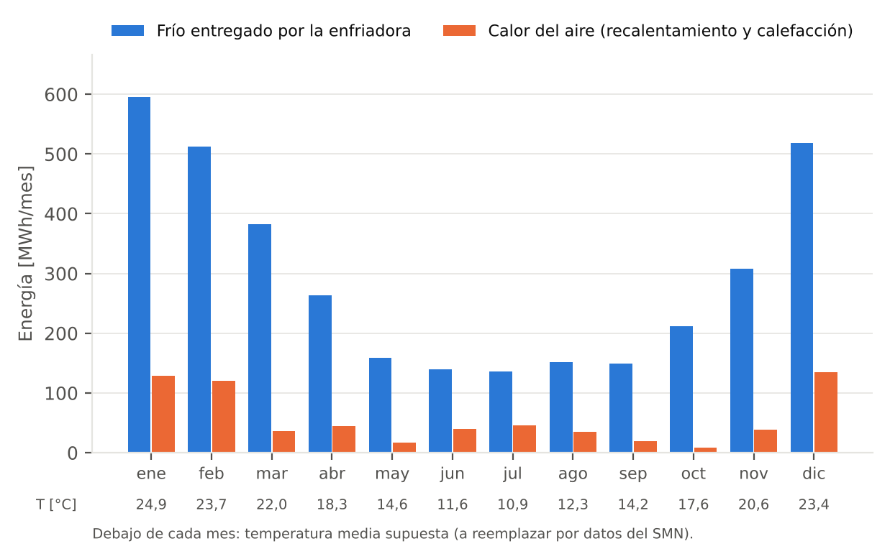
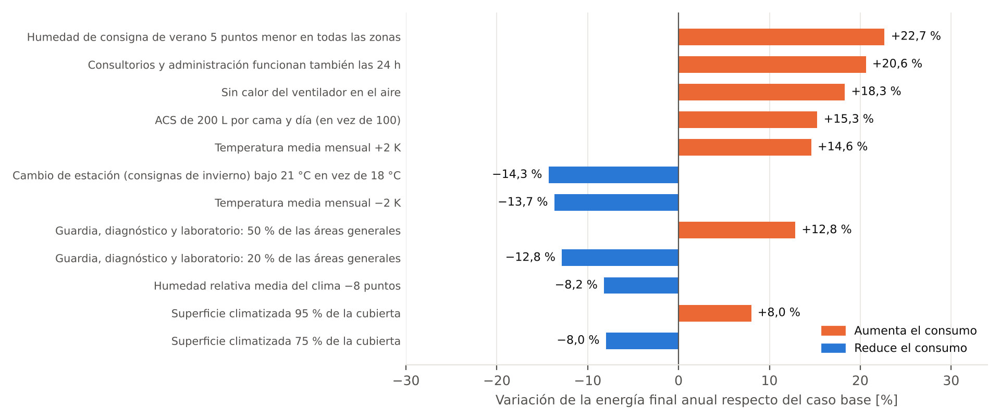

::: {custom-style="Nota"}
**Cómo leer este borrador.** Es la versión de trabajo del informe: sirve para ver qué se está armando, no es la entrega. Todas las cifras de cálculo salen del código (`calculo/`) y este documento se regenera con él (`python -m calculo.construir_borrador`). Los recuadros naranjas marcan lo que **falta**; los azules, avisos sobre el origen de los datos. Los valores de entrada marcados como *supuesto* no tienen todavía fuente citable (sección 4.7 y anexo A).
:::

| Sección | Estado | Qué falta |
|---|---|---|
| 1 Introducción, 2 Objetivos | Borrador completo | Revisar redacción |
| 3 Descripción del sistema | Completo con datos del hospital y supuestos declarados | Reemplazar supuestos por fuentes |
| 4 Metodología | Completa salvo exergía | Ecuaciones de exergía por equipo |
| 5 Resultados 5.1 a 5.5 | **Calculados y verificados** (aire húmedo, refrigeración, combustión, consumo anual, sensibilidad) | Datos de clima y normativa citables |
| 5.6 Exergía | **Pendiente** | Todo el análisis |
| 6 Alternativas y mejoras | **Pendiente** (hay una cota superior calculada) | Alternativa B y al menos dos mejoras con números |
| 7 Discusión | Parcial | Comparar alternativas |
| 8 Conclusiones | Ordenadas según las cinco preguntas de la Consigna 5; las preguntas 1, 3 y 4 quedan abiertas | Exergía, alternativa B y mejoras |
| Presentación oral y memoria de cálculo | No iniciadas | |
| Longitud | 13 páginas con anexos; la consigna pide 8 a 12 para el informe y la memoria de cálculo va aparte | Recortar al armar la versión final |

# Resumen

Se modela el sistema térmico de un hospital general de agudos de alta complejidad del AMBA, con el Hospital Dr. René Favaloro (La Matanza: {{A_cub}} m² cubiertos, {{camas_gen}} camas de internación general y {{camas_uti}} de terapia intensiva, {{n_or}} quirófanos) como referencia de tamaño y programa. El sistema abarca frío, recalentamiento, calefacción, humidificación y agua caliente sanitaria (ACS), más los ventiladores y bombas que los acompañan. Con aire húmedo, un ciclo de compresión de vapor de R134a y la combustión de gas natural, el modelo estima un consumo anual de **{{E_total_MWh}} MWh de energía final ({{i_cub}} kWh/m² y año)**: {{E_elec_MWh}} MWh de electricidad y {{E_gas_MWh}} MWh de gas natural.

Dos hallazgos ordenan el trabajo. Primero, con los supuestos actuales los ventiladores consumen más que el compresor ({{pct_vent}} % contra {{pct_comp}} % de la energía); el orden depende de la presión y del rendimiento supuestos de los ventiladores. Segundo, el sistema enfría el aire para quitarle humedad y después lo recalienta con gas: el recalentamiento es el {{pct_recal_util}} % del calor útil de la caldera, mientras la enfriadora rechaza al ambiente {{Q_cond_MWh}} MWh por año, unas {{Q_cond_sobre_recal}} veces ese calor. Esa ineficiencia es el hilo que une los cuatro contenidos de la materia y la base de la alternativa B (recuperar el calor del condensador).

El resultado depende de supuestos de entrada sin fuente citable todavía (clima, condiciones de ASHRAE 170, horarios de las zonas, consumo de ACS, temperatura de cambio de estación): variando uno por vez, la intensidad queda entre {{sens_min}} y {{sens_max}} kWh/m² y año. El análisis exergético, la alternativa B y las mejoras están pendientes.

# 1. Introducción

Un hospital opera todo el año y todo el día, y buena parte de su climatización no es de confort sino de **proceso**: los quirófanos, la terapia intensiva y las habitaciones exigen temperatura y humedad controladas, presión positiva y un mínimo de aire exterior filtrado. En el clima templado y húmedo del AMBA esa exigencia tiene una consecuencia termodinámica concreta. El aire exterior de verano (unos {{T_ext_ver}} °C con {{W_ext_ver}} g de vapor por kg de aire seco) debe enfriarse por debajo de su punto de rocío para condensar vapor, y a esa temperatura ya no puede impulsarse a la zona: hay que **recalentarlo**. Se gasta frío para deshumidificar y combustible para devolver temperatura.

El trabajo diseña y evalúa ese sistema integrando los cuatro contenidos de la materia sobre **una sola cadena de equipos**: el aire húmedo fija la carga frigorífica y el calor de recalentamiento; la refrigeración convierte esa carga en electricidad y en calor rechazado; la combustión convierte el calor de recalentamiento, de calefacción y de ACS en gas natural; y la exergía mide dónde se pierde capacidad de producir trabajo. El caso es un hospital del AMBA con el tamaño y el programa del Hospital Favaloro; los datos que ese hospital no publica (climatización, consumos) se estiman como supuestos declarados.

# 2. Objetivos

**Objetivo general.** Definir, modelar y evaluar con la Primera y la Segunda Ley el sistema térmico de un hospital del AMBA, y proponer configuraciones y mejoras que reduzcan su consumo.

**Objetivos específicos.**

1. Definir el edificio, las zonas térmicas y sus condiciones de proyecto, y declarar cada dato como dato, supuesto o constante.
2. Calcular la carga frigorífica (sensible y latente), el recalentamiento y la calefacción con aire húmedo.
3. Calcular el trabajo, el COP y el calor rechazado de la enfriadora, y el consumo y el rendimiento de la caldera.
4. Estimar el consumo anual de energía final y contrastarlo con hospitales de referencia.
5. Calcular la destrucción de exergía por equipo y comparar al menos dos alternativas y dos mejoras. *(pendiente)*

# 3. Descripción del sistema

## 3.1 El edificio

Se toma como base el **Hospital Dr. René Favaloro (SAMIC), Rafael Castillo, La Matanza**, un Hospital General de Agudos de Alta Complejidad. Ningún documento recibido trae datos de climatización ni de consumo del edificio real [F1, F2], de modo que el modelo es una réplica de su tamaño y programa, no de sus instalaciones.

| Dato | Valor | Estado |
|---|---|---|
| Superficie cubierta | {{A_cub}} m² (otra cifra declarada: más de 20.000 m² de construcción, dicha por el intendente sin aclarar si es cubierta) | Dato de programa [F1, F2], sin confirmar con la obra terminada |
| Camas | {{camas_gen}} de internación general y {{camas_uti}} de terapia intensiva ({{camas_tot}} en total); la presentación de Presidencia prevé 160 de internación | Dato [F2] y [F1]; se interpreta 144 + 14 como el total del hospital |
| Quirófanos | {{n_or}} | Dato de programa [F1] |
| Niveles | Tres pisos listados (podría haber un cuarto); quirófanos y áreas críticas en el 2.º; guardia y diagnóstico en el 1.º | Dato [F1] |
| Funcionamiento | Guardia las 24 h; internación y áreas críticas continuas | Dato [F1, F2] (guardia 24 h) y supuesto (el resto) |
| Superficie climatizada | {{f_acond}} % de la cubierta ({{A_cond}} m²) | Supuesto |
| Clima | AMBA, templado y húmedo | Supuesto (a reemplazar con datos del SMN) |

Table: Tabla 1. Datos del hospital base.

## 3.2 Zonas térmicas

El edificio se divide en cinco zonas, cada una tratada como un sistema de aire de caudal constante con su propia unidad de tratamiento.

{{tabla_zonas}}

Table: Tabla 2. Zonas térmicas, consignas de verano y caudales.

Las renovaciones mínimas de G1, G2 y G3 son valores de ASHRAE 170 recordados, a verificar con la norma; la de G4 es un promedio ponderado de valores de ASHRAE 170 con pesos supuestos, y la de G5 es un supuesto sin norma. Las superficies de zona también son supuestos ({{a_or}} m² por quirófano, {{a_uti}} m² por cama de terapia intensiva, {{a_gen}} m² por cama de internación, altura libre de {{h_techo}} m). El caudal de impulsión es el mayor entre el que fijan esas renovaciones y el que pide la carga sensible, por eso las renovaciones resultantes pueden ser mayores. Los demás parámetros de cada zona están en el anexo A (tabla A2).

## 3.3 Esquema del sistema

El aire exterior se mezcla con el retorno, una serpentina de agua helada lo enfría y deshumidifica, un recalentador lleva el aire a la temperatura necesaria y un ventilador lo impulsa a la zona. La enfriadora (compresión de R134a) produce el agua helada y rechaza calor al ambiente; la caldera de gas natural alimenta el recalentamiento, la calefacción de invierno y el ACS.

{width=14.5cm}

**Volúmenes de control.** Los balances se plantean sobre cuatro sistemas:

| Sistema | Límite | Flujos que lo cruzan |
|---|---|---|
| Unidad de tratamiento de aire | Mezcla, serpentina, recalentador, humidificador y ventilador | Aire exterior y de retorno (entran), aire de impulsión (sale), agua helada, calor de la caldera, vapor |
| Enfriadora | Compresor, condensador, válvula y evaporador | Calor del agua helada (entra), electricidad (entra), calor al ambiente (sale) |
| Caldera | Cámara de combustión e intercambiador | Gas y aire (entran), gases de escape (salen), calor útil (sale) |
| Producción de ACS | Acumulación y recirculación | Calor de la caldera, agua fría (entra), agua caliente (sale) |

Table: Tabla 3. Sistemas de estudio y sus límites.

## 3.4 Cómo se integran los cuatro contenidos

| Contenido | Qué resuelve | Qué entrega, y a quién |
|---|---|---|
| Aire húmedo | Estados del aire en la mezcla, la serpentina, el recalentador y la impulsión; cargas sensible y latente | Carga frigorífica (a la refrigeración) y calor de recalentamiento y calefacción (a la combustión) |
| Refrigeración | Ciclo de la enfriadora: trabajo, COP, calor rechazado | Electricidad del frío (al balance) y calor del condensador (base de la alternativa B) |
| Combustión | Gas natural con exceso de aire: reacción, poder calorífico, rendimiento, temperatura de llama | Gas para recalentar, calefaccionar y producir ACS (al balance y a la exergía) |
| Exergía | Dónde se destruye capacidad de producir trabajo, con estado muerto en el exterior | Destrucción por equipo, para comparar alternativas y mejoras |

Table: Tabla 4. Integración de los contenidos.

# 4. Metodología

## 4.1 Hipótesis y frontera

1. En cada estado considerado el régimen es permanente; cada mes se parte en una mitad diurna y una nocturna.
2. El aire húmedo es una mezcla de aire seco y vapor, ambos gases ideales, a 101,325 kPa.
3. Sistema de caudal constante con serpentina y recalentamiento, sin economizador ni recuperación de calor: es la línea de base (alternativa A).
4. El ventilador de impulsión aspira después de la serpentina y toda su potencia eléctrica se disipa como calor en el aire.
5. El refrigerante cumple un ciclo de compresión de vapor con compresor adiabático de rendimiento isentrópico constante, expansión isoentálpica y sin pérdidas de presión. La evaporación es fija a {{T_ev}} °C, el COP depende de la temperatura de condensación del estado y no de la carga (no hay curva de carga parcial) y el motor del compresor está fuera de la corriente de refrigerante.
6. Combustión completa del gas natural, gases ideales y sin disociación; el aire tiene 21 % de O₂ y 79 % de N₂; los gases de escape salen a {{T_gases}} °C sin condensar.
7. **Frontera:** se calcula el sistema térmico y sus auxiliares (ventiladores de las unidades, ventiladores del condensador, bombas de agua helada). No se incluyen iluminación, equipos médicos, cocina, lavandería ni esterilización, por lo que **el resultado no es el consumo total del hospital**. No se modelan economizador, ventiladores de retorno y extracción, bombas de agua caliente ni pérdidas de distribución.

## 4.2 Aire húmedo

La humedad específica y la entalpía del aire húmedo, por kg de aire seco, son

$$\omega = 0\text{,}622\,\frac{p_v}{P - p_v}, \qquad h = 1\text{,}006\,T + \omega\,(2501 + 1\text{,}86\,T)$$

con $T$ en °C y $h$ en kJ/kg. La mezcla de aire exterior y de retorno conserva entalpía y humedad: $\dot m_a h_{mez} = \dot m_{ae} h_{ext} + \dot m_{ar} h_{ret}$ y la misma relación para $\omega$. La serpentina enfría hasta $T_c$ y deshumidifica hasta $\omega_c$, con el aire a la salida al {{HR_serp}} % de humedad relativa:

$$\dot Q_{serp} = \dot m_a\left[(h_{mez} - h_c) - (\omega_{mez} - \omega_c)\,h_f\right], \qquad \dot Q_{lat} = \dot m_a\,(\omega_{mez} - \omega_c)\,h_{fg}$$

donde $h_f = 4\text{,}186\,T_c$ es la entalpía del condensado y la parte sensible es la diferencia. El recalentador lleva el aire a $T_{obj}$, que es la temperatura de impulsión menos el calentamiento que producirá el ventilador:

$$\dot Q_{rec} = \dot m_a\,c_{p,ah}\,(T_{obj} - T_c), \qquad T_{obj} = T_{imp} - \frac{\dot W_{vent}}{\dot m_a\,c_{p,ah}}, \qquad c_{p,ah} = 1\text{,}006 + 1\text{,}86\,\omega$$

El estado de impulsión sale del balance de la zona. Con la actividad $f_{act}$, la fracción de envolvente expuesta $f_{env}$, la conductancia $UA$ ({{UA}} W/(m² K)) y la ganancia solar $q_{sol}$:

$$\dot Q_s = A\left[q_s\,f_{act} + f_{env}\,\big(UA\,(T_{ext} - T_r) + q_{sol}\big)\right], \qquad \dot Q_l = A\,q_l\,f_{act}$$

$$T_{imp} = T_r - \frac{\dot Q_s}{\dot m_a\,c_{p,ah}}, \qquad \omega_{imp} = \omega_r - \frac{\dot Q_l}{\dot m_a\,h_{fg}}, \qquad \dot W_{vent} = \frac{\dot V\,\Delta p}{\eta_{vent}}$$

con $T_{imp}$ limitada entre 13 y 35 °C, $h_{fg} = 2501$ kJ/kg, $\eta_{vent} = {{eta_vent_m}}$ y $\rho = 1\text{,}2$ kg/m³. La serpentina lleva el aire a $\omega_c = \omega_{imp}$ con la temperatura de salida que corresponde a la saturación parcial indicada; si esa temperatura supera $T_{obj}$, enfría hasta $T_{obj}$. El caudal de impulsión es el mayor entre el que fijan las renovaciones y el que pide la carga sensible, y el de aire exterior se fija en valor absoluto. En invierno, si el aire sale más seco que la humedad mínima de la zona, se humidifica con vapor.

## 4.3 Refrigeración

Para el ciclo con entalpías $h_1$ a $h_4$ (estados de la tabla 6), por kg de refrigerante:

$$q_L = h_1 - h_4, \qquad w = h_2 - h_1 = \frac{h_{2s} - h_1}{\eta_{is}}, \qquad q_H = h_2 - h_3$$

$$COP_{eje} = \frac{q_L}{w}, \qquad COP_{el} = \frac{q_L}{w/\eta_{mot}}, \qquad COP_{Carnot} = \frac{T_{ev}}{T_{cond} - T_{ev}}$$

$$\dot W_{comp} = \frac{\dot Q_L}{COP_{el}}, \qquad \dot Q_{cond} = \dot Q_L + \eta_{mot}\,\dot W_{comp}$$

El rendimiento del motor es $\eta_{mot} = {{eta_motor_m}}$ y el COP de Carnot usa temperaturas absolutas (K). La temperatura de condensación sigue al clima: $T_{cond} = \max(T_{ext} + {{dT_cond}}\ \text{K},\ {{T_cond_min}}\ °C)$. Los ventiladores del condensador consumen el {{f_vent_cond}} % del calor rechazado y las bombas se calculan con el caudal de agua helada (salto de {{dT_ah}} K), {{dP_bomba}} kPa de presión y {{eta_bomba}} de rendimiento total.

## 4.4 Combustión

La reacción por kmol de gas natural, con relación de aire $\lambda$ = {{lambda_m}} (el oxígeno estequiométrico es $a_{st}$ = {{o2_st_m}} kmol y el real, $\lambda\,a_{st}$), es

$${{gas_CH4_m}}\,\text{CH}_4 + {{gas_C2H6_m}}\,\text{C}_2\text{H}_6 + {{gas_C3H8_m}}\,\text{C}_3\text{H}_8 + {{gas_N2_m}}\,\text{N}_2 + {{gas_CO2_m}}\,\text{CO}_2 + {{o2_reac_m}}\left(\text{O}_2 + \tfrac{79}{21}\,\text{N}_2\right) \rightarrow {{co2_prod_m}}\,\text{CO}_2 + {{h2o_prod_m}}\,\text{H}_2\text{O} + {{n2_prod_m}}\,\text{N}_2 + {{o2_prod_m}}\,\text{O}_2$$

Los poderes caloríficos salen de las entalpías de formación, con agua líquida en los productos para el superior (PCS) y vapor para el inferior (PCI). El rendimiento de la caldera se calcula por el balance de los gases de escape, y el combustible necesario para entregar un calor útil $Q_{util}$ es

$$\eta = 1 - q_{gases} - f_{rad}, \qquad q_{gases} = \frac{H_{prod}(T_{gases}) - H_{reac}(T_{aire})}{PCI}, \qquad E_{PCS} = \frac{Q_{util}}{\eta}\cdot\frac{PCS}{PCI}$$

donde $H$ son las entalpías sensibles respecto de 25 °C (calores específicos de gas ideal de CoolProp), $T_{aire}$ = {{T_aire_comb}} °C y $f_{rad}$ = {{f_rad}} % del PCI son las pérdidas por radiación y funcionamiento (supuesto).

El ACS se calcula desde el consumo por cama, no desde una potencia por m²:

$$\dot Q_{ACS} = \frac{L\cdot N_{camas}\cdot 4\text{,}186\,(T_{ACS} - T_{red})\cdot f_{perd}}{86\,400}$$

con $L$ = {{L_cama}} L/(cama día), $N_{camas}$ = {{camas_tot}}, $T_{ACS}$ = {{T_acs}} °C, $T_{red}$ = {{T_red}} °C, $f_{perd}$ = {{f_perd}}, agua de 1 kg/L y resultado en kW (media de las 8.760 h del año; el modelo no calcula el pico).

## 4.5 Consumo anual

Cada mes se representa con dos estados de $12\,d_i$ horas ($d_i$ son los días del mes): uno diurno ($T_i + {{dT_dia_m}}$ K) y uno nocturno ($T_i - {{dT_dia_m}}$ K), con la humedad específica media del mes limitada a la saturación. La estación de cada estado se decide por su temperatura exterior: verano (consignas de verano, con deshumidificación y recalentamiento) si $T \geq$ {{T_cambio}} °C e invierno (consignas de invierno, con calefacción y humidificación) si no, sin histéresis; el resultado es sensible a ese umbral (tabla 9). En cada estado se calculan las cargas de las cinco zonas, la planta de frío con la temperatura exterior del estado y el calor de la caldera, y se multiplican por las horas. Se prefirió este método a las horas equivalentes a plena carga porque la ventilación es continua y un número de horas la representa mal.

## 4.6 Exergía

::: {custom-style="Pendiente"}
**Pendiente.** El análisis usará, para cada equipo, la exergía de flujo $\dot X = \dot m\,[(h - h_0) - T_0\,(s - s_0)]$, la exergía del calor $\dot X_Q = \dot Q\,(1 - T_0/T)$, la destrucción $\dot X_{dest} = T_0\,\dot S_{gen}$ y la eficiencia exergética. **Decisión a confirmar: el estado muerto.** Con $T_0$ = {{T_ext_ver}} °C (verano de diseño) el aire tratado (13 a 19 °C) queda por debajo del estado muerto y la exergía térmica del enfriamiento y del recalentamiento cambia de signo; con una temperatura media anual (unos {{T_media_anual}} °C) o con el estado exterior de cada estado el planteo es otro, y también cambia la exergía del calor a 60 °C del ACS. Además hay que definir producto y combustible de cada equipo, la exergía química del gas natural y el tratamiento de la humedad y del condensado.
:::

## 4.7 Datos y supuestos

El modelo tiene {{n_filas}} parámetros escalares de entrada, más las cinco zonas y el clima de los 12 meses: {{n_dato}} de los escalares son datos leídos de documentos recibidos (cuatro describen el hospital base y la temperatura del ACS viene del artículo [H]), {{n_supuesto}} son supuestos fundamentados pero sin fuente citable todavía y {{n_const}} son constantes de diseño o propiedades físicas. Según la sensibilidad (tabla 9), los que más mueven el resultado son la humedad de consigna de verano, los horarios de las zonas, el calor del ventilador, el ACS por cama, la temperatura media del clima, la temperatura de cambio de estación y la superficie climatizada; las ganancias internas y la conductancia de la envolvente pesan poco (menos de 3 % con ±30 %). El anexo A muestra los parámetros principales, las zonas y el clima; la tabla completa, con la fuente de cada uno, está en `informe/supuestos.md`.

::: {custom-style="Nota"}
**Origen de las propiedades.** Aire húmedo con las fórmulas de ASHRAE Fundamentals (psychrolib) contrastadas con CoolProp; refrigerante y capacidades caloríficas de gases con CoolProp. Cuando la cátedra indique el libro de tablas, se contrastarán tres puntos contra esas tablas.
:::

# 5. Resultados

## 5.1 Caso detallado: quirófano en el punto de verano pico

El quirófano (zona G1, {{m_sup_G1}} kg/s de aire seco, equivalente a {{m3h_G1}} m³/h, con {{oa_G1}} % de aire exterior) se calcula con el exterior a {{T_ext_ver}} °C de bulbo seco y {{Tbh_ver}} °C de bulbo húmedo y actividad plena. La serpentina entrega {{Q_serp_G1}} kW, de los cuales {{Q_sens_G1}} kW son sensibles y {{Q_lat_G1}} kW latentes; el recalentador aporta {{Q_recal_G1}} kW y el ventilador calienta el aire {{dT_vent_G1}} K ({{calor_vent_G1}} kW).

{width=14.5cm}

{{tabla_psicro}}

Table: Tabla 5. Estados del aire en el quirófano (A a F, figura 2). Las diferencias de una décima entre valores se deben al redondeo.

En el punto de diseño el recalentamiento del edificio es de solo {{Q_recal_ver}} kW: con carga máxima el aire sale de la serpentina cerca de la temperatura que se necesita. El recalentamiento aparece a carga parcial, y **dimensionar su recuperación con el pico subestimaría el potencial**.

## 5.2 Ciclo de refrigeración

Con la suma de las serpentinas, la capacidad frigorífica de diseño es **{{Q_L_dis}} kW** ({{Q_L_dis_wm2}} W/m² cubierto). El R134a evapora a {{T_ev}} °C ({{p_ev}} kPa) y condensa a {{T_cond_dis}} °C ({{p_c}} kPa), porque el condensador es enfriado por aire a {{T_ext_ver}} °C.

{width=13cm}

{{tabla_ciclo}}

Table: Tabla 6. Estados del ciclo de refrigeración. Las diferencias de una décima entre valores se deben al redondeo.

El efecto frigorífico es {{q_L_ref}} kJ/kg, el trabajo de compresión {{w_ref}} kJ/kg y el calor rechazado {{q_H_ref}} kJ/kg. El COP sobre el eje es {{cop_eje}} y sobre la potencia eléctrica {{cop_elec}}, contra {{cop_carnot}} del ciclo de Carnot entre las mismas temperaturas, que es el límite de la Segunda Ley: **el COP eléctrico es el {{eta_carnot}} % del de Carnot** ({{eta_carnot_eje}} % si se cuenta sobre el eje). La potencia eléctrica del compresor al diseño es {{W_comp_dis}} kW y el caudal de refrigerante, {{m_ref}} kg/s. El compresor descarga a {{T2_ref}} °C, pero el calor del sobrecalentamiento de la descarga es solo el {{frac_desrec}} % del calor rechazado; el resto sale a la temperatura de condensación. Es el nivel de temperatura que se podría aprovechar.

## 5.3 Combustión y caldera

Por kmol de gas natural y con {{exceso}} % de exceso de aire, la reacción consume {{o2_reac}} kmol de O₂ y {{n2_aire}} kmol de N₂ del aire, y produce {{co2_prod}} kmol de CO₂, {{h2o_prod}} kmol de H₂O, {{n2_prod}} kmol de N₂ y {{o2_prod}} kmol de O₂ sin consumir. El balance de átomos de C, H, O y N cierra.

| Magnitud | Valor |
|---|---|
| Poder calorífico superior | {{PCS_kcal}} kcal/m³ = {{PCS_kWh}} kWh/m³ (m³ estándar a 15 °C) |
| Poder calorífico inferior | {{PCI_kWh}} kWh/m³ (relación PCS/PCI = {{PCS_PCI}}) |
| Pérdida por gases de escape ({{T_gases}} °C) | {{q_gases}} % del PCI |
| Pérdida por radiación y funcionamiento (supuesto) | {{f_rad}} % del PCI |
| **Rendimiento de la caldera** | **{{eta_PCI}} % sobre PCI** ({{eta_PCS}} % sobre PCS) |
| Temperatura de rocío de los gases | {{T_rocio}} °C (fracción molar de agua: {{y_H2O}} %); la chimenea a {{T_gases}} °C no condensa |
| Temperatura de llama adiabática teórica (sin disociación) | {{T_llama}} °C |
| Gas por kWh de calor útil | {{gas_m3_kWh}} m³ |

Table: Tabla 7. Combustión del gas natural y rendimiento de la caldera.

La carga de la caldera en el aire es de {{Q_cal_inv}} kW en el día de diseño de invierno, más {{acs_kW}} kW medios de ACS (el modelo no calcula el pico de ACS).

## 5.4 Consumo anual

La energía final anual es **{{E_total_MWh}} MWh**: {{E_elec_MWh}} MWh de electricidad y {{E_gas_MWh}} MWh de gas natural medido por su PCS, unos {{V_gas_mil}} m³. Sobre la superficie cubierta son **{{i_cub}} kWh/m² y año** ({{i_elec}} de electricidad y {{i_gas}} de gas); sobre la climatizada, {{i_cond}}. El gas es el {{frac_gas}} % de la energía. La energía final suma electricidad y gas (PCS) kWh a kWh, sin ponderar por energía primaria.

{{tabla_usos}}

Table: Tabla 8. Consumo anual por uso final. Los totales pueden diferir en 1 MWh de la suma de las filas por redondeo.

La humidificación con vapor no aparece en la tabla porque, con estados medios mensuales, el aire exterior nunca queda lo bastante seco. En el día de diseño de invierno sí haría falta ({{Q_hum_inv}} kW), así que un año real tendría un consumo de vapor que este método no ve (tabla 13).

{width=14cm}

El frío entregado en el año es {{frio_MWh}} MWh. El COP estacional del compresor es {{COP_est_comp}}, mayor que el de diseño ({{cop_elec}}) porque la mayor parte del año la condensación es más baja; el COP estacional de la planta, con los ventiladores del condensador y las bombas, es {{COP_planta}}. Las horas equivalentes a plena carga de refrigeración son {{EFLH}} h.

{width=14cm}

**El calor del aire es mayor en verano que en invierno**: {{calor_ene}} MWh en enero y {{calor_dic}} MWh en diciembre, contra {{calor_jul}} MWh en julio. Es el recalentamiento posterior a la deshumidificación, no la calefacción, lo que domina el gas del aire. El frío pasa de {{frio_ene}} MWh en enero a {{frio_jul}} MWh en julio y no es cero en invierno porque las ganancias internas y el calor de los ventiladores siguen existiendo y el modelo no incluye economizador (enfriamiento gratuito con aire exterior).

## 5.5 Sensibilidad

Cada fila de la tabla 9 cambia un supuesto y deja los demás en su valor base. Las 12 variaciones que más mueven el resultado son:

{{tabla_sens}}

Table: Tabla 9. Sensibilidad de la energía final anual (caso base: {{E_total_MWh}} MWh).

{width=14.5cm}

Tomadas de a una, las variaciones mueven la intensidad entre {{sens_min}} y {{sens_max}} kWh/m² y año. **Eso no es un intervalo de confianza**: las variaciones se combinan y los supuestos no son independientes. Una revisión externa del modelo estimó la incertidumbre global en alrededor de ±15 a 20 %; es una estimación del revisor, no un cálculo de este modelo. La sensibilidad indica qué conviene reemplazar primero por datos citables: la humedad de consigna de verano (5 puntos menos: {{s_hr5}} %), los horarios de las zonas (consultorios 24 h: {{s_g5_24h}} %), el calor del ventilador (sin él: {{s_fan}} %), el ACS por cama (200 L: {{s_acs200}} %), la temperatura media (±2 K: {{s_tp2}} % y {{s_tm2}} %) y la temperatura de cambio de estación (21 °C: {{s_est21}} %; 15 °C: {{s_est15}} %). Las ganancias internas y la conductancia de la envolvente, en cambio, mueven menos de 3 % con ±30 %.

El orden entre ventiladores y compresor no es robusto: con 20 % menos de presión de ventilador los ventiladores consumen {{vent_dp80}} MWh y el compresor, {{comp_dp80}} MWh; con un rendimiento de ventilador de 0,75, {{vent_eta75}} y {{comp_eta75}} MWh. En esos dos casos el compresor pasa a ser el primer consumo.

::: {custom-style="Pendiente"}
**Pendiente: 5.6 Análisis exergético.** Falta calcular la destrucción de exergía en la serpentina y la enfriadora (compresor, condensador, válvula), en el recalentador y la caldera, y en los ventiladores, con su eficiencia exergética y un diagrama de flujo de exergía (Grassmann). La hipótesis a poner a prueba: calentar aire unos pocos grados con una llama de {{T_llama}} °C destruye casi toda la exergía del combustible.
:::

# 6. Alternativas y mejoras

::: {custom-style="Pendiente"}
**Pendiente: esta sección todavía no tiene resultados.** Lo que ya está definido y lo que ya se calculó:

**Alternativa A (línea de base):** enfriadora de compresión, caldera de gas y aire de caudal constante con recalentamiento. Es la que se calculó en la sección 5.

**Alternativa B:** igual que A, con **recuperación del calor del condensador** para el recalentamiento. Un recuperador alimentado con el calor que hoy se rechaza reemplazaría parte del gas del recalentamiento. **Cota superior ya calculada:** si el condensador cubriera todo el recalentamiento, se ahorrarían {{MWh_recal_gas}} MWh de gas al año ({{pct_recal_gas}} % de la energía final). No es el resultado de B: faltan la coincidencia en el tiempo entre el recalentamiento y el calor disponible, el nivel de temperatura (el calor de la descarga a más de 46 °C es solo el {{frac_desrec}} % del rechazado; durante el año el condensador trabaja entre {{T_cond_min}} y {{T_cond_anual_max}} °C, y a {{T_cond_dis}} °C solo en el punto de diseño, donde el compresor descarga a unos {{T2_ref}} °C) y el trabajo extra del compresor si hay que subir la presión de condensación.

**Mejoras candidatas** (la consigna pide al menos dos, explicadas desde la Termodinámica). Hay que elegir dos o tres que se puedan cuantificar con el mismo modelo:
:::

| Mejora | Principio termodinámico | Qué se cuantificaría con el modelo |
|---|---|---|
| Recuperación del calor del condensador (alternativa B) | Aprovechar calor que hoy se rechaza a {{T_cond_min}} a {{T_cond_anual_max}} °C (hasta {{T2_ref}} °C en la descarga del compresor, en el diseño), en lugar de quemar gas en una llama adiabática teórica de {{T_llama}} °C | Gas evitado y trabajo extra del compresor |
| Control del exceso de aire o caldera de condensación | Menos pérdida en los gases de escape y recuperación del calor latente del agua formada (la temperatura de rocío es {{T_rocio}} °C; solo condensa si el retorno de agua está por debajo de unos 55 °C) | Rendimiento de la caldera y gas ahorrado |
| Recuperación de calor del aire de extracción con serpentinas de circuito cerrado | Precalentar o preenfriar el aire exterior con el aire que sale, sin mezclarlos (en un hospital la contaminación cruzada es una restricción dura) | Reducción de la carga de serpentina y de recalentamiento |
| Mayor temperatura de evaporación | Menor salto de presión del compresor, menos trabajo | Reducción de la electricidad del compresor |
| Reducción de la presión y del caudal de los ventiladores en zonas no críticas | Los ventiladores son el {{pct_vent}} % de la energía y la potencia crece con el caudal y la presión | Electricidad de ventiladores |

Table: Tabla 10. Mejoras candidatas.

El informe de HCWH sobre hospitales argentinos aporta estimaciones locales de ahorro (por ejemplo, hasta 40 % en un hospital de San Juan reemplazando splits por VRF con recuperación de calor en habitaciones, bomba de calor en consultorios y recambio de equipos en áreas especiales, y 26 % con VRF en el laboratorio de un centro de Rosario), con base no declarada y con la salvedad de que son estimaciones de los auditores [A]. Corresponden a sistemas de expansión directa y no a un sistema todo aire con recalentamiento como el de este modelo, así que sirven como orden de magnitud local y no como estimación para este caso.

# 7. Discusión

## 7.1 Tres cosas que el resultado muestra

1. **Los ventiladores son lo que más energía consume** ({{pct_vent}} %, {{MWh_vent}} MWh), por encima del compresor ({{pct_comp}} %). Es un efecto del tipo de sistema (todo aire), de las renovaciones que exige un hospital en quirófanos y áreas críticas ({{ach_G1}}, {{ach_G2}} y {{ach_G4}} por hora) y, en internación y consultorios, de la carga sensible, que fija {{ach_G3_real}} renovaciones por hora, más que el mínimo normativo. **El orden depende de la presión y el rendimiento supuestos de los ventiladores** (sección 5.5).
2. **El recalentamiento es casi la mitad del calor útil de la caldera** ({{q_recal_MWh}} de {{q_total_MWh}} MWh). La enfriadora rechaza al ambiente {{Q_cond_MWh}} MWh por año, unas {{Q_cond_sobre_recal}} veces el calor de recalentamiento: el calor existe, falta ver si coincide en el tiempo y en temperatura.
3. **El COP estacional de la planta ({{COP_planta}}) coincide casi exactamente con el COP 4 que supone el artículo de Hospitecnia [H].** Es una coincidencia de resultado, no un ajuste: el COP sale del ciclo y de las temperaturas de condensación del clima.

## 7.2 Contraste con las referencias

Las referencias miden el edificio completo y este resultado solo el sistema térmico. Para compararlas se estima el consumo total equivalente dividiendo por la fracción que el sistema térmico representa del total. **Esas fracciones las calculó el equipo** sumando porcentajes sueltos de cuatro repartos del artículo [H] (tabla 11); el artículo no las da como tales, y el reparto de Chile que sirve de base suma 103 % en el artículo. El total equivalente queda entre {{eq_min}} y {{eq_max}} kWh/m² y año.

{{tabla_part}}

Table: Tabla 11. Fracción del sistema térmico y consumo total equivalente.

{{tabla_ref}}

Table: Tabla 12. Intensidad energética del modelo y de las referencias.

El total equivalente del edificio completo ({{eq_min}} a {{eq_max}} kWh/m²) queda por encima de CEMAR ({{ref_cemar}}) y de Giordano ({{ref_giordano}}), solapa con Garrahan ({{ref_garrahan}}) en su extremo bajo, contiene la mediana internacional ({{ref_med}}) y queda por debajo del modelo español ({{ref_es_min}} a {{ref_es_max}}). El valor del solo sistema térmico ({{i_cub}}) es menor que los totales de Garrahan y CEMAR y apenas mayor que el de Giordano, como corresponde a una parte del total. Los hospitales argentinos auditados tienen otro perfil (tamaños de 4.970 a 120.000 m², uno pediátrico, uno ambulatorio) y sus consumos son estimaciones por auditoría con equipos viejos e ineficientes y, en áreas especiales, sistemas que no permiten el recambio de aire requerido [A, p. 22]. **Esta comparación es una banda de plausibilidad, no una validación**: son tres hospitales estimados, dos fuera del AMBA, y la fracción del sistema térmico varía entre {{part_min}} y {{part_max}} % según el reparto.

## 7.3 Qué no incluye el modelo y hacia dónde empujaría

| Omisión | Efecto esperado sobre el consumo |
|---|---|
| Economizador (enfriamiento gratuito con aire exterior) | Baja unos 2,5 a 4 % |
| Ventiladores de retorno y de extracción, y bombas de agua caliente | Sube unos 3 a 9 % |
| Rendimiento de la caldera a carga parcial (se usa el de plena carga, 90 % sobre PCI) | Sube el gas 6 a 20 % |
| Planta con torre de refrigeración en vez de condensación por aire | Baja unos 3 a 6 % |
| Diversidad de cargas dentro de una zona (cada zona es un solo local) | Sube unos 2 a 6 % |
| ACS de guardia, quirófanos, cocina y personal (solo se cuenta por cama) | Sube unos 2 a 14 % |
| Clima de un año típico horario (se usan estados medios por mes) | Cambia en ±5 %, con signo incierto |
| Humidificación de invierno: el cálculo anual con estados medios no la usa y el día de diseño pide {{Q_hum_inv}} kW | Sube algo el consumo real (menos de 0,5 %) |
| Curva de carga parcial de la enfriadora (el COP no depende de la carga) y evaporación fija | No estimado |

Table: Tabla 13. Omisiones del modelo. Los efectos son estimaciones de un revisor externo, no cálculos del modelo.

Cocina, lavandería, esterilización y vapor quedan fuera de la frontera: no cambian este resultado, pero el gas total del hospital sería mucho mayor.

# 8. Conclusiones (preliminares)

::: {custom-style="Pendiente"}
**Pendiente.** Las respuestas siguen las cinco preguntas de la Consigna 5. Las preguntas 1, 3 y 4 quedan abiertas hasta tener la exergía, la alternativa B y las mejoras cuantificadas.
:::

1. **¿La alternativa seleccionada satisface los requerimientos?** La alternativa A (enfriadora, caldera y aire de caudal constante con recalentamiento) entrega las condiciones de consigna de las cinco zonas por construcción del modelo: capacidad frigorífica de {{Q_L_dis}} kW, {{Q_cal_inv}} kW de calefacción del aire en invierno y {{acs_kW}} kW medios de ACS. Lo que no se verificó es que equipos reales entreguen esas capacidades. En desempeño consume {{E_total_MWh}} MWh por año ({{i_cub}} kWh/m²), que para el edificio completo equivale a {{eq_min}} a {{eq_max}} kWh/m² y está dentro del rango de las referencias. Si es suficientemente eficiente depende de la comparación con B y de la exergía (pendiente).
2. **¿Cuáles son las principales variables que condicionan su desempeño?** Según la sensibilidad: la humedad de consigna de verano (5 puntos menos: {{s_hr5}} %), los horarios de las zonas (consultorios 24 h: {{s_g5_24h}} %), el calor del ventilador (sin él: {{s_fan}} %), el ACS por cama (200 L: {{s_acs200}} %), la temperatura media (±2 K: {{s_tp2}} % y {{s_tm2}} %) y la temperatura de cambio de estación (21 °C: {{s_est21}} %). Termodinámicamente, el COP de la enfriadora depende de la temperatura de condensación: {{cop_elec}} al diseño y {{COP_est_comp}} en el año.
3. **¿Qué procesos presentan mayores pérdidas de energía o destrucción de exergía?** En energía: los ventiladores ({{pct_vent}} % de la energía final, que termina como calor en el aire), el compresor ({{pct_comp}} %), el gas del recalentamiento ({{pct_recal_gas}} %), el calor que el condensador rechaza al ambiente ({{Q_cond_MWh}} MWh por año, unas {{Q_cond_sobre_recal}} veces el calor de recalentamiento) y la pérdida de los gases de la caldera ({{q_gases}} % del PCI). La destrucción de exergía por equipo está **pendiente**.
4. **¿Qué modificaciones permitirían mejorar el aprovechamiento de los recursos?** Recuperar el calor del condensador para el recalentamiento (cota superior del ahorro de gas: {{MWh_recal_gas}} MWh por año, {{pct_recal_gas}} % de la energía final), recuperar calor del aire de extracción, controlar el exceso de aire o pasar a una caldera de condensación (los gases salen a {{T_gases}} °C, por encima del rocío de {{T_rocio}} °C), subir la temperatura de evaporación y reducir la presión de los ventiladores en zonas no críticas. **Pendiente de cuantificar.**
5. **¿Qué limitaciones presenta el análisis y qué información adicional haría falta?** El resultado se mueve entre {{sens_min}} y {{sens_max}} kWh/m² y año con un supuesto por vez, y la incertidumbre global se estima en ±15 a 20 %. Faltan datos citables de clima (SMN), de condiciones y renovaciones (ASHRAE 170 o la norma argentina), de ACS y de horarios; los consumos y las instalaciones del hospital real (ninguno publicado); las curvas de carga parcial de los equipos; y los efectos omitidos de la tabla 13 (economizador, ventiladores de retorno y extracción, caldera a carga parcial, humidificación de invierno). Después, la composición del gas y los demás supuestos.

# Anexo A. Supuestos principales

La tabla A1 muestra {{n_anexo}} de los {{n_filas}} parámetros escalares; las tablas A2 y A3, las zonas y el clima. Estado de cada uno: **DATO** (leído de un documento recibido: E1, E3, E4 y E5 son del hospital base y S2 viene del artículo [H]), **SUPUESTO** (fundamentado pero sin fuente citable todavía) o **CONSTANTE** (convención de diseño o propiedad física). La tabla completa, con la justificación de cada uno, está en `informe/supuestos.md`.

::: {custom-style="Largo"}
{{tabla_anexo}}

Table: Tabla A1. Parámetros principales del modelo.
:::

{{tabla_anexo_zonas}}

Table: Tabla A2. Parámetros de las zonas (todos supuestos; las renovaciones están en la tabla 2). La actividad es la fracción de la ganancia interna de plena actividad que hay de día y de noche..

{{tabla_anexo_clima}}

Table: Tabla A3. Clima mensual aproximado, en dos semestres (supuesto de conocimiento general, a reemplazar con datos del SMN).

# Anexo B. Fuentes

- **[F1]** Presidencia de la Nación. Presentación *Inicio de la puesta en marcha. Hospital SAMIC «Dr. René Favaloro»*. Diapositivas, sin fecha explícita.
- **[F2]** Gobierno de la Provincia de Buenos Aires. *Kicillof participó de la inauguración del Hospital Doctor René Favaloro en La Matanza*. 28 de julio de 2020.
- **[A]** Health Care Without Harm y Kigali Cooling Efficiency Program. *Energy efficiency and cooling audits in health care facilities in Argentina, China, and the Philippines. Final project report*. Marzo de 2021.
- **[H]** Gallostra Isern, J., Sánchez-Vaqué, Á. y Túnica Buira, J. *Caracterización de consumos energéticos y suministros en hospitales*. Hospitecnia, octubre de 2022.
- Propiedades del refrigerante y de los gases: CoolProp. Aire húmedo: psychrolib (fórmulas de ASHRAE Fundamentals).
- Condiciones interiores y renovaciones: ASHRAE 170, **valores recordados y a verificar con la norma**.
- Clima de diseño y mensual: **sin fuente citable todavía** (a reemplazar con datos del SMN).
- Composición del gas natural: **sin fuente citable todavía** (a verificar con ENARGAS).

# Anexo C. Verificación del cálculo

- **49 chequeos termodinámicos** (`python -m pytest calculo/tests`): primera ley, segunda ley (COP menor que el de Carnot), balance de átomos de la combustión, coincidencia de la psicrometría con CoolProp y reproducción de la tabla de supuestos. Comprueban la coherencia interna; no prueban que la física sea la correcta.
- **Reimplementación independiente.** Agentes que no vieron el código reconstruyeron el cálculo solo con la especificación y la tabla de supuestos. En la primera versión coincidieron al 0,5 % o mejor salvo un defecto de la tabla de supuestos (redondeo de un parámetro), ya corregido. En la versión actual, uno coincidió exactamente y otro, con otra librería de aire húmedo, quedó dentro de 0,24 % en las magnitudes globales y de 0,02 % en la energía final.
- **Revisión adversarial.** Un tercer revisor encontró una omisión física importante, el calor de los ventiladores, y varias incoherencias menores. El conjunto de correcciones de la segunda versión (calor del ventilador, humedad nocturna acotada a la saturación, operación semanal, presión de los ventiladores con filtro HEPA y otras) llevó el consumo base de 181 a 165 kWh/m²; quitar solo el calor del ventilador lo subiría a {{sin_fan_i}} kWh/m² (tabla 9).
- Lo que sigue **sin verificar** son los supuestos de entrada, no el cálculo.
