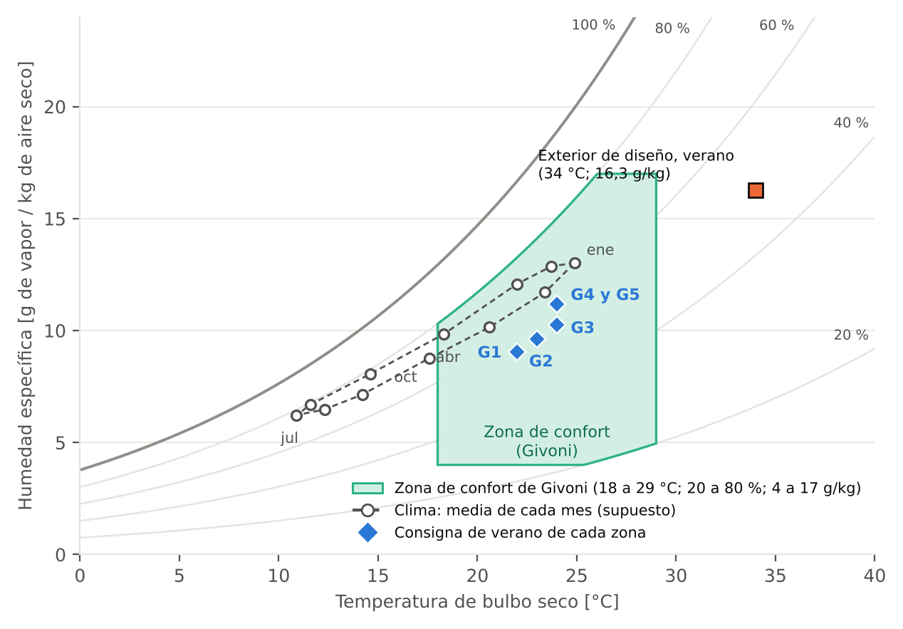
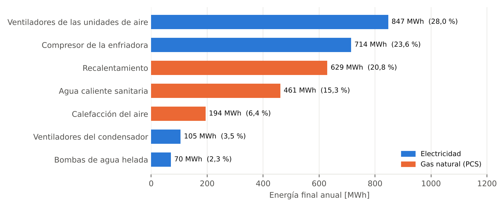

::: {custom-style="Nota"}
**Cómo leer este borrador.** Explica **qué decidimos, por qué y en qué nos apoyamos**; las ecuaciones y los estados completos están en la memoria de cálculo. Cada dato lleva su nivel de respaldo: **visto** (documento recibido y leído), **cita** (fuente secundaria vista en una búsqueda; falta cotejarla con la original), **propio** (cálculo o criterio nuestro, con su lógica) o **recordado** (de memoria, sin fuente a mano).
:::

# Resumen

Se diseña y evalúa el sistema térmico de un hospital de alta complejidad del AMBA con el tamaño y el programa del Hospital Favaloro (La Matanza: {{A_cub}} m², {{camas_tot}} camas, {{n_or}} quirófanos). Es un sistema de aire con enfriadora y caldera de gas, porque quirófanos y áreas críticas exigen aire filtrado, muchas renovaciones y humedad controlada. Para cada dato de partida se explica cómo se obtuvo y en qué se apoya.

El sistema consume **{{E_total_MWh}} MWh de energía final por año ({{i_cub}} kWh/m²)**. El hallazgo central es que el aire se enfría para quitarle humedad y se recalienta con gas, mientras la enfriadora tira al ambiente {{Q_cond_MWh}} MWh de calor por año. Aprovecharlo (alternativa B) baja la energía {{dE_B}} % y las emisiones {{dC_B}} %; el paquete de mejoras de sustentabilidad, {{dE_P}} % y {{dC_P}} %. <<RESUMEN_EXERGIA>> Los equipos se eligen con redundancia y se ubican pensando en lo civil (azotea, shafts, ruido, izaje). Lo que no tiene fuente citable está marcado y la sensibilidad muestra cuánto pesa.

# 1. Introducción y objetivos

Un hospital funciona todo el año y todo el día, y su climatización es de **proceso**, no de confort: exige temperatura y humedad controladas, presión positiva y aire exterior filtrado. En el AMBA eso tiene una consecuencia termodinámica concreta: el aire exterior de verano (unos {{T_ext_ver}} °C con {{W_ext_ver}} g de vapor por kg de aire seco) hay que enfriarlo por debajo de su punto de rocío para quitarle vapor, y a esa temperatura ya no se puede impulsar: hay que **recalentarlo**. Se gasta frío para deshumidificar y combustible para devolver temperatura.

**Objetivo:** definir, modelar y evaluar con la Primera y la Segunda Ley el sistema térmico de un hospital del AMBA y proponer alternativas y mejoras que reduzcan su consumo y su impacto ambiental. Específicamente: respaldar cada dato de partida, elegir y ubicar los equipos, calcular cargas, enfriadora, caldera y consumo anual, calcular dónde se destruye exergía, comparar alternativas y responder con números las cinco preguntas de la consigna.

# 2. El edificio y cómo obtuvimos cada dato

Elegimos un hospital porque es el caso donde refrigeración, combustión, aire húmedo y exergía se necesitan a la vez sobre un mismo sistema, y el **Hospital Dr. René Favaloro (SAMIC)** frente a Nordelta porque es el que trae el dato que dimensiona el modelo: la superficie cubierta. Ningún documento trae datos de climatización ni de consumo del edificio real: el modelo replica su **tamaño y programa**, no sus instalaciones.

{{tabla_datos_edificio}}

Table: Tabla 1. Datos del edificio, cómo los obtuvimos y en qué nos apoyamos.

**Contraste global.** El Favaloro tiene {{gross_per_bed}} m² cubiertos por cama, contra {{ref_bed_hospitecnia}} del artículo de Hospitecnia [H] y {{ref_bed_cruce}} del Hospital El Cruce (visto): es más compacto, una señal para vigilar y no un error de magnitud. **Qué pasa si nos equivocamos:** ±6 m² por cama de internación cambian la energía ±{{sens_a_gen}} %; por quirófano, ±{{sens_a_or}} %; por cama de terapia, ±{{sens_a_uti}} %; climatizar 95 % o 75 % en vez de 85 %, ±{{sens_f_acond}} %; y que la guardia y el diagnóstico ocupen 50 % o 20 % de las áreas generales en vez de 35 %, ±{{sens_g4}} %. Las áreas de cada zona pesan poco; lo que pesa es **cuánta superficie se climatiza y cuántas horas funciona**.

{{tabla_zonas}}

Table: Tabla 2. Zonas térmicas, consignas de verano y caudales. El caudal es el mayor entre el de las renovaciones mínimas y el de la carga sensible, por eso G3 y G5 resultan con más renovaciones que el mínimo (sección 3.2).

# 3. Decisiones de diseño y su respaldo

## 3.1 Temperatura y humedad interiores

**Zonas críticas (G1, G2).** ASHRAE 170 pide para quirófano de 20 a 24 °C y de 20 a 60 % de humedad relativa, con presión positiva y filtro MERV-16 (**cita**: extracto de un adendo visto en una búsqueda), y para habitaciones de pacientes de 21 a 24 °C y hasta 60 % (**cita**: tabla de muestra del capítulo de hospitales del Handbook); un cirujano o un procedimiento pueden pedir otros valores. No pudimos abrir la norma. Elegimos {{T_G1}} °C para el quirófano y {{T_G2}} °C para la terapia, con humedad de consigna de **55 %**: el máximo de 60 % menos 5 puntos de margen de control (**propio**). Pesa: con 5 puntos menos en todas las zonas la energía sube {{s_hr5}} %.

**Zonas de confort (G3, G4, G5).** Usamos 24 °C y 55 a 60 %. Para respaldarlo usamos la **carta bioclimática de Givoni**, una carta psicrométrica con la zona de confort dibujada (figura 1): 18 a 29 °C, 20 a 80 % de humedad y 4 a 17 g/kg (**cita**: valores de Givoni (1992) que da una herramienta de carta bioclimática, vistos en una búsqueda; falta cotejar con el artículo). Nuestras cinco consignas caen **dentro** de la zona.

{width=10.5cm}

La carta también explica el problema: el clima medio de octubre a abril cae dentro de la zona de confort o muy cerca, pero el **estado exterior de diseño de verano** (34 °C y 16 g/kg) queda fuera, y para llevarlo a las consignas hay que enfriarlo y quitarle vapor; en invierno queda a la izquierda y hay que calentarlo.

## 3.2 Renovaciones por hora: de dónde salen y qué significan

Los quirófanos llevan **20 renovaciones totales por hora, de las cuales 4 son de aire exterior** (ASHRAE 170; **cita**: extracto de un adendo y una guía que la resume; la docente lo confirmó). Cumplen funciones distintas: las 20 mueven el aire por filtros de alta eficiencia, diluyen contaminantes y mantienen la sobrepresión; las 4 de aire exterior aseguran el aire fresco mínimo (olores, gases anestésicos, CO₂) (**propio**: es nuestra explicación). La relación 20/4 = **5** significa que el aire exterior es el 20 % del que se mueve y el 80 % restante se recircula filtrado: solo hay que tratar con las condiciones exteriores un quinto del aire.

Un detalle: un adendo reciente de ASHRAE 170 reconoce que las 20 renovaciones no tienen una justificación científica definitiva, aunque tampoco pudo rechazarlas, y recomienda una evaluación de riesgo antes de cambiarlas (**cita**). Por eso las mantenemos como dato normativo y mostramos su peso: pasar a 15 o 25 cambia la energía {{s_ach15}} % y {{s_ach25}} %; con 6 de aire exterior en vez de 4, {{s_oa_g1_6}} %.

**Nuestra comprobación.** Con {{qs_G1}} W/m² de ganancia sensible (supuesto propio), el caudal que haría falta solo por carga es {{m3h_load_G1}} m³/h, o sea {{ach_load_G1}} renovaciones por hora; la norma pide 20, {{ratio_norm_load}} veces más. **En el quirófano manda la norma, no la carga térmica**, y por eso su consumo por m² es alto.

| Zona | Total / aire exterior | De dónde sale | Respaldo |
|---|---|---|---|
| G1 Quirófanos | 20 / 4 | ASHRAE 170 | Cita y la docente |
| G2 Terapia intensiva | 6 / 2 | ASHRAE 170 | Recordado |
| G3 Internación | 4 / 2 | ASHRAE 170, habitación de pacientes | Cita |
| G4 Guardia, imágenes, laboratorio | 8 / 2 | Promedio ponderado: 25 % sala de espera y triage (12), 5 % shock (15), 70 % imágenes y laboratorio (6) = 0,25·12 + 0,05·15 + 0,70·6 ≈ 8 | Propio con valores recordados |
| G5 Consultorios y administración | 3 / 1 | Supuesto nuestro, sin contrastar con la norma | Propio |

Table: Tabla 3. Renovaciones por hora y su respaldo. En internación (G3) y consultorios (G5) el caudal real sale de la carga sensible y da {{ach_G3_real}} renovaciones por hora.

## 3.3 Clima y agua caliente

**Clima.** Usamos medias mensuales de Buenos Aires partidas en mitad diurna y nocturna (amplitud de 9 K). Las contrastamos con el Observatorio Central del SMN, 1991 a 2020, a través de una página que reproduce la tabla (**cita**): enero {{T_ene_smn}} °C, julio {{T_jul_smn}} °C y diciembre {{T_dic_smn}} °C, contra {{T_ene}}, {{T_jul}} y {{T_dic}} °C nuestros. La humedad media anual de esa fuente es de unos {{HR_smn}} % contra {{HR_media}} % nuestros: usamos algo más de humedad y **sobreestimamos** un poco el consumo (cada 4 puntos son unos {{s_hr4}} %). El estado de diseño de verano (**{{T_ext_ver}} °C de bulbo seco y {{Tbh_ver}} °C de bulbo húmedo**) es un valor habitual que **recordamos** y no pudimos cotejar con ASHRAE.

**Agua caliente.** {{L_cama}} L por cama y día a 60 °C (red a {{T_red}} °C). El artículo de Hospitecnia [H] trae casos medidos de 50 a 55 L (**visto**) y ratios de diseño de 200 a 300 (**visto**), de 4 a 6 veces más: elegimos un valor intermedio y mostramos los extremos, 55 L {{s_acs55}} % y 200 L {{s_acs200}} %.

## 3.4 Por qué elegimos este sistema

{{tabla_decisiones}}

Table: Tabla 4. Decisiones de diseño del sistema, alternativas consideradas y motivos.

# 4. Equipos y ubicación

<<EQUIPOS>>

# 5. Cálculo y resultados

## 5.1 El método y un caso paso a paso

Cada zona es un sistema de aire de caudal constante. Para cada estado exterior se sigue el aire por la mezcla, la serpentina que enfría y quita vapor, el recalentador y el ventilador (que además lo calienta); de ahí salen la carga frigorífica (sensible y latente) y el calor de recalentamiento. La carga de las serpentinas es la que vence la enfriadora (ciclo de R134a: trabajo, COP, calor rechazado) y el calor de recalentamiento, calefacción y agua caliente se convierte en gas con el rendimiento de la caldera (balance de la reacción y de los gases). Cada mes se parte en una mitad diurna y otra nocturna y se repite el cálculo. **Las ecuaciones y los estados completos están en la memoria.**

**El quirófano en verano pico.** Con el exterior a {{T_ext_ver}} °C y {{Tbh_ver}} °C de bulbo húmedo, el aire exterior (A) se mezcla con el de retorno (B) y queda a {{T_mix_G1}} °C (C); la serpentina lo enfría hasta {{T_c_G1}} °C y le quita vapor (D); el recalentador lo sube a {{T_obj_G1}} °C (E) y el ventilador, que le agrega {{dT_vent_G1}} K, lo deja a {{T_sup_G1}} °C (F). La serpentina entrega {{Q_serp_G1}} kW ({{Q_sens_G1}} sensibles y {{Q_lat_G1}} latentes) y el recalentador, {{Q_recal_G1}} kW. En el punto de diseño todo el edificio recalienta solo {{Q_recal_ver}} kW: **el recalentamiento aparece a carga parcial, y dimensionar su recuperación con el pico subestimaría el potencial**.

{width=10cm}

## 5.2 Enfriadora y caldera

La capacidad frigorífica de diseño es **{{Q_L_dis}} kW** ({{Q_L_dis_wm2}} W/m²). El R134a evapora a {{T_ev}} °C y condensa a {{T_cond_dis}} °C porque el condensador es enfriado por aire a {{T_ext_ver}} °C. El COP eléctrico es **{{cop_elec}}**, el {{eta_carnot}} % del de Carnot ({{cop_carnot}}), y el compresor consume {{W_comp_dis}} kW. El catálogo de la enfriadora del ejemplo da un COP de {{cop_catalogo}} contando solo los compresores a 35 °C: del mismo orden. Con gas natural y {{exceso}} % de exceso de aire, el poder calorífico superior es de {{PCS_kcal}} kcal/m³ y el inferior de {{PCI_kWh}} kWh/m³; los gases salen a {{T_gases}} °C, por encima de su rocío ({{T_rocio}} °C), la pérdida es {{q_gases}} % del PCI y la caldera rinde **{{eta_PCI}} % sobre PCI**, igual al 90 % del artículo de Hospitecnia [H] (visto). Cada kWh de gas emite {{co2_gas_kg}} kg de CO₂, de la propia reacción.

{width=9cm}

## 5.3 Consumo anual

La energía final es **{{E_total_MWh}} MWh por año**: {{E_elec_MWh}} de electricidad y {{E_gas_MWh}} de gas (por su PCS, unos {{V_gas_mil}} m³), **{{i_cub}} kWh/m²**; suma kWh a kWh, sin ponderar por energía primaria. Las emisiones son {{co2_t}} t de CO₂ por año ({{co2_gas_t}} del gas y {{co2_elec_t}} de la electricidad). El factor de la electricidad ({{ef_elec}} t/MWh, meta de CAMMESA 2023) es el más incierto: otras fuentes dan 0,29 y 0,40, con lo que el paquete de mejoras reduce las emisiones {{dC_P_lo}} % y {{dC_P_hi}} %.

{width=11cm}

**Primero**, con los supuestos actuales los ventiladores consumen más que el compresor ({{pct_vent}} % contra {{pct_comp}} %), por ser un sistema todo aire con muchas renovaciones; el orden depende de la presión y el rendimiento supuestos (con 20 % menos de presión el compresor pasa adelante, pero el gas de recalentamiento sube porque el ventilador ya no calienta el aire, y el ahorro neto es de solo {{ahorro_dp80}} %). **Segundo**, el recalentamiento es casi la mitad del calor útil de la caldera ({{q_recal_MWh}} de {{q_total_MWh}} MWh): el calor del aire es mayor en verano que en invierno ({{calor_ene}} MWh en enero contra {{calor_jul}} en julio). **Tercero**, el COP estacional de la planta ({{COP_planta}}) coincide con el COP 4 que supone Hospitecnia [H]; es coincidencia de resultado, no un ajuste.

**Qué tan seguro es el número.** Variando un supuesto por vez, la intensidad queda entre {{sens_min}} y {{sens_max}} kWh/m² y año; **eso no es un intervalo de confianza**. Un revisor externo estimó la incertidumbre global en ±15 a 20 % (su estimación, no un cálculo de este modelo). Lo que más mueve el resultado:

{{tabla_sens_corta}}

Table: Tabla 6. Supuestos que más mueven la energía final (caso base: {{E_total_MWh}} MWh). Ganancias internas y envolvente (±30 %) mueven menos de 3 %.

# 6. Exergía: dónde se pierde la capacidad de hacer trabajo

<<EXERGIA>>

# 7. Alternativas y mejoras de sustentabilidad

**Alternativa A** (base): enfriadora, caldera de gas y recalentamiento. **Alternativa B:** el recalentamiento y la calefacción del aire se cubren con el **calor del condensador**, que hoy se tira, en lugar de quemar gas. Sale directo del hallazgo central: el calor existe ({{Q_cond_MWh}} MWh por año, unas {{Q_cond_sobre_recal}} veces el de recalentamiento) y alcanza con agua tibia a {{T_agua_rec}} °C. **Es honesta:** entregar agua a {{T_agua_rec}} °C exige condensar a {{T_cond_rec}} °C, más caliente que los {{T_cond_min}} a {{T_cond_anual_max}} °C de un condensador por aire, y eso **cuesta trabajo del compresor**. En cada estado del año se elige el mejor entre no recuperar, recuperar solo el sobrecalentamiento de la descarga o poner a condensar el recuperador. B recupera {{rec_MWh}} MWh de calor, ahorra {{ahorro_gas_B}} MWh de gas y gasta {{extra_comp_B}} MWh más de electricidad: **la energía baja {{dE_B}} % y las emisiones {{dC_B}} %**. Como el modelo usa estados medios, supone que calor y demanda coinciden dentro de cada estado; si coinciden 75 % o 50 % del tiempo, el ahorro baja a {{dE_B75}} % y {{dE_B50}} %: es el límite superior realista.

La docente pidió énfasis en mejoras que consuman menos y sean más verdes. Las evaluamos con el mismo modelo, una por vez:

{{tabla_mejoras}}

Table: Tabla 7. Mejoras respecto de A ({{E_total_MWh}} MWh y {{co2_t}} t de CO₂ por año).

{width=11cm}

**Cómo leer la tabla.** Las medidas **no se suman**: dependen unas de otras (con B, la caldera de condensación tiene menos calor para entregar). El paquete da {{dE_P}} % menos de energía y {{dC_P}} % menos de emisiones. Las que ahorran gas bajan la energía más que las emisiones, porque el gas emite {{co2_gas_pcs}} t/MWh y la red {{ef_elec}} (cita secundaria); las que ahorran electricidad (fotovoltaica, ventiladores) bajan más las emisiones. **Lo que no conviene priorizar:** aislar la envolvente un 30 % baja solo {{s_ua30}} % y reducir las ganancias internas un 30 % (por ejemplo LED), {{s_gi30}} %: el consumo está en el aire, no en la envolvente.

**Refrigerante.** El R134a tiene un PCA de 1.430 (**cita**) y la Enmienda de Kigali obliga a reducir los HFC: Argentina depositó su ratificación el 22/11/2019 (en vigor desde el 20/2/2020) y la Resolución 104/2020 puso los HFC bajo licencia de importación (**cita**). Con el modelo de ciclo, el R1234ze(E) (PCA menor que 1, **cita**) da el mismo COP ({{cop_ze}} contra {{cop_134}}) pero {{caida_qvol}} % menos capacidad volumétrica, o sea un compresor {{mas_compresor}} % más grande, y es ligeramente inflamable (A2L, **recordado**), lo que pesa en un hospital. El R513A (PCA 631, **cita**) no está en la biblioteca que usamos.

**Prioridad propuesta:** (1) **B**, la de mayor ahorro y la única que ataca la ineficiencia central; (2) **fotovoltaica**, por emisiones; (3) **solar térmico** para el ACS; (4) **recuperador del aire de extracción**; (5) **caldera de condensación** y (6) **ventiladores**. Sin costos no se puede ordenar por retorno; la consigna no pide presupuesto.

# 8. Conclusiones

1. **¿La alternativa seleccionada satisface los requerimientos?** Entrega las condiciones de consigna de las cinco zonas por construcción del modelo, con {{Q_L_dis}} kW de frío, {{Q_cal_inv_aire}} kW de calefacción del aire ({{Q_hum_inv}} kW más de humidificación) y {{acs_kW}} kW medios de ACS; una enfriadora real casi la cubre con redundancia. Lo que **no** satisface bien es la eficiencia: consume {{E_total_MWh}} MWh y tira {{Q_cond_MWh}} MWh de calor; B cumple lo mismo con {{dE_B}} % menos de energía.
2. **¿Cuáles son las principales variables que condicionan su desempeño?** La humedad de consigna (5 puntos menos, {{s_hr5}} %), los horarios (consultorios 24 h, {{s_g5_24h}} %), el ACS por cama (200 L, {{s_acs200}} %) y la temperatura media (±2 K, {{s_tp2}} % y {{s_tm2}} %). Los parámetros de los equipos mueven menos de 3 % cada uno; el COP depende sobre todo de la temperatura de condensación ({{cop_elec}} al diseño, {{COP_est_comp}} en el año).
3. **¿Qué procesos presentan mayores pérdidas de energía o destrucción de exergía?** <<CONCL3>>
4. **¿Qué modificaciones permitirían mejorar el aprovechamiento de los recursos?** Recuperar el calor del condensador (B: {{dE_B}} % de energía y {{dC_B}} % de CO₂), fotovoltaica ({{dE_M5}} %), solar térmico ({{dE_M2}} %), recuperador del aire de extracción ({{dE_M3}} %), caldera de condensación ({{dE_M1}} %) y ventiladores de menor presión ({{dE_M4}} %); el paquete, {{dE_P}} % menos de energía y {{dC_P}} % menos de emisiones. No conviene priorizar la envolvente ni la iluminación.
5. **¿Qué limitaciones presenta el análisis y qué información haría falta?** El resultado se mueve entre {{sens_min}} y {{sens_max}} kWh/m² con un supuesto por vez. Faltan datos citables de clima (SMN) y de la norma (ASHRAE 170), que no pudimos abrir; las instalaciones y consumos del hospital real; las curvas de carga parcial y los catálogos completos; los efectos omitidos (economizador, ventiladores de retorno y extracción, caldera a carga parcial, humidificación de invierno); y la coincidencia en el tiempo entre calor disponible y demanda de B. No hay análisis de costos.

# Anexo A. Referencias y su nivel de verificación

| Referencia | Qué se usó | Nivel |
|---|---|---|
| [F1] Presidencia de la Nación, presentación del Hospital SAMIC «Dr. René Favaloro»; [F2] Gobierno de la Provincia de Buenos Aires, gacetilla del 28/07/2020 | Superficie, quirófanos, niveles, camas, guardia 24 h | Visto |
| [H] Gallostra Isern, Sánchez-Vaqué y Túnica Buira, *Caracterización de consumos energéticos y suministros en hospitales*, Hospitecnia, 2022; [A] HCWH y K-CEP, *Energy efficiency and cooling audits in health care facilities in Argentina, China, and the Philippines*, 2021; El Cruce (Medina y Marini, 2010) | ACS, m²/cama, COP y rendimiento de referencia; consumos y hallazgos de tres hospitales argentinos | Visto |
| ASHRAE 170 (adendo de 2025) y Handbook, capítulo de hospitales; FGI Guidelines (quirófano de 400 ft²); Resolución 748/2014 (terapia, 9 m² por cama); Givoni (1992) según Lamberts, Dutra y Pereira | Renovaciones, temperaturas, humedades, superficies, zona de confort | Cita (extractos de búsquedas); no se pudieron abrir |
| SMN, normales 1991-2020 (vía una página que reproduce la tabla); Global Solar Atlas; CAMMESA (meta 2023), Climate Transparency vía Carbon Footprint y Ember | Clima, irradiación, factor de emisión de la electricidad (de 0,29 a 0,40 t/MWh) | Cita (búsquedas) |
| Carrier (enfriadora AquaForce 30XA), Viessmann (Vitocrossal 300 CM3C), Trane y *Consulting-Specifying Engineer* (recuperación de calor del condensador en hospitales), Kigali y Resolución 104/2020 | Equipos de ejemplo, antecedentes de la alternativa B, estado de los HFC | Cita (búsquedas) |
| CoolProp y psychrolib | Propiedades del refrigerante, los gases y el aire húmedo | Visto (código) |

Table: Tabla A1. Fuentes y nivel de verificación. **Las páginas de ASHRAE, SMN, NOAA y otras no se pudieron abrir desde el entorno de trabajo**; todo lo marcado «cita» hay que cotejarlo con la fuente original antes de la entrega.

# Anexo B. Verificación del cálculo

**{{n_tests}} chequeos** (`python -m pytest calculo/tests`): primera ley, segunda ley (COP menor que el de Carnot, destrucción de exergía no negativa, cierre del balance exergético), balance de átomos de la combustión, psicrometría contra CoolProp, reproducción de la tabla de supuestos y que las mejoras den el caso base cuando no se activan. Comprueban la coherencia interna, no que la física sea correcta. El núcleo del modelo se reimplementó de forma independiente (coincidencia dentro de 0,24 %); las mejoras, la exergía y los equipos se revisaron con revisores independientes pero **no** se reimplementaron. Sigue **sin verificar** lo propio y lo recordado.
