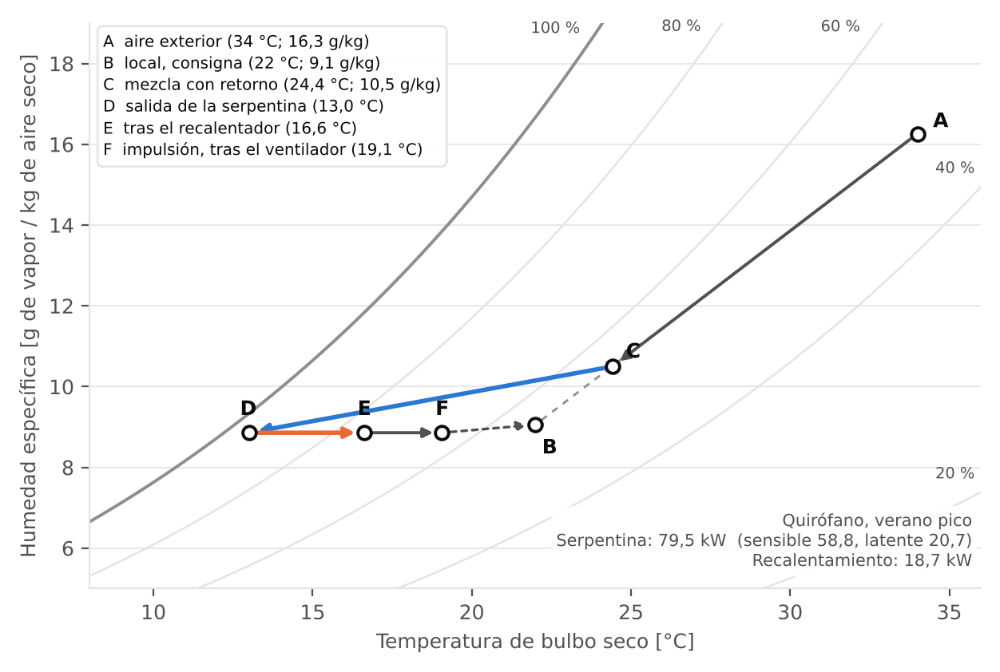
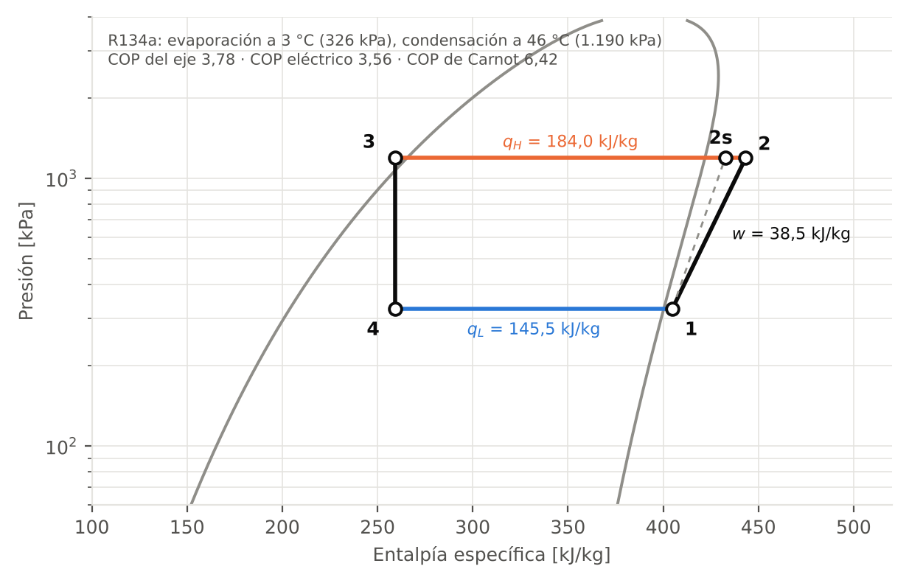
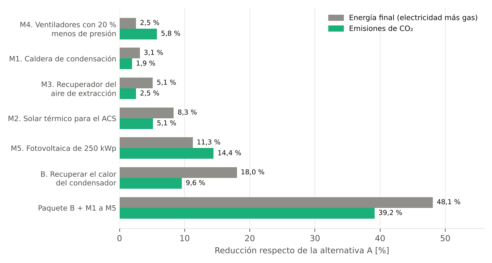

::: {custom-style="Nota"}
**Cómo leer este borrador.** Es la versión de trabajo: explica **qué decidimos, por qué y en qué nos apoyamos**. Las ecuaciones y los estados completos están en la memoria de cálculo. Cada dato lleva su nivel de respaldo: **visto** (documento recibido y leído), **cita** (fuente secundaria vista en una búsqueda; falta cotejar con la fuente original), **propio** (cálculo o criterio nuestro, con su lógica) o **recordado** (de memoria, sin fuente a mano). Todas las cifras de cálculo salen del código y el documento se regenera con él.
:::

# Resumen

Se diseña y evalúa el sistema térmico de un hospital general de agudos de alta complejidad del AMBA, con el tamaño y el programa del Hospital Dr. René Favaloro (La Matanza: {{A_cub}} m² cubiertos, {{camas_tot}} camas, {{n_or}} quirófanos). El sistema es de aire con enfriadora de agua helada y caldera de gas, porque los quirófanos y las áreas críticas exigen aire filtrado, renovaciones altas y humedad controlada. Para cada dato de partida se explica cómo se obtuvo y en qué se apoya: superficies y camas, condiciones interiores (ASHRAE 170 y la carta de Givoni), renovaciones por hora (20 totales y 4 de aire exterior en quirófanos), clima y agua caliente.

El sistema consume **{{E_total_MWh}} MWh de energía final por año ({{i_cub}} kWh/m²)**. El hallazgo que ordena el trabajo es que el aire se enfría para quitarle humedad y después se recalienta con gas, mientras la enfriadora tira al ambiente {{Q_cond_MWh}} MWh de calor por año. Aprovecharlo (alternativa B) reduce la energía {{dE_B}} % y las emisiones {{dC_B}} %. Con el paquete de mejoras de sustentabilidad (recuperar calor, caldera de condensación, solar térmico para el agua caliente, recuperador del aire de extracción, ventiladores más eficientes y paneles fotovoltaicos) la energía baja {{dE_P}} % y las emisiones de CO₂, {{dC_P}} %. El análisis exergético muestra dónde se destruye más capacidad de hacer trabajo. <<RESUMEN_EXERGIA>>

Los equipos se eligen con redundancia (2 enfriadoras en servicio y 1 de reserva) y se ubican pensando en lo civil: cargas en la azotea, shafts de aire, ruido, acceso e izaje. Lo que no tiene fuente citable (clima mensual, condiciones de ASHRAE 170 que no se pudieron cotejar con la norma, ganancias internas) está marcado, y la sensibilidad muestra cuánto pesa cada uno.

# 1. Introducción y objetivos

Un hospital funciona todo el año y todo el día, y buena parte de su climatización no es de confort sino de **proceso**: los quirófanos, la terapia intensiva y las habitaciones exigen temperatura y humedad controladas, presión positiva y aire exterior filtrado. En el clima templado y húmedo del AMBA eso tiene una consecuencia termodinámica concreta: el aire exterior de verano (unos {{T_ext_ver}} °C con {{W_ext_ver}} g de vapor por kg de aire seco) hay que enfriarlo por debajo de su punto de rocío para quitarle vapor, y a esa temperatura ya no se puede impulsar a la zona: hay que **recalentarlo**. Se gasta frío para deshumidificar y combustible para devolver temperatura.

**Objetivo general.** Definir, modelar y evaluar con la Primera y la Segunda Ley el sistema térmico de un hospital del AMBA, y proponer configuraciones y mejoras que reduzcan su consumo y su impacto ambiental. **Objetivos específicos:**

1. Explicar y respaldar cada dato de partida: superficies, camas, condiciones interiores, renovaciones, clima y agua caliente.
2. Elegir el sistema y los equipos, mostrar un ejemplo real que cumpla lo calculado y proponer dónde ubicarlos.
3. Calcular cargas (aire húmedo), enfriadora (refrigeración), caldera (combustión) y consumo anual.
4. Calcular dónde se destruye exergía y comparar la alternativa A con la B y con las mejoras de sustentabilidad.
5. Responder con números las cinco preguntas de la consigna.

# 2. El edificio y cómo obtuvimos cada dato

## 2.1 Por qué este hospital

Elegimos un hospital porque es el caso donde los cuatro contenidos de la materia (refrigeración, combustión, aire húmedo y exergía) se necesitan a la vez sobre un mismo sistema. Entre los candidatos del AMBA (Favaloro, en La Matanza, y Nordelta, en Tigre) elegimos el **Hospital Dr. René Favaloro (SAMIC)** porque es el que trae el dato que dimensiona el modelo: la superficie cubierta. Ningún documento recibido trae datos de climatización ni de consumo del edificio real, de modo que el modelo es una réplica de su **tamaño y programa**, no de sus instalaciones.

## 2.2 Superficies, camas y zonas: de dónde sale cada número

| Dato | Valor | Cómo lo obtuvimos | Respaldo |
|---|---|---|---|
| Superficie cubierta | {{A_cub}} m² | Es la cifra oficial de la presentación de Presidencia. El intendente habló de «más de 20.000 m² de construcción» sin aclarar si es cubierta; usamos la oficial | Visto [F1, F2] |
| Camas | {{camas_gen}} de internación general y {{camas_uti}} de terapia intensiva ({{camas_tot}}) | La gacetilla provincial las atribuye a la sala de cuidados progresivos; nosotros las tomamos como el total del hospital. La presentación de Presidencia prevé 160 de internación | Visto [F2, F1]; la interpretación es nuestra |
| Quirófanos | {{n_or}} | Cifra de programa de la presentación | Visto [F1] |
| Niveles | Tres, de {{A_nivel}} m² cada uno | La presentación lista tres pisos: guardia, consultorios y diagnóstico en el 1.º; internación, quirófanos y áreas críticas en el 2.º; administración y docencia en el 3.º. Podría haber un cuarto nivel; suponemos tres iguales | Visto [F1] y propio |
| Superficie climatizada | {{f_acond}} % de la cubierta ({{A_cond}} m²) | Se climatiza casi todo; se excluyen locales técnicos, morgue y depósitos | Propio |
| Quirófano | {{a_or}} m² cada uno | Un quirófano general necesita 400 ft² (37,2 m²) libres con 6,1 m de lado mínimo según las guías FGI; sumamos el equipamiento fijo hasta unos 6,5 × 6,5 m | Cita (FGI) y propio |
| Terapia intensiva | {{a_uti}} m² por cama | La Resolución 748/2014 exige al menos 9 m² por cama para el área del paciente; agregamos el apoyo (enfermería, depósito, lavado, circulación) con un factor de 2,7 | Cita (Res. 748/2014) y propio (el factor) |
| Internación general | {{a_gen}} m² por cama | Estimación nuestra: habitaciones con baño más office de enfermería, sala de procedimientos y circulaciones del sector. No encontramos una referencia; por eso mostramos que ±6 m² cambian la energía solo ±{{sens_a_gen}} % | Propio |
| Guardia, imágenes y laboratorio | {{f_g4_pct}} % de las áreas generales, funcionando 24 h | La guardia atiende las 24 h según la gacetilla; sumamos diagnóstico por imágenes y laboratorio. El resto (consultorios, administración, docencia) funciona 12 h de lunes a viernes | Visto [F2] (las 24 h) y propio (el 35 %) |
| Altura libre | {{h_techo}} m | Convención de diseño | Propio |

Table: Tabla 1. Datos del edificio, cómo los obtuvimos y en qué nos apoyamos.

**Contraste global.** El Favaloro tiene {{gross_per_bed}} m² cubiertos por cama, contra {{ref_bed_hospitecnia}} m²/cama que usa el artículo de Hospitecnia [H] para hospitales españoles y {{ref_bed_cruce}} m²/cama del Hospital El Cruce (Florencio Varela, visto). Es más compacto por cama; es una señal para vigilar y no un error de magnitud.

**Qué pasa si nos equivocamos.** Con el modelo probamos cuánto cambia la energía final si cada una de estas decisiones está mal: ±6 m² por cama de internación, ±{{sens_a_gen}} %; ±6 m² por quirófano, ±{{sens_a_or}} %; ±6 m² por cama de terapia, ±{{sens_a_uti}} %; superficie climatizada de 95 % o 75 % en vez de 85 %, ±{{sens_f_acond}} %; y que la guardia y el diagnóstico ocupen el 50 % o el 20 % de las áreas generales en vez del 35 %, ±{{sens_g4}} %. Las áreas de quirófano, terapia e internación pesan poco; lo que sí pesa es **cuánta superficie se climatiza y cuántas horas funciona cada zona**.

{{tabla_zonas}}

Table: Tabla 2. Zonas térmicas, consignas de verano y caudales. Las renovaciones mínimas se explican en la sección 3.2; el caudal de impulsión es el mayor entre el que fijan esas renovaciones y el que pide la carga sensible, por eso las renovaciones resultantes de G3 y G5 son mayores.

# 3. Decisiones de diseño y su respaldo

## 3.1 Temperatura y humedad interiores

**Zonas críticas (G1, G2).** Quirófanos y terapia intensiva se proyectan con la norma de ventilación hospitalaria ASHRAE 170: para quirófano, de 20 a 24 °C (68 a 75 °F) y de 20 a 60 % de humedad relativa, con presión positiva y filtro MERV-16 (**cita**: extracto de un adendo de ASHRAE 170 visto en una búsqueda); para habitaciones de pacientes, de 21 a 24 °C y hasta 60 % (**cita**: tabla de muestra del capítulo de hospitales del ASHRAE Handbook). No pudimos abrir la norma completa. Esa misma tabla aclara que un cirujano o un procedimiento pueden pedir otras temperaturas, ventilación o humedad. Elegimos {{T_G1}} °C para el quirófano y {{T_G2}} °C para la terapia con una humedad de consigna de **55 %**, que es el máximo de 60 % menos 5 puntos de margen de control (**propio**). Es una decisión que pesa: si la humedad de consigna de todas las zonas fuera 5 puntos menor, la energía subiría {{s_hr5}} %.

**Zonas de confort (G3, G4, G5).** Para internación general, guardia y consultorios usamos 24 °C y 55 a 60 % de humedad relativa en verano. Para respaldar que son condiciones de confort razonables usamos la **carta bioclimática de Givoni**, que es una carta psicrométrica con una zona de confort dibujada (figura 1). Con los valores de Givoni para países cálidos y en desarrollo (18 a 29 °C, 20 a 80 % de humedad relativa y de 4 a 17 g/kg; **cita**: valores de Givoni (1992) que da una herramienta de carta bioclimática, vista en una búsqueda; falta cotejar con el artículo original), nuestras cinco consignas caen **dentro** de la zona de confort.

{width=14cm}

La carta también explica el problema del sistema. El clima medio de octubre a abril cae dentro de la zona de confort o muy cerca; en cambio el **estado exterior de diseño de verano** (34 °C y 16 g/kg) queda fuera, a la derecha y arriba, y para llevarlo a las consignas hay que enfriarlo y quitarle vapor. En invierno el aire exterior queda a la izquierda y hay que calentarlo. Por eso el sistema necesita frío en verano, calor en invierno y calor de recalentamiento después de deshumidificar.

## 3.2 Renovaciones por hora: de dónde salen y qué significan

Las renovaciones por hora son el dato que más condiciona el tamaño del sistema. Los quirófanos llevan **20 renovaciones totales por hora, de las cuales 4 son de aire exterior** (ASHRAE 170, tabla de requisitos por tipo de local; **cita**: extracto de un adendo de la norma y una guía que la resume, vistos en búsquedas; la docente lo confirmó). Esos dos números tienen funciones distintas:

- Las **20 renovaciones totales** mueven el aire por los filtros de alta eficiencia y diluyen contaminantes; mantienen la limpieza del local y la sobrepresión respecto de los pasillos.
- Las **4 renovaciones de aire exterior** aseguran el aire fresco mínimo (dilución de olores y gases anestésicos, CO₂ de las personas).
- La relación 20/4 = **5** significa que el aire exterior es el 20 % del que se mueve y el 80 % restante se recircula después de filtrarlo. Es lo que vuelve viable el diseño: solo hay que tratar con las condiciones exteriores un quinto del aire. Con 6 renovaciones de aire exterior en vez de 4, la energía subiría {{s_oa_g1_6}} %.

**Un detalle que conviene decir.** Un adendo reciente de ASHRAE 170 reconoce que el valor de 20 renovaciones para quirófanos no tiene una justificación científica definitiva, aunque tampoco pudo rechazarse, y recomienda una evaluación de riesgo antes de cambiar la ventilación de un quirófano (**cita**: extracto del adendo, visto en una búsqueda). Por eso lo mantenemos como dato normativo y mostramos cuánto pesa.

**Nuestra comprobación.** Con la carga térmica del quirófano ({{qs_G1}} W/m² de ganancia sensible, supuesto propio) el caudal que haría falta solo por carga son {{m3h_load_G1}} m³/h, equivalentes a {{ach_load_G1}} renovaciones por hora; la norma pide 20, o sea {{ratio_norm_load}} veces más. **En el quirófano manda la norma, no la carga térmica**: por eso el consumo de ventiladores y de recalentamiento por m² del quirófano es alto. Pasar de 20 a 15 o a 25 renovaciones cambia la energía {{s_ach15}} % y {{s_ach25}} %.

Para las demás zonas, la fuente es distinta y lo declaramos:

| Zona | Renovaciones totales / de aire exterior | De dónde sale | Respaldo |
|---|---|---|---|
| G1 Quirófanos | 20 / 4 | ASHRAE 170 | Cita (extracto de un adendo) y confirmado por la docente |
| G2 Terapia intensiva | 6 / 2 | ASHRAE 170, valor recordado | Recordado |
| G3 Internación | 4 / 2 | ASHRAE 170, habitación de pacientes | Cita (Handbook, tabla de muestra) |
| G4 Guardia, imágenes, laboratorio | 8 / 2 | Promedio ponderado: 25 % sala de espera y triage (12), 5 % shock (15), 70 % imágenes y laboratorio (6), valores recordados de ASHRAE 170: 0,25·12 + 0,05·15 + 0,70·6 ≈ 8 | Propio con valores recordados |
| G5 Consultorios y administración | 3 / 1 | Supuesto nuestro; no lo contrastamos con la norma | Propio |

Table: Tabla 3. Renovaciones por hora de cada zona y su respaldo. Un dato que **no** es de la norma: en internación (G3) y consultorios (G5) el caudal real sale de la **carga sensible** y da {{ach_G3_real}} renovaciones por hora, más que el mínimo.

## 3.3 Clima

Usamos temperaturas y humedades medias mensuales de Buenos Aires, partidas en una mitad diurna y una nocturna (amplitud de 9 K). Las contrastamos con el Observatorio Central del SMN, período 1991 a 2020, a través de una página que reproduce la tabla (**cita**): enero {{T_ene_smn}} °C, julio {{T_jul_smn}} °C y diciembre {{T_dic_smn}} °C, contra {{T_ene}}, {{T_jul}} y {{T_dic}} °C que usamos. La humedad relativa media anual de esa fuente es de unos {{HR_smn}} % (entre 62 y 82 % según el mes), contra {{HR_media}} % en nuestros valores: usamos algo más de humedad, lo que **sobreestima** un poco el consumo (cada 4 puntos de humedad son unos {{s_hr4}} %). El estado de diseño de verano (**{{T_ext_ver}} °C de bulbo seco y {{Tbh_ver}} °C de bulbo húmedo**) es un valor de diseño habitual para el AMBA que **recordamos** y no pudimos cotejar con la tabla de ASHRAE. Pendiente: reemplazar todo por la serie del SMN o por las tablas de ASHRAE.

## 3.4 Agua caliente sanitaria

Usamos {{L_cama}} litros por cama y día a 60 °C (agua de red a {{T_red}} °C). El artículo de Hospitecnia [H] trae casos medidos de 50 a 55 L por cama y día (**visto**) y ratios de diseño de 200 a 300 (**visto**), y los dos grupos difieren de 4 a 6 veces. Elegimos un valor intermedio y mostramos el efecto de cada extremo: 55 L baja la energía {{s_acs55}} % y 200 L la sube {{s_acs200}} %.

## 3.5 Por qué elegimos este sistema

| Decisión | Alternativas | Elegimos | Por qué | Respaldo |
|---|---|---|---|---|
| Tipo de sistema de aire | Todo aire con recalentamiento; splits o VRF por local; fancoils con aire exterior aparte | Todo aire de caudal constante con serpentina y recalentador | Las zonas críticas necesitan filtrado, muchas renovaciones y control de humedad y de presiones, que un split no da. La auditoría de HCWH encontró en hospitales argentinos splits instalados «porque el aire central no alcanzaba» | Propio; [A] (visto) |
| Producción de frío | Enfriadora condensada por aire o por agua con torre | Por aire | Sin torre no hay consumo de agua, tratamiento ni riesgo de legionela; a cambio tiene un COP algo menor | Propio |
| Redundancia | Sin reserva o N+1 | N+1: 2 enfriadoras en servicio y 1 de reserva; 2 calderas al 100 % | Un hospital no puede parar la climatización de quirófanos y terapia | Propio |
| Combustible | Gas natural, electricidad o gasoil | Gas natural | Hay red de gas en el AMBA y es el combustible dominante en los hospitales del artículo | Propio; [H] (visto) |
| Línea de base del recalentamiento | Caldera o recuperación de calor | Caldera como base (A) y recuperación como alternativa B | Es la configuración convencional; permite medir cuánto se gana al recuperar | Propio |

Table: Tabla 4. Decisiones de diseño del sistema, alternativas consideradas y motivos.

# 4. Equipos y ubicación

<<EQUIPOS>>

# 5. Cálculo y resultados

## 5.1 Cómo se calcula, en una página

1. **Zonas y caudales.** Cada zona es un sistema de aire de caudal constante; el caudal es el mayor entre el de las renovaciones y el de la carga sensible.
2. **Aire húmedo (carta psicrométrica).** Para cada estado exterior se sigue el aire por la mezcla, la serpentina que enfría y quita vapor, el recalentador y el ventilador (que además lo calienta). De ahí salen la carga frigorífica (sensible y latente) y el calor de recalentamiento y de calefacción.
3. **Refrigeración.** La carga de las serpentinas es la que debe vencer la enfriadora; se calcula su ciclo de R134a para obtener el trabajo, el COP y el calor rechazado.
4. **Combustión.** El calor de recalentamiento, calefacción y agua caliente se convierte en gas con el rendimiento de la caldera, que sale del balance de la reacción y de los gases de escape.
5. **Año.** Cada mes se parte en una mitad diurna y otra nocturna y en cada una se repite el cálculo; se prefirió a las horas equivalentes a plena carga porque la ventilación es continua.

| Para qué | Ecuación principal | Dónde se aplica |
|---|---|---|
| Estado del aire | $h = 1{,}006\,T + \omega\,(2501 + 1{,}86\,T)$ | Mezcla, serpentina, recalentador |
| Carga de la serpentina | $\dot Q = \dot m_a\,[(h_{mez} - h_c) - (\omega_{mez} - \omega_c)\,h_f]$ | Frío y deshumidificación |
| COP de la enfriadora | $COP = q_L\,/\,(w/\eta_{mot})$ | Compresor |
| Rendimiento de la caldera | $\eta = 1 - q_{gases} - f_{rad}$ | Gas del calor útil |
| Destrucción de exergía | $\dot X_{dest} = T_0\,\dot S_{gen}$ | Cada equipo |

Table: Tabla 5. Ecuaciones principales. El desarrollo completo está en la memoria de cálculo.

## 5.2 Un caso paso a paso: el quirófano en verano pico

El quirófano (zona G1, {{m_sup_G1}} kg/s de aire seco, equivalente a {{m3h_G1}} m³/h, con {{oa_G1}} % de aire exterior) se calcula con el exterior a {{T_ext_ver}} °C de bulbo seco y {{Tbh_ver}} °C de bulbo húmedo y actividad plena. El aire exterior (A) se mezcla con el de retorno (B) y queda a {{T_mix_G1}} °C (C); la serpentina lo enfría hasta {{T_c_G1}} °C y le quita vapor (D); el recalentador lo sube a {{T_obj_G1}} °C (E) y el ventilador, que le agrega {{dT_vent_G1}} K, lo deja a {{T_sup_G1}} °C (F). La serpentina entrega {{Q_serp_G1}} kW, de los cuales {{Q_sens_G1}} kW son sensibles y {{Q_lat_G1}} kW latentes; el recalentador aporta {{Q_recal_G1}} kW.

{width=13.5cm}

En el punto de diseño el recalentamiento de todo el edificio es de solo {{Q_recal_ver}} kW, porque con carga máxima el aire sale de la serpentina cerca de la temperatura que se necesita. El recalentamiento aparece a carga parcial, y **dimensionar su recuperación con el pico subestimaría el potencial**.

## 5.3 La enfriadora

Con la suma de las serpentinas, la capacidad frigorífica de diseño es **{{Q_L_dis}} kW** ({{Q_L_dis_wm2}} W/m² cubierto). El R134a evapora a {{T_ev}} °C ({{p_ev}} kPa) y condensa a {{T_cond_dis}} °C ({{p_c}} kPa), porque el condensador es enfriado por aire a {{T_ext_ver}} °C. El efecto frigorífico es {{q_L_ref}} kJ/kg, el trabajo de compresión {{w_ref}} kJ/kg y el calor rechazado {{q_H_ref}} kJ/kg: el COP eléctrico es **{{cop_elec}}**, el {{eta_carnot}} % del de Carnot ({{cop_carnot}}), que es el límite de la Segunda Ley. El compresor consume {{W_comp_dis}} kW al diseño. Como contraste, el catálogo de la enfriadora del ejemplo (sección 4) da un COP de {{cop_catalogo}} contando solo los compresores a 35 °C de aire exterior: del mismo orden.

{width=12cm}

## 5.4 La caldera

Con gas natural y {{exceso}} % de exceso de aire, la reacción da un poder calorífico superior de {{PCS_kcal}} kcal/m³ ({{PCS_kWh}} kWh/m³) y un inferior de {{PCI_kWh}} kWh/m³. Los gases salen a {{T_gases}} °C, por encima de su punto de rocío ({{T_rocio}} °C), así que no condensan; la pérdida por gases es {{q_gases}} % del PCI y la caldera rinde **{{eta_PCI}} % sobre PCI** ({{eta_PCS}} % sobre PCS), igual al 90 % que usa el artículo de Hospitecnia [H] (visto). La llama adiabática teórica sería de {{T_llama}} °C. Cada kWh de gas emite {{co2_gas_kg}} kg de CO₂, de la propia reacción.

## 5.5 Consumo anual

La energía final anual es **{{E_total_MWh}} MWh**: {{E_elec_MWh}} MWh de electricidad y {{E_gas_MWh}} MWh de gas natural medido por su PCS, unos {{V_gas_mil}} m³. Sobre la superficie cubierta son **{{i_cub}} kWh/m² y año**. La energía final suma electricidad y gas kWh a kWh, sin ponderar por energía primaria. Las emisiones del sistema son {{co2_t}} toneladas de CO₂ por año ({{co2_gas_t}} del gas y {{co2_elec_t}} de la electricidad). El factor de emisión de la electricidad usado ({{ef_elec}} t/MWh, meta de CAMMESA para 2023) es el más incierto: otras fuentes dan 0,29 (Climate Transparency, datos de 2021) y 0,40 (Ember, 2022); con 0,29 el paquete de mejoras reduce las emisiones {{dC_P_lo}} % y con 0,40, {{dC_P_hi}} %.

{{tabla_usos}}

Table: Tabla 6. Consumo anual por uso final. Los totales pueden diferir en 1 MWh de la suma de las filas por redondeo.

{width=13.5cm}

Tres cosas que muestra el resultado. **Primero**, con los supuestos actuales los ventiladores consumen más que el compresor ({{pct_vent}} % contra {{pct_comp}} %), por el tipo de sistema (todo aire) y por las renovaciones; el orden depende de la presión y el rendimiento supuestos de los ventiladores (con 20 % menos de presión el compresor pasa adelante, pero el gas de recalentamiento sube porque el ventilador ya no calienta el aire, y el ahorro neto es de solo {{ahorro_dp80}} %). **Segundo**, el recalentamiento es casi la mitad del calor útil de la caldera ({{q_recal_MWh}} de {{q_total_MWh}} MWh): el calor del aire es mayor en verano que en invierno ({{calor_ene}} MWh en enero y {{calor_dic}} en diciembre, contra {{calor_jul}} en julio). **Tercero**, el COP estacional de la planta ({{COP_planta}}) coincide casi exactamente con el COP 4 que supone el artículo de Hospitecnia [H]; es una coincidencia de resultado, no un ajuste.

**Qué tan seguro es el número.** Variando un supuesto por vez, la intensidad queda entre {{sens_min}} y {{sens_max}} kWh/m² y año; **eso no es un intervalo de confianza**. Lo que más mueve el resultado:

{{tabla_sens_corta}}

Table: Tabla 7. Los supuestos que más mueven la energía final (caso base: {{E_total_MWh}} MWh). La tabla completa y la figura están en la memoria de cálculo.

Un revisor externo estimó la incertidumbre global en ±15 a 20 %; es una estimación del revisor, no un cálculo de este modelo. Las ganancias internas y la conductancia de la envolvente, en cambio, mueven menos de 3 % con ±30 %.

# 6. Exergía: dónde se pierde la capacidad de hacer trabajo

<<EXERGIA>>

# 7. Alternativas y mejoras de sustentabilidad

## 7.1 Alternativa A y alternativa B

**A (línea de base):** enfriadora, caldera de gas y aire de caudal constante con recalentamiento. **B:** igual que A, pero el recalentamiento y la calefacción del aire se cubren con el **calor del condensador** de la enfriadora, que hoy se tira al ambiente, en lugar de quemar gas. Es la alternativa que sale directamente del hallazgo del trabajo: el calor existe ({{Q_cond_MWh}} MWh por año rechazados, unas {{Q_cond_sobre_recal}} veces el de recalentamiento) y alcanza con agua tibia a {{T_agua_rec}} °C.

**Cómo se modela y por qué es honesto.** Para entregar agua a {{T_agua_rec}} °C el condensador tiene que condensar a {{T_cond_rec}} °C, más caliente que los {{T_cond_min}} a {{T_cond_anual_max}} °C de un condensador por aire durante el año; eso **cuesta trabajo del compresor** (COP más bajo). En cada estado del año se elige el mejor entre no recuperar, recuperar solo el sobrecalentamiento de la descarga (sin cambiar la condensación) o poner a condensar el recuperador. Con eso, B recupera {{rec_MWh}} MWh de calor por año en {{rec_horas}} horas, ahorra {{ahorro_gas_B}} MWh de gas y gasta {{extra_comp_B}} MWh más de electricidad en el compresor: **la energía final baja {{dE_B}} % y las emisiones, {{dC_B}} %**. Como el modelo trabaja con estados medios, supone que el calor disponible y la demanda coinciden dentro de cada estado; si coinciden solo el 75 % o el 50 % del tiempo, el ahorro baja a {{dE_B75}} % y {{dE_B50}} %. Es el límite superior realista, no una promesa.

## 7.2 Mejoras

La docente pidió énfasis en mejoras que ayuden a consumir menos y a ser más verdes. Evaluamos las siguientes con el mismo modelo; cada una explica por qué ahorra desde la Termodinámica y cuánto da.

{{tabla_mejoras}}

Table: Tabla 8. Mejoras evaluadas, una por vez, respecto de la alternativa A (energía final de {{E_total_MWh}} MWh y {{co2_t}} t de CO₂ por año).

{width=13.5cm}

**Cómo leer la tabla.** Las medidas **no se suman**: dependen unas de otras (por ejemplo, con B la caldera de condensación tiene menos calor para entregar). El paquete completo (B más M1 a M5) da {{dE_P}} % menos de energía final y {{dC_P}} % menos de emisiones. Las medidas que ahorran gas bajan la energía más que las emisiones, porque el gas emite {{co2_gas_pcs}} t/MWh y la electricidad de la red {{ef_elec}} t/MWh (cita secundaria); las que ahorran electricidad, como la fotovoltaica y los ventiladores, bajan más las emisiones que la energía.

**Lo que no conviene priorizar.** Mejorar la aislación de la envolvente un 30 % baja solo {{s_ua30}} % y reducir las ganancias internas un 30 % (por ejemplo, iluminación LED) baja {{s_gi30}} %: en un hospital con tanto aire exterior y recirculado, el consumo está en el aire y no en la envolvente. Es un resultado que viene del modelo y que cambia el orden de prioridades de una obra.

**Refrigerante.** El R134a tiene un potencial de calentamiento global (PCA) de 1.430 (**cita**) y la Enmienda de Kigali obliga a reducir los HFC; Argentina depositó su ratificación el 22 de noviembre de 2019 y la enmienda entró en vigor el 20 de febrero de 2020, y la Resolución 104/2020 puso los HFC bajo licencia de importación (**cita**, búsqueda web). Con el modelo de ciclo probamos el R1234ze(E) (PCA menor que 1, **cita**) en las mismas temperaturas: el COP eléctrico es {{cop_ze}} contra {{cop_134}} del R134a, es decir, **igual**, pero la capacidad volumétrica baja {{caida_qvol}} % y hace falta un compresor un {{mas_compresor}} % más grande. Tiene una contra que en un hospital pesa: es ligeramente inflamable (clase A2L, **recordado**). El R513A (PCA de 631, **cita**) no está en la biblioteca de propiedades que usamos y no se pudo calcular.

**Prioridad propuesta.** (1) **B**, la de mayor ahorro y la única que ataca la ineficiencia central; (2) **fotovoltaica**, por impacto en emisiones; (3) **solar térmico** para el ACS, sencillo y robusto; (4) **recuperador del aire de extracción**; (5) **caldera de condensación** y (6) **ventiladores**, de menor ahorro individual. Sin datos de costos no se puede ordenar por retorno de inversión; la consigna no pide presupuesto.

# 8. Conclusiones

1. **¿La alternativa seleccionada satisface los requerimientos?** El sistema entrega las condiciones de consigna de las cinco zonas por construcción del modelo, con una capacidad frigorífica de {{Q_L_dis}} kW, {{Q_cal_inv_aire}} kW de calefacción del aire en invierno ({{Q_hum_inv}} kW más de humidificación) y {{acs_kW}} kW medios de ACS; un ejemplo real de enfriadora cubre esa capacidad con redundancia. Lo que **no** satisface bien es la eficiencia: consume {{E_total_MWh}} MWh por año y tira {{Q_cond_MWh}} MWh de calor. La alternativa B cumple los mismos requerimientos con {{dE_B}} % menos de energía.
2. **¿Cuáles son las principales variables que condicionan su desempeño?** Las renovaciones y la humedad de consigna (el aire exterior hay que enfriarlo y deshumidificarlo): humedad 5 puntos menor, {{s_hr5}} %; los horarios (consultorios 24 h, {{s_g5_24h}} %); el ACS por cama (200 L, {{s_acs200}} %); la temperatura media del clima (±2 K, {{s_tp2}} % y {{s_tm2}} %). Los parámetros de los equipos mueven menos de 3 % cada uno; el COP depende sobre todo de la temperatura de condensación ({{cop_elec}} al diseño y {{COP_est_comp}} en el año).
3. **¿Qué procesos presentan mayores pérdidas de energía o destrucción de exergía?** <<CONCL3>>
4. **¿Qué modificaciones permitirían mejorar el aprovechamiento de los recursos?** Recuperar el calor del condensador (B: {{dE_B}} % de energía y {{dC_B}} % de CO₂), fotovoltaica ({{dE_M5}} %), solar térmico para el ACS ({{dE_M2}} %), recuperador del aire de extracción ({{dE_M3}} %), caldera de condensación ({{dE_M1}} %) y ventiladores de menor presión ({{dE_M4}} %); el paquete completo da {{dE_P}} % menos de energía y {{dC_P}} % menos de emisiones. No conviene priorizar la envolvente ni la iluminación.
5. **¿Qué limitaciones presenta el análisis y qué información adicional haría falta?** El resultado se mueve entre {{sens_min}} y {{sens_max}} kWh/m² y año con un supuesto por vez, y un revisor externo estimó la incertidumbre global en ±15 a 20 %. Faltan: datos citables de clima (SMN) y de las condiciones y renovaciones de la norma (ASHRAE 170 o la norma argentina), que no pudimos abrir; las instalaciones y consumos del hospital real, que no están publicados; las curvas de carga parcial y los catálogos completos de los equipos; los efectos omitidos (economizador, ventiladores de retorno y de extracción, caldera a carga parcial, humidificación de invierno); y la coincidencia en el tiempo entre calor disponible y demanda de B, que el modelo supone dentro de cada estado. No hay análisis de costos.

# Anexo A. Referencias y su nivel de verificación

| Referencia | Qué se usó | Nivel |
|---|---|---|
| [F1] Presidencia de la Nación, presentación del Hospital SAMIC «Dr. René Favaloro» | Superficie, quirófanos, niveles | Visto |
| [F2] Gobierno de la Provincia de Buenos Aires, gacetilla del 28/07/2020 | Camas, guardia 24 h | Visto |
| [H] Gallostra Isern, Sánchez-Vaqué y Túnica Buira, *Caracterización de consumos energéticos y suministros en hospitales*, Hospitecnia, 2022 | ACS, m²/cama, COP y rendimiento de caldera de referencia | Visto |
| [A] Health Care Without Harm y K-CEP, *Energy efficiency and cooling audits in health care facilities in Argentina, China, and the Philippines*, 2021 | Consumos de tres hospitales argentinos, hallazgos técnicos | Visto |
| El Cruce, Medina y Marini, Revista Argentina de Salud Pública, 2010 | Superficie por cama | Visto |
| ASHRAE 170 (ventilación de hospitales), un adendo de 2025 y el ASHRAE Handbook, capítulo de hospitales | Renovaciones, temperaturas y humedades; nota sobre las 20 renovaciones | Cita (extractos vistos en búsquedas); no se pudo abrir la norma |
| FGI Guidelines (diseño de hospitales) | Quirófano general de 400 ft² (37,2 m²) libres | Cita (búsqueda web) |
| Resolución 748/2014 del Ministerio de Salud de la Nación (terapia intensiva) | Superficie mínima de 9 m² por cama | Cita (búsqueda web) |
| Givoni (1992), zona de confort, según Lamberts, Dutra y Pereira | Zona de confort de la figura 1 | Cita (búsqueda web) |
| SMN, normales 1991-2020, Observatorio Central, vía página que reproduce la tabla | Temperatura y humedad medias | Cita (búsqueda web) |
| Carrier, catálogo de la enfriadora AquaForce 30XA | Capacidad y potencia de la enfriadora del ejemplo | Cita (búsqueda web) |
| Viessmann, caldera de condensación Vitocrossal 300 CM3C | Capacidad y rendimiento del ejemplo de caldera | Cita (búsqueda web) |
| Trane, caso Baylor Scott & White; Consulting-Specifying Engineer, caso de reducción de recalentamiento | Hospitales con recuperación de calor del condensador | Cita (búsqueda web) |
| Global Solar Atlas | Irradiación anual | Cita (búsqueda web) |
| CAMMESA (meta 2023), Climate Transparency vía Carbon Footprint, Ember | Factor de emisión de la electricidad: de 0,29 a 0,40 t/MWh según la fuente | Cita (búsquedas web); la de CAMMESA es una meta |
| Kigali y Resolución 104/2020 | Estado de los HFC en Argentina | Cita (búsqueda web) |
| CoolProp y psychrolib | Propiedades del refrigerante, los gases y el aire húmedo | Visto (código) |

Table: Tabla A1. Fuentes y nivel de verificación. **Las páginas de ASHRAE, del SMN, de NOAA y otras no se pudieron abrir desde el entorno de trabajo**; todo lo marcado como «cita» hay que cotejarlo con la fuente original antes de la entrega.

# Anexo B. Verificación del cálculo

- **{{n_tests}} chequeos termodinámicos** (`python -m pytest calculo/tests`): primera ley, segunda ley (COP menor que el de Carnot, destrucción de exergía no negativa), balance de átomos de la combustión, coincidencia de la psicrometría con CoolProp, reproducción de la tabla de supuestos y que las mejoras den el caso base cuando no se activan. Comprueban la coherencia interna; no prueban que la física sea la correcta.
- **Reimplementación independiente** del núcleo del modelo por agentes que solo vieron la especificación (coincidieron con el código dentro de 0,24 % en las magnitudes globales). Las mejoras, la exergía y la selección de equipos se revisaron con revisores independientes pero **no** se reimplementaron.
- Lo que sigue **sin verificar** son los supuestos de entrada marcados como propios o recordados, no el cálculo.
