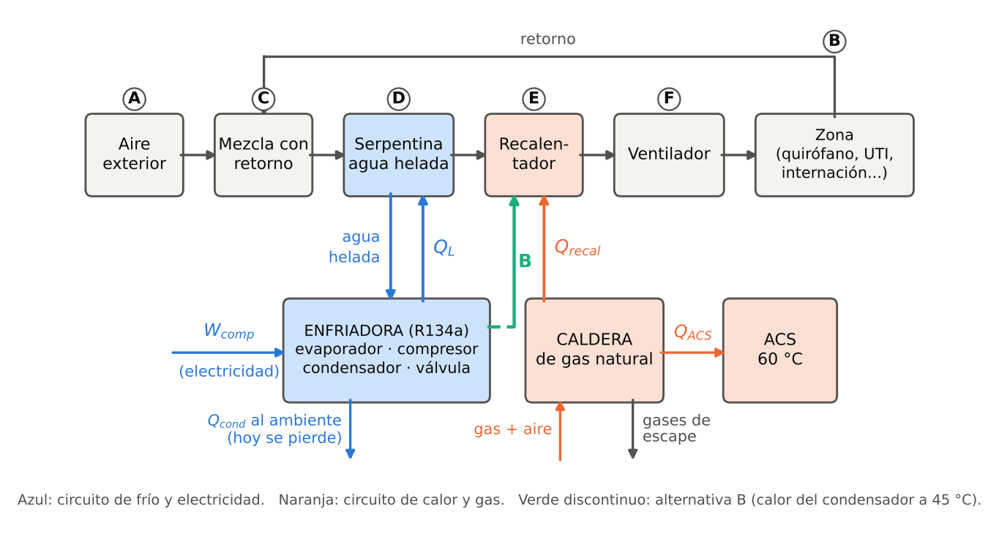
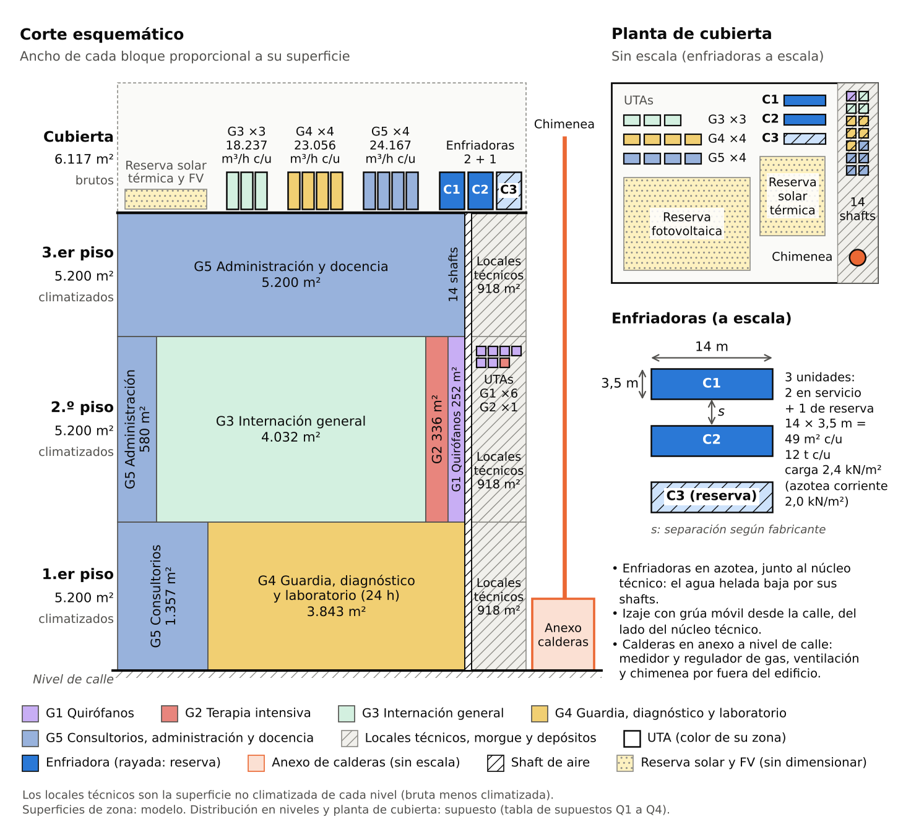
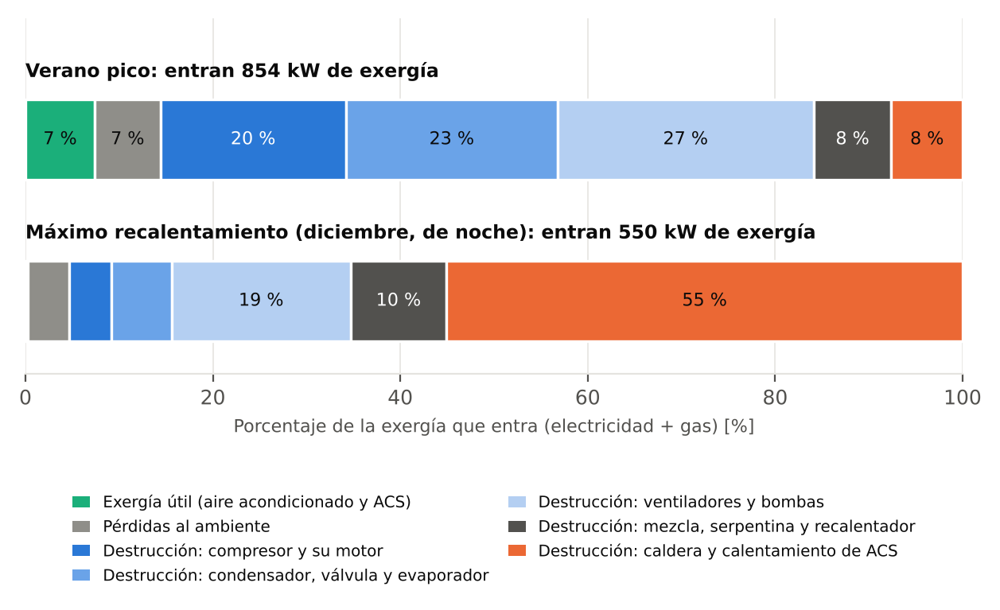

# Resumen

Se diseña y evalúa el sistema térmico de un hospital de alta complejidad del AMBA, con el tamaño y el programa del Hospital Favaloro (18.352 m², 158 camas, 6 quirófanos): un sistema de aire con enfriadora y caldera de gas. Consume **3.021 MWh de energía final por año (165 kWh/m²)**. El hallazgo central es que el aire se enfría para quitarle humedad y se recalienta con gas, mientras el condensador de la enfriadora tira 4.198 MWh de calor por año. Aprovechar ese calor (alternativa B) baja la energía 18,0 % y las emisiones 9,6 %; sumando las demás mejoras, 49,6 % y 41,2 %. El análisis exergético muestra que se destruye casi toda la exergía que entra: sobre todo en la enfriadora y su entorno en el verano pico (42,4 % de lo que entra) y en la caldera en el máximo recalentamiento (eficiencia exergética de 12,9 %), donde se quema gas con una llama adiabática teórica de 1.848 °C para subir el aire unos kelvin.

# 1. Introducción y objetivos

Un hospital funciona todo el año y todo el día, y su climatización es de **proceso**, no de confort: exige temperatura y humedad controladas, presión positiva y aire exterior filtrado. En el AMBA eso tiene una consecuencia termodinámica concreta: el aire exterior de verano (unos 34 °C con 16,3 g de vapor por kg de aire seco) hay que enfriarlo por debajo de su punto de rocío para quitarle vapor, y a esa temperatura ya no se puede impulsar: hay que **recalentarlo**. Se gasta frío para deshumidificar y combustible para devolver temperatura.

**Objetivo:** modelar y evaluar con la Primera y la Segunda Ley el sistema térmico de un hospital del AMBA, elegir y ubicar sus equipos, comparar alternativas y proponer mejoras que reduzcan su consumo y su impacto ambiental. Los cuatro temas de la cátedra se usan como una cadena, no por separado:

| Tema | Qué resuelve en este sistema | Qué recibe y qué entrega |
|-------------|---------------------------------------------|------------------------------------------|
| Aire húmedo | Cuánto frío y cuánto calor necesita el aire de cada zona: se enfría para quitarle vapor y se recalienta para impulsarlo | Recibe el clima y las consignas; entrega la carga de la serpentina (frío) y del recalentador (calor) |
| Refrigeración | La enfriadora (ciclo de compresión de R134a) que vence la carga de las serpentinas | Recibe esa carga; entrega el trabajo del compresor, el COP y el calor que rechaza el condensador (4.198 MWh por año) |
| Combustión | La caldera de gas que entrega el calor de recalentamiento, calefacción y agua caliente | Recibe ese calor útil; entrega el consumo de gas, los gases de escape y el CO₂ |
| Exergía | Dónde se destruye capacidad de producir trabajo y por qué conviene aprovechar el calor del condensador | Recibe los resultados de los tres temas; entrega la destrucción por equipo y la eficiencia exergética |

Table: Tabla 1. Los cuatro temas y cómo se conectan en este sistema.

El **hilo conductor**: el aire húmedo fija cuánto frío y cuánto recalentamiento hacen falta; la enfriadora paga ese frío con electricidad y tira calor; la caldera paga el recalentamiento con gas; la exergía muestra que el calor que se tira es justo el que haría falta para recalentar, y de ahí sale la alternativa B. En el texto, [n] remite a la lista de referencias, el asterisco indica una fuente que solo conocemos por un extracto (hay que cotejarla con el original) y «supuesto» marca una decisión nuestra, con su motivo.

# 2. El edificio y sus datos

Elegimos el **Hospital Dr. René Favaloro (SAMIC, La Matanza)** porque es el hospital del AMBA que trae el dato que dimensiona el modelo, la superficie cubierta [1]. Ningún documento trae datos de climatización ni de consumo del edificio real: replicamos su **tamaño y programa**, no sus instalaciones. Cada dato y su origen:

| Dato | Valor | Cómo lo obtuvimos |
|--------------------|-----------------|---------------------------------------------------------------|
| Superficie cubierta | 18.352 m² | Cifra oficial de Presidencia [1] y la gacetilla [2]; el intendente habló de «más de 20.000 m²» sin aclarar si es cubierta |
| Camas | 144 + 14 = 158 | La gacetilla [2] las atribuye a cuidados progresivos y las tomamos como el total (Presidencia [1] prevé 160 de internación) |
| Quirófanos | 6 | Cifra de programa [1] |
| Niveles | 3 de 6.117 m² | Presidencia [1] lista tres pisos (guardia y consultorios; internación y áreas críticas; administración); suponemos tres iguales (supuesto) |
| Superficie climatizada | 85 % (15.599 m²) | Supuesto: se excluyen locales técnicos, morgue y depósitos |

Table: Tabla 2. Datos del edificio y cómo los obtuvimos.

El Favaloro tiene 116 m² cubiertos por cama, contra 148 del artículo de Hospitecnia [3] (hospitales españoles) y 157 de El Cruce [5]: es algo más compacto, una señal para vigilar y no un error de magnitud. Dividimos el edificio en cinco zonas térmicas según su uso:

| Zona | Superficie [m²] y cómo se obtiene | Consigna de verano | Renovaciones totales / de aire exterior [1/h] | De dónde salen | Horario |
|-------------|-------------------------------|----------|-------------|----------------------|-----------|
| G1 Quirófanos | 252 = 6 × 42: la FGI [7]\* exige al menos 37,2 m² libres; sumamos equipamiento fijo (supuesto) | 22 °C; 55 % | 20 / 4 | ASHRAE 170 [6]\* | Continuo |
| G2 Terapia intensiva | 336 = 14 camas × 24 m²: 9 m² por cama [8]\* × 2,7 por apoyo y circulación (supuesto) | 23 °C; 55 % | 6 / 2 | ASHRAE 170 [6]\*, a contrastar | Continuo |
| G3 Internación | 4.032 = 144 camas × 28 m² (supuesto: habitación con baño, office y circulaciones) | 24 °C; 55 % | 4 / 2 (resulta 4,5) | ASHRAE 170, habitación de pacientes [6]\* | Continuo |
| G4 Guardia, imágenes, laboratorio | 3.843 = 35 % de las áreas generales (supuesto; la gacetilla [2] da guardia 24 h) | 24 °C; 60 % | 8 / 2 | Promedio ponderado (supuesto): 0,25·12 espera y triage + 0,05·15 shock + 0,70·6 imágenes y laboratorio ≈ 8 | 24 h |
| G5 Consultorios y administración | 7.136: el resto de la superficie climatizada | 24 °C; 60 % | 3 / 1 (resulta 4,5) | Supuesto, sin contrastar con la norma | 12 h, lunes a viernes |

Table: Tabla 3. Zonas térmicas: superficie, consigna de verano, renovaciones por hora y su origen. En G3 y G5 el caudal real sale de la carga sensible y es mayor que el mínimo.

Las áreas de cada zona pesan poco (±6 m² por cama de internación cambian la energía ±1,6 %); lo que pesa es cuánta superficie se climatiza y cuántas horas funciona (memoria de cálculo).

# 3. Descripción del sistema y condiciones de diseño

## 3.1 El sistema y por qué lo elegimos

{width=11.5cm}

Cada zona tiene una unidad de tratamiento de aire de caudal constante: el aire exterior (A) se mezcla con el de retorno (C), la serpentina de agua helada lo enfría y le quita vapor (D), el recalentador lo lleva a la temperatura de impulsión (E) y el ventilador lo impulsa a la zona (F). El agua helada la produce una **enfriadora de R134a** con condensador por aire ($\dot Q_L$ de frío, $\dot W_{comp}$ eléctrico, $\dot Q_{cond}$ rechazado al ambiente). Una **caldera de gas natural** da el recalentamiento, la calefacción de invierno y el ACS. La alternativa B manda el calor del condensador, a 45 °C, al recalentador en lugar de la caldera.

- **Todo aire de caudal constante**, porque quirófanos y terapia necesitan filtrado, muchas renovaciones y control de humedad y de presiones, que un split no da; la auditoría de HCWH [4] encontró en hospitales argentinos splits instalados «porque el aire central no alcanzaba».
- **Enfriadora condensada por aire**: sin torre no hay consumo de agua, tratamiento ni riesgo de legionela; el COP es algo menor.
- **Con reserva**: 3+1 enfriadoras y 2 calderas al 100 %, porque un hospital no puede parar la climatización de quirófanos y terapia.
- **Gas natural**: hay red en el AMBA y es el combustible dominante en [3]; la caldera es la base (A) y la recuperación de calor, la alternativa (B).

Lo que el sistema tiene que dar, con los cálculos de las secciones siguientes:

| Uso | Condición que debe cumplir | Potencia de diseño | Energía anual |
|----------------|------------------------------------|------------------------------|------------------|
| Frío (serpentinas) | Llevar el aire exterior (34 °C, 16,3 g/kg) a las consignas de verano de la tabla de zonas | 1.987 kW (1.230 sensibles y 758 latentes, 38 % latente; 108 W/m²) | 3.526 MWh |
| Recalentamiento | Subir el aire que sale frío de la serpentina hasta la temperatura de impulsión | 19 kW en el diseño; hasta 272 kW en diciembre, de noche | 511 MWh |
| Calefacción del aire | Consignas de invierno de 22 a 23 °C con exterior a 2 °C y 80 % de humedad | 557 kW, más 92 kW de vapor para humidificar | 158 MWh (la humidificación anual no se modela) |
| Agua caliente sanitaria | Calentar el agua de red de 17 a 60 °C, 100 L por cama y día | 43 kW medios (86 de punta) | 375 MWh |

Table: Tabla 4. Necesidades térmicas del edificio: potencia de diseño y energía anual.

## 3.2 Temperatura y humedad: la carta de Givoni

**Quirófano y terapia (G1, G2).** ASHRAE 170 [6]\* pide de 20 a 24 °C y hasta 60 % de humedad relativa en quirófano. Elegimos 22 °C para el quirófano y 23 °C para la terapia, con humedad de consigna de **55 %**: el máximo de 60 % menos 5 puntos de margen de control (supuesto). **Resto de las zonas (G3, G4, G5).** 24 °C y 55 a 60 %. Para respaldarlo usamos la **carta bioclimática de Givoni** [9]\*, una carta psicrométrica (eje horizontal: temperatura de bulbo seco; vertical: humedad específica) con la zona donde la mayoría de la gente está cómoda sin equipos: de 18 a 29 °C, de 20 a 80 % de humedad y de 4 a 17 g/kg. Nuestras cinco consignas caen dentro de la zona (figura 2); elegimos 24 °C y no 22 °C por estar en su parte media-alta (menos frío que producir).

{width=9cm}

La carta también muestra el problema: el clima medio de octubre a abril cae dentro de la zona o muy cerca, pero el **estado exterior de diseño de verano** (34 °C y 16,3 g/kg) queda fuera. Para llevarlo a las consignas hay que enfriarlo, quitarle vapor y recalentarlo; en invierno queda a la izquierda y hay que calentarlo.

## 3.3 Renovaciones por hora: de dónde sale el 20/4

Los quirófanos llevan **20 renovaciones totales por hora, de las cuales 4 son de aire exterior** (ASHRAE 170 [6]\*). Cumplen funciones distintas: las 20 mueven el aire por filtros de alta eficiencia, diluyen contaminantes y mantienen la sobrepresión; las 4 de aire exterior aportan el aire fresco mínimo (olores, gases anestésicos, CO₂); esa explicación es nuestra. La relación 20/4 = **5** significa que el aire exterior es el 20 % del que se mueve y el 80 % se recircula filtrado: solo hay que tratar con las condiciones exteriores un quinto del aire.

**Comprobación.** Con 60 W/m² de ganancia sensible (supuesto), por carga térmica bastarían 6,5 renovaciones por hora; la norma pide 20, 3,1 veces más. **En el quirófano manda la norma, no la carga térmica**, y por eso su consumo por m² es alto. Un adendo de ASHRAE 170 admite que el 20 no tiene una justificación científica definitiva y recomienda evaluar el riesgo antes de cambiarlo [6]\*; lo mantenemos y mostramos su peso: con 15 o 25 renovaciones la energía cambia −2,3 % y +2,4 %. Para las demás zonas, la tabla 3 indica el origen de cada valor.

## 3.4 Clima y agua caliente

**Clima.** Medias mensuales de Buenos Aires partidas en mitad diurna y nocturna (amplitud de 9 K), contrastadas con el SMN 1991-2020 [10]\*: enero 24,9 °C y julio 11,0 °C contra 24,9 y 10,9 °C nuestros; la humedad media de esa fuente es 68 % contra 72 % nuestros (usamos algo más de humedad, lo que sobreestima un poco el consumo). El estado de diseño de verano, 34 °C de bulbo seco y 25 °C de bulbo húmedo, es un valor habitual de diseño (supuesto).

**Agua caliente.** 100 L por cama y día de 17 a 60 °C, más 30 % por pérdidas de acumulación y recirculación (supuesto): 43 kW medios. Hospitecnia [3] da una guía de 55 L, un caso de 540 camas que sale en unos 51 L y ratios de diseño de 200 a 300 L; elegimos un valor intermedio (con 55 L la energía cambia −6,9 % y con 200 L, +15,3 %).

# 4. Metodología e hipótesis

Para cada zona y cada mes (partido en una mitad diurna y una nocturna) se siguen cuatro pasos encadenados, que son los cuatro temas:

1. **Aire húmedo:** balances de masa (vapor) y de energía en la mezcla, la serpentina, el recalentador y el ventilador; dan las cargas sensible y latente.
2. **Refrigeración:** ciclo de compresión de R134a que vence la carga de las serpentinas; da el trabajo, el COP y el calor rechazado.
3. **Combustión:** balance de la reacción del gas natural con exceso de aire; da el rendimiento de la caldera y el consumo de gas.
4. **Exergía:** balance $F = P + L + D$ de cada equipo; da dónde se destruye capacidad de hacer trabajo.

**Hipótesis principales.** Régimen permanente en cada estado; aire y vapor como gases ideales a 101,325 kPa; sistema de caudal constante con serpentina y recalentamiento, sin economizador; el ventilador disipa toda su potencia como calor en el aire; ciclo de compresión de vapor con compresor adiabático de rendimiento isentrópico 0,72, expansión isoentálpica y evaporación fija a 3 °C; combustión completa con 15 % de exceso de aire, sin disociación, y gases de escape a 190 °C.

**Frontera.** Se calcula el sistema térmico y sus auxiliares (ventiladores de las unidades y del condensador, bombas de agua helada). No se incluyen iluminación, equipos médicos, cocina, lavandería ni esterilización: **los 3.021 MWh no son el consumo total del hospital** y no se pueden comparar sin más con el consumo de hospitales completos. Las ecuaciones, los estados y los datos completos están en la memoria de cálculo.

# 5. Cálculos y resultados

## 5.1 Aire húmedo: el quirófano en verano pico

Con el exterior a 34 °C y 25 °C de bulbo húmedo, el aire exterior (A) se mezcla con el de retorno (B) y queda a 24,4 °C (C); la serpentina lo enfría hasta 13,0 °C y le quita vapor (D); el recalentador lo sube a 16,6 °C (E) y el ventilador, que le agrega 2,4 K, lo deja a 19,1 °C (F). «Quirófano» son aquí los 6 quirófanos juntos (zona G1, 15.120 m³/h, 5,04 kg/s de aire seco). La carga de la serpentina es el balance de energía del aire más la entalpía del agua que condensa ($h_f = 4{,}186\,T_D$):

$$\dot Q_{serp}=\dot m_a\left[(h_C-h_D)-(\omega_C-\omega_D)\,h_f\right]=5\text{,}04\left[(51\text{,}31-35\text{,}45)-(0\text{,}01050-0\text{,}00886)\cdot 54\text{,}4\right]=79\text{,}5\ \mathrm{kW}$$

$$\dot Q_{lat}=\dot m_a\,(\omega_C-\omega_D)\,h_{fg}=5\text{,}04\cdot 0\text{,}00164\cdot 2\,501=20\text{,}7\ \mathrm{kW}\qquad \dot Q_{sens}=58\text{,}8\ \mathrm{kW}\qquad \dot Q_{recal}=18\text{,}7\ \mathrm{kW}$$

{width=8cm}

| Estado | Descripción | T [°C] | ω [g/kg] | h [kJ/kg] | HR [%] |
|--------|------------------------------------|------------|------------|--------------|----------|
| A | Aire exterior | 34,0 | 16,26 | 75,9 | 48 |
| B | Local (consigna) | 22,0 | 9,06 | 45,2 | 55 |
| C | Mezcla con retorno | 24,4 | 10,50 | 51,3 | 55 |
| D | Salida de la serpentina | 13,0 | 8,86 | 35,4 | 95 |
| E | Tras el recalentador | 16,6 | 8,86 | 39,2 | 75 |
| F | Impulsión (tras el ventilador) | 19,1 | 8,86 | 41,7 | 64 |

Table: Tabla 5. Estados del aire del quirófano en verano pico (A a F).

Con todo el edificio, la serpentina entrega 1.987 kW en el verano pico, de los cuales el 38 % es latente (tabla 4). En el mismo punto todo el edificio recalienta solo 19 kW: **el recalentamiento aparece a carga parcial**, y dimensionar su recuperación con el pico subestimaría el potencial.

## 5.2 Refrigeración: ciclo de R134a

La enfriadora vence esos 1.987 kW. El R134a evapora a 3 °C (agua helada 12/7 °C) y condensa a 46 °C, porque el condensador es enfriado por aire a 34 °C; usamos un rendimiento isentrópico de 0,72 y un rendimiento del motor de 0,94 (supuestos de un compresor de tornillo habitual). Los estados 1 a 4 de la tabla 6 se ven en la figura 4.

| Estado | Descripción | T [°C] | P [kPa] | h [kJ/kg] |
|--------|--------------------------------------------------|------------|------------|--------------|
| 1 | Salida del evaporador (vapor sobrecalentado 5 K) | 8,0 | 326 | 404,9 |
| 2s | Salida del compresor, isentrópica | – | 1.190 | 432,6 |
| 2 | Salida del compresor, real (rendimiento isentrópico 0,72) | 64,9 | 1.190 | 443,3 |
| 3 | Salida del condensador (subenfriado 4 K) | 42,0 | 1.190 | 259,4 |
| 4 | Salida de la válvula de expansión (título 0,28) | 3,0 | 326 | 259,4 |

Table: Tabla 6. Estados del ciclo de R134a al punto de diseño de verano.

$$q_L=h_1-h_4=145\text{,}50\ \mathrm{kJ/kg}\qquad w=h_2-h_1=38\text{,}45\ \mathrm{kJ/kg}\qquad COP=\frac{q_L}{w/\eta_{mot}}=3\text{,}557\qquad \dot W=\frac{\dot Q_L}{COP}=559\ \mathrm{kW}$$

$$\dot Q_{cond}=\dot Q_L+\eta_{mot}\,\dot W=1\,987+0\text{,}94\cdot 559=2\,512\ \mathrm{kW}$$

El COP es el 55 % del de Carnot (6,42) y el catálogo de la enfriadora del ejemplo da 3,43 contando solo los compresores a 35 °C: del mismo orden.

{width=8cm}

## 5.3 Combustión: la caldera de gas

El gas de red tiene una composición que suponemos (fracciones molares: metano 0,91, etano 0,05, propano 0,01, CO₂ 0,01 y N₂ 0,02). Para el metano, la reacción con 15 % de exceso de aire ($\lambda = 1\text{,}15$) es

$$\mathrm{CH_4}+2{,}30\,(\mathrm{O_2}+3{,}76\,\mathrm{N_2})\;\to\;\mathrm{CO_2}+2\,\mathrm{H_2O}+0{,}30\,\mathrm{O_2}+8{,}65\,\mathrm{N_2}$$

y la memoria balancea la mezcla completa. El gas tiene un poder calorífico superior de 10,695 kWh/m³ (9.196 kcal/m³) y uno inferior de 9,656 kWh/m³. Los gases salen a 190 °C, por encima de su rocío (56,1 °C), con una pérdida de 8,0 % del PCI; sumando 2,0 % de pérdidas de la caldera (supuesto):

$$\eta_{PCI}=1-q_{gases}-f_{rad}=1-0{,}080-0{,}020=90,0\ \%\ \Rightarrow\ \eta_{PCS}=81,2\ \%\qquad E_{gas}=\frac{Q_{util}}{\eta_{PCS}}=\frac{ 1\,044 }{ 0\text{,}8124 }=1\,285\ \mathrm{MWh/a\tilde{n}o}$$

Son unos 120.000 m³ de gas por año. Cada kWh de PCS emite 0,183 kg de CO₂, de la propia reacción. Hospitecnia [3] usa un rendimiento de 90 % sin aclarar la base, así que la coincidencia es de resultado y no una comparación directa.

## 5.4 Consumo anual

La energía final es **3.021 MWh por año**: 1.736 de electricidad y 1.285 de gas (PCS), 165 kWh/m² (se suman kWh sin ponderar por energía primaria). Las emisiones son 895 t de CO₂ por año (235 del gas y 660 de la electricidad, con 0,38 t/MWh [12]\*; otras fuentes dan 0,29 y 0,40).

{width=9cm}

# 6. Equipos y ubicación

## 6.1 Qué elegimos

Es un ejemplo para mostrar que los equipos existen y cumplen lo calculado, no un proyecto ejecutivo.

- **Enfriadoras:** 4 unidades iguales de tornillo con condensador por aire (3 en servicio y 1 de reserva). Ejemplo: Carrier AquaForce 30XA 1002 [13]\*, R-134a, 988 kW nominales y 288,2 kW de compresores a 35 °C. Cada unidad en servicio debe dar al menos 662,4 kW (un tercio de 1.987,2 kW). Con una unidad parada quedan **2.964 kW contra 1.987,2 kW de carga (+49 %)**. Con 2+1 la misma unidad no alcanza (faltan 11,2 kW, 0,6 %), por eso 3+1: queda sobredimensionada, y el margen cubre el calor de las bombas y la diferencia entre los 34 °C de diseño y los 35 °C del catálogo.
- **Calderas:** 2 de agua caliente de 734 kW cada una, al 100 % cada una (carga de 649 kW de invierno más 86 kW de punta de ACS). Los 92 kW de humidificación con vapor necesitan un generador de vapor aparte. Ejemplo de condensación: 4 Viessmann Vitocrossal 300 CM3C de 311 kW [14]\*.
- **Unidades de tratamiento de aire:** 18 en total; las 7 críticas (una por quirófano y una para terapia intensiva, con filtro de alta eficiencia) van junto a su zona y las 11 restantes, en cubierta.

No pudimos abrir los catálogos: las capacidades son citas que hay que cotejar con el fabricante.

## 6.2 Dónde ponerlos

Como ingenieros civiles, la ubicación depende del aire, el ruido, la estructura, el izaje, las cañerías y el mantenimiento. Armamos un esquema con tres niveles iguales de 6.117 m² brutos (5.200 climatizados y 918 de locales técnicos, morgue y depósitos) con las zonas según la presentación del hospital [1] (figura 6).

- **Enfriadoras en la azotea**, junto al núcleo técnico: necesitan aire libre (en un patio recirculan el aire caliente) y el ruido queda por encima del 3.er piso, separado de la internación por una losa. Las 4 unidades ocupan 196 m², el 3,2 % de la cubierta de 6.117 m². Las tomas de aire exterior deben quedar lejos de las descargas de extracción y de la chimenea; la distancia mínima la fija la norma y no la fijamos acá.
- **Carga estructural:** con un peso supuesto de 12 t por unidad, la carga media sobre su huella es de 2,40 kN/m², 1,20 veces una sobrecarga de referencia de azotea de 2,0 kN/m² (supuesta, sin consultar el CIRSOC 101). Hace falta plataforma o vigas y la verificación del calculista.
- **Aire y agua:** las UTAs críticas van en el cuarto técnico del 2.º piso, con conductos cortos; los 264.774 m³/h de impulsión necesitan 21,5 m² netos de shafts verticales (14 shafts de unos 2 m²) en un núcleo técnico apilado en los tres niveles. Las calderas van en un anexo a nivel de calle, con acceso, medidor y regulador de gas y chimenea (DN 300). **Izaje:** unidades de 14 m y 12 t a unos 15 m de altura exigen grúa móvil grande y corte de calle; es el costo de la azotea.

{width=11.5cm}

Evaluamos también el patio a nivel y el puntaje es parejo (matriz en la memoria); elegimos la azotea por el aire libre. Las reservas para solar térmico (300 m²) y fotovoltaica (unos 1.250 m²) caben, pero **no dimensionamos las UTAs ni la sala de calderas**. La planta tipo a escala, con los m² de cada zona, está en la memoria.

# 7. Exergía: dónde se pierde la capacidad de hacer trabajo

Para cada equipo se plantea la exergía que entra (F), la exergía útil que entrega (P), la pérdida al ambiente (L) y la exergía destruida (D): $F = P + L + D$, con eficiencia $\psi = P/F$. Tomamos como **estado muerto el aire exterior** de cada caso y analizamos dos: el **verano pico** (exterior a 34,0 °C, el que dimensiona la enfriadora) y el **máximo recalentamiento** (dic, de noche, exterior a 18,9 °C, con 272 kW de recalentamiento). La exergía química del gas es 1,037 veces su PCI: usamos valores de uso corriente que hay que cotejar con el libro de la cátedra (supuesto).

{width=12.5cm}

- **Casi toda la exergía se destruye:** 85,6 % en el verano pico y 95,4 % en el recalentamiento. Es lo esperable: el sistema trabaja con calor y frío a temperaturas cercanas a la ambiente, que valen poco en exergía.
- **En el verano pico manda la enfriadora y su entorno:** el compresor con su motor (19,8 %) y el condensador, la válvula y el evaporador (22,6 %) destruyen el 42,4 % de lo que entra, y los ventiladores y bombas, otro 27,3 %. La eficiencia exergética de la enfriadora es de **30,8 %** (contando el compresor) aunque su COP de 3,56 sea alto: el frío de agua a 9,5 °C con exterior a 34,0 °C vale solo el 8,7 % de su energía en exergía.
- **En el recalentamiento manda la caldera,** con una eficiencia exergética de **12,9 %**: el 30,2 % del combustible se destruye en la combustión (llama adiabática teórica de 1.848 °C, calculada sin disociación) y el 52,5 % al pasar el calor al agua a 80/60 °C, **todo para subir el aire unos kelvin**. El calor de 32 a 46 °C que rechaza el condensador vale poco en exergía, igual que el que pide el recalentamiento: por eso la alternativa B es buena también desde la Segunda Ley.

La eficiencia exergética global del verano pico es de 7,4 %; en el recalentamiento no se puede definir (el aire sale casi con la exergía con que entra). Con otro estado muerto la destrucción total varía menos de 4,4 % (memoria).

# 8. Alternativas, mejoras y discusión

## 8.1 Alternativas A y B

**A** es la base: enfriadora, caldera de gas y recalentamiento. **B** cubre el recalentamiento y la calefacción del aire con el **calor del condensador**, que hoy se tira. Nace del hallazgo central: ese calor existe (4.198 MWh por año, 8,2 veces el de recalentamiento) y alcanza con agua tibia a 45 °C. **Tiene un costo:** entregar agua a 45 °C exige condensar a 50 °C, más caliente que los 32 a 41 °C de un condensador por aire, y eso aumenta el trabajo del compresor; por eso en cada estado del año se elige el mejor entre no recuperar, recuperar solo el sobrecalentamiento de la descarga o condensar en el recuperador. B recupera 499 MWh de calor, ahorra 615 MWh de gas y gasta 70 MWh más de electricidad. Hay antecedentes: un hospital de Texas calienta con agua a 46 °C de enfriadoras de recuperación de calor en lugar de agua de caldera a 82 °C, y el fabricante informa 80 % menos de gas [15]\*.

| Indicador | A (base) | B (recupera el calor del condensador) |
|----------------------|------------------------------|------------------------------------------------|
| Energía final por año | 3.021 MWh (165 kWh/m²) | 2.477 MWh (135 kWh/m²): −18,0 % |
| Electricidad y gas (PCS) | 1.736 y 1.285 MWh | 1.807 y 670 MWh |
| Gas natural | unos 120 mil m³ | unos 63 mil m³ (−48 %) |
| CO₂ por año | 895 t | 809 t: −9,6 % |
| COP anual del compresor | 4,94 | 4,43 |
| Calor que se tira al ambiente | 4.198 MWh | 3.775 MWh |
| Ventajas | Simple y probada; es la referencia | Usa un calor que hoy se tira y evita quemar gas; no agrega combustible ni equipos de combustión |
| Limitaciones | Quema gas para recalentar mientras tira 4.198 MWh de calor | El condensador trabaja más caliente (50 °C) y el compresor gasta 70 MWh más; hay que coordinar calor y demanda (13,5 % si coinciden el 75 % del tiempo); necesita una enfriadora con recuperación |

Table: Tabla 7. Alternativas A y B: indicadores, ventajas y limitaciones.

## 8.2 Mejoras de sustentabilidad

Cada mejora se evaluó con el mismo modelo, una por vez; la tabla ordena por ahorro de energía (por CO₂, la fotovoltaica es primera).

| Medida | Por qué mejora (principio termodinámico) | Energía | CO₂ |
|--------------------|----------------------------------------------------|--------------|--------------|
| B. Recuperar el calor del condensador | El calor que rechaza el condensador a 32–41 °C vale poco como exergía y alcanza para agua a 45 °C: sustituye gas que se quema con una llama teórica de 1.848 °C. Cuesta trabajo del compresor (condensa a 50 °C) | −18,0 % (544 MWh) | −9,6 % (86 t) |
| Fotovoltaica de 250 kWp | Convierte radiación en electricidad (exergía pura) y desplaza la de la red: 340 MWh por año a 0,38 t CO₂/MWh | −11,3 % (340 MWh) | −14,4 % (129 t) |
| Solar térmico de 300 m² para el ACS | El agua a 60 °C es calor de baja exergía: el sol lo entrega sin quemar gas y cubre el 54 % de la demanda del ACS | −8,3 % (251 MWh) | −5,1 % (46 t) |
| Recuperador del aire de extracción | El aire que sale del edificio (unos 22 °C) precalienta o preenfría el aire exterior sin mezclarse (efectividad 0,50): baja la carga de la serpentina y del recalentador | −5,1 % (154 MWh) | −2,5 % (23 t) |
| Caldera de condensación | Con gases a 45 °C, por debajo del rocío (56,1 °C), condensa el vapor de la combustión y recupera su calor latente: el rendimiento sobre PCS pasa de 81,2 a 91,8 % | −3,1 % (94 MWh) | −1,9 % (17 t) |
| M4 y M6. Ventiladores con 20 % menos de presión; quirófanos al 50 % del caudal de noche | La potencia de un ventilador crece con el cubo del caudal: menos caudal sin actividad ahorra mucho más que lo que se pierde; detalle en la memoria | −2,5 % y −2,0 % | −5,8 % y −2,4 % |
| Paquete B + M1 a M6 | No es la suma: el aporte de cada medida depende de las demás (con B, la caldera de condensación ahorra menos) | −49,6 % (1.500 MWh) | −41,2 % (368 t) |

Table: Tabla 8. Mejoras respecto de A (3.021 MWh y 895 t de CO₂ por año).

Las medidas casi se suman en el total (sueltas ahorran 1.520 MWh y el paquete 1.500 MWh), pero con B la caldera de condensación ahorra 24 MWh en vez de 94: el aporte de cada una **depende de las demás**. **Refrigerante:** el R134a tiene un potencial de calentamiento global de 1.430 (valor de uso corriente; supuesto) y la Enmienda de Kigali obliga a reducir los HFC [16]\*; con el mismo ciclo, el R1234ze(E) da el mismo COP (3,55 contra 3,56) con un compresor 35 % más grande y es ligeramente inflamable (clase A2L; supuesto), lo que pesa en un hospital. Aislar la envolvente 30 % baja la energía solo 2,5 %, y reducir las ganancias internas 30 % no ahorra: la sube 0,7 %, porque con menos calor interno hay más recalentamiento. El consumo está en el aire, no en la envolvente.

## 8.3 Discusión

- **Qué mueve el resultado.** Cambiando un supuesto por vez, la intensidad queda entre 141 y 202 kWh/m² por año: la humedad de consigna (5 puntos menos: +22,7 %), los horarios (consultorios 24 h: +20,6 %), el ACS por cama (200 L: +15,3 %) y la temperatura media (±2 K: +14,6 % y −13,7 %). Eso es un rango, no un intervalo de confianza.
- **Ventiladores contra compresor.** Los ventiladores consumen más que el compresor (28,0 % contra 23,6 %) por ser un sistema todo aire con muchas renovaciones; el orden depende de la presión y el rendimiento supuestos.
- **El recalentamiento** es casi la mitad del calor útil de la caldera (511 de 1.044 MWh), y es mayor en verano que en invierno (129 MWh de calor del aire en enero contra 46 en julio).
- **COP.** El del compresor es 3,56 al diseño y 4,94 como media anual, porque casi siempre el aire está más frío que a 34 °C; con ventiladores del condensador y bombas, la planta da 3,96.

# 9. Conclusiones

1. **¿La alternativa seleccionada satisface los requerimientos?** Sí: la serpentina alcanza las consignas de las cinco zonas, cada zona recibe al menos sus renovaciones mínimas, y los equipos elegidos cubren 1.987 kW de frío con redundancia (3 + 1 enfriadoras Carrier 30XA 1002: 2.964 kW con una parada, 49 % sobre la carga), 557 kW de calefacción del aire (más 92 kW de humidificación, que necesita vapor) y 43 kW medios de ACS. Lo que no satisface bien es la eficiencia: consume 3.021 MWh y tira 4.198 MWh de calor; B cumple lo mismo con 18,0 % menos de energía.
2. **¿Cuáles son las principales variables que condicionan su desempeño?** La humedad de consigna (+22,7 %), los horarios (+20,6 %), el ACS por cama (+15,3 %) y la temperatura media (+14,6 % y −13,7 %). Termodinámicamente, la humedad del aire exterior (16,3 g/kg) obliga a deshumidificar y recalentar, y el COP depende de la temperatura de condensación (3,56 al diseño y 4,94 como media anual).
3. **¿Qué procesos presentan mayores pérdidas de energía o destrucción de exergía?** **En energía:** los ventiladores (28,0 % de la energía final), el compresor (23,6 %) y el gas del recalentamiento (20,8 %) son los mayores consumos (el orden de los dos primeros depende de la presión y el rendimiento supuestos de los ventiladores); las pérdidas son el calor que el condensador rechaza (4.198 MWh por año, 8,2 veces el de recalentamiento), los gases de escape (8,0 % del PCI) y la irreversibilidad del compresor. **En exergía:** en el verano pico se destruye el 85,6 % de lo que entra, sobre todo en la enfriadora y su entorno (42,4 %) y en ventiladores y bombas (27,3 %); en el máximo recalentamiento la caldera destruye el 57,1 % del total destruido (eficiencia exergética de 12,9 %), porque calienta aire unos kelvin con una llama adiabática teórica de 1.848 °C.
4. **¿Qué modificaciones permitirían mejorar el aprovechamiento de los recursos?** Recuperar el calor del condensador (B: 18,0 % de energía y 9,6 % de CO₂), fotovoltaica (11,3 %), solar térmico (8,3 %), recuperador del aire de extracción (5,1 %) y caldera de condensación (3,1 %); el paquete completo, 49,6 % menos de energía y 41,2 % menos de emisiones. Sin costos no se puede ordenar por retorno; la consigna no pide presupuesto.
5. **¿Qué limitaciones presenta el análisis y qué información haría falta?** El resultado se mueve entre 141 y 202 kWh/m² con un supuesto por vez. Faltan los consumos y las instalaciones del hospital real, datos citables de clima (SMN) y de la norma (ASHRAE 170) cotejados con sus originales, las curvas de carga parcial de los equipos y los efectos omitidos (economizador, ventiladores de retorno, caldera a carga parcial, humidificación de invierno); y para B, la coincidencia en el tiempo entre calor disponible y demanda. Las exergías químicas del gas son valores de uso corriente que hay que cotejar con el libro de la cátedra. No hay análisis de costos, y la distribución en planta es un esquema.

# Referencias

[1] Presidencia de la Nación, presentación del Hospital SAMIC «Dr. René Favaloro» (documento recibido).

[2] Gobierno de la Provincia de Buenos Aires, gacetilla del 28/07/2020 sobre el Hospital Favaloro (documento recibido).

[3] Gallostra Isern, Sánchez-Vaqué y Túnica Buira, *Caracterización de consumos energéticos y suministros en hospitales*, Hospitecnia, 2022 (hospitales españoles: sirve para órdenes de magnitud, no como valor de diseño; documento recibido).

[4] HCWH y K-CEP, *Energy efficiency and cooling audits in health care facilities in Argentina, China, and the Philippines*, 2021 (documento recibido).

[5] Medina y Marini, Hospital de Alta Complejidad El Cruce, 2010 (documento recibido).

[6]\* ASHRAE Standard 170 (adendo de 2025) y ASHRAE Handbook, capítulo de hospitales: renovaciones, temperaturas y humedades.

[7]\* FGI Guidelines for Design and Construction of Hospitals: quirófano de 400 pie².

[8]\* Resolución 748/2014 (Argentina), requisitos de terapia intensiva: 9 m² por cama (emisor y texto no verificados).

[9]\* Givoni (1992), carta bioclimática, según Lamberts, Dutra y Pereira.

[10]\* Servicio Meteorológico Nacional, normales 1991-2020 de Buenos Aires (vía una página que reproduce la tabla).

[11]\* Global Solar Atlas: irradiación global horizontal.

[12]\* CAMMESA, factor de emisión de la red eléctrica (meta 2023), visto en el perfil de DitchCarbon; Climate Transparency vía Carbon Footprint y Ember (0,29 a 0,40 t/MWh).

[13]\* Carrier, enfriadora AquaForce 30XA 1002: catálogo.

[14]\* Viessmann, caldera de condensación Vitocrossal 300 CM3C: catálogo.

[15]\* Trane, recuperación de calor del condensador en un hospital, *Consulting-Specifying Engineer*.

[16]\* Enmienda de Kigali al Protocolo de Montreal (ratificada por Argentina en 2019) y Resolución 104/2020 (licencias de importación de HFC).

[17] CoolProp y psychrolib: propiedades del refrigerante, de los gases y del aire húmedo (código).

\* Fuente conocida por un extracto (no se accedió al documento completo): el dato citado se tomó de ese extracto.
