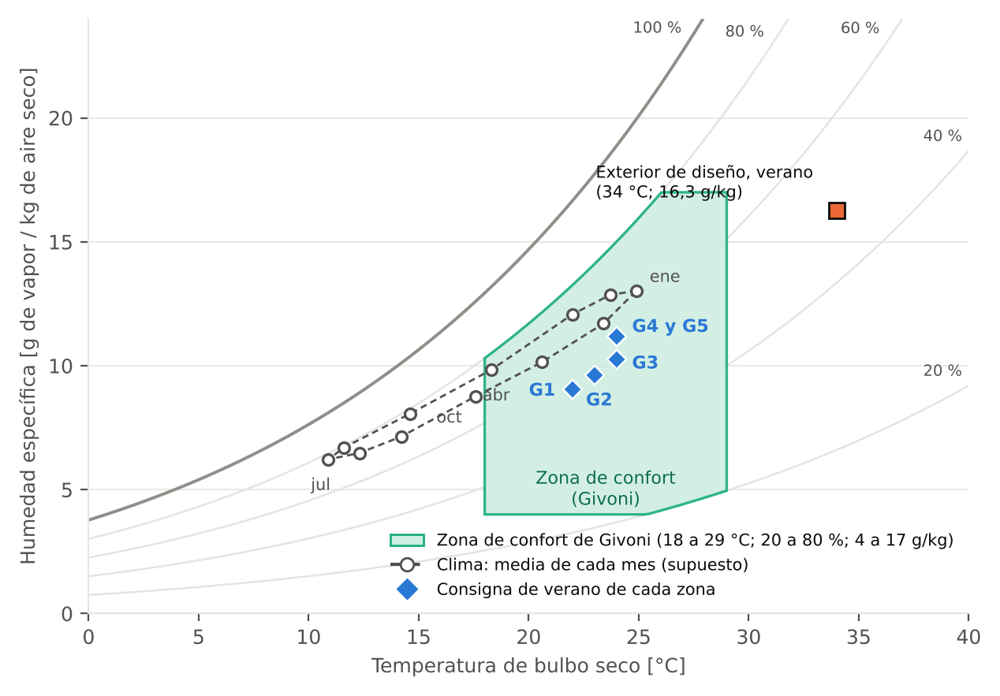
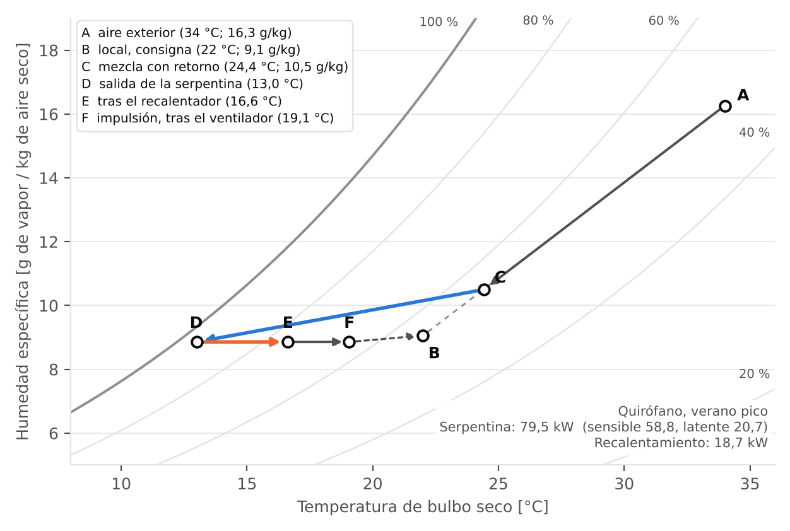
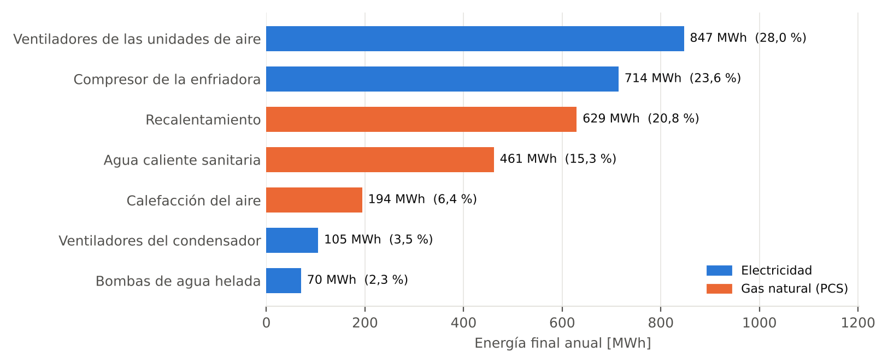
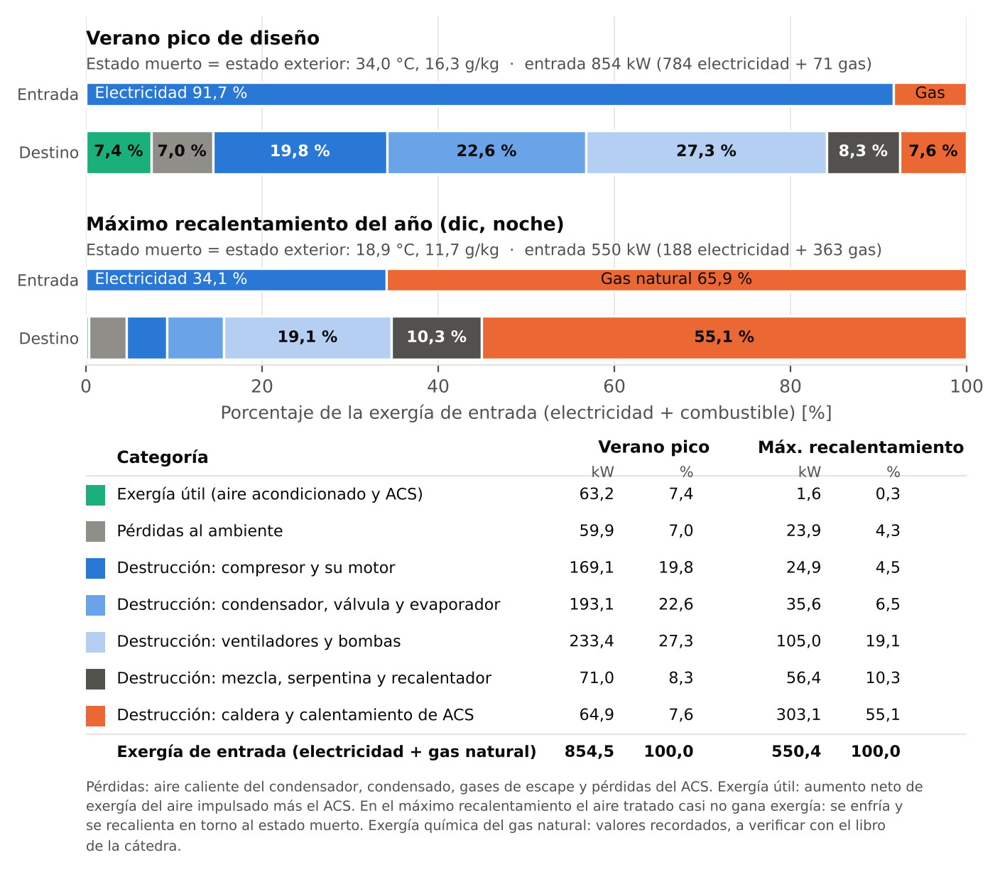
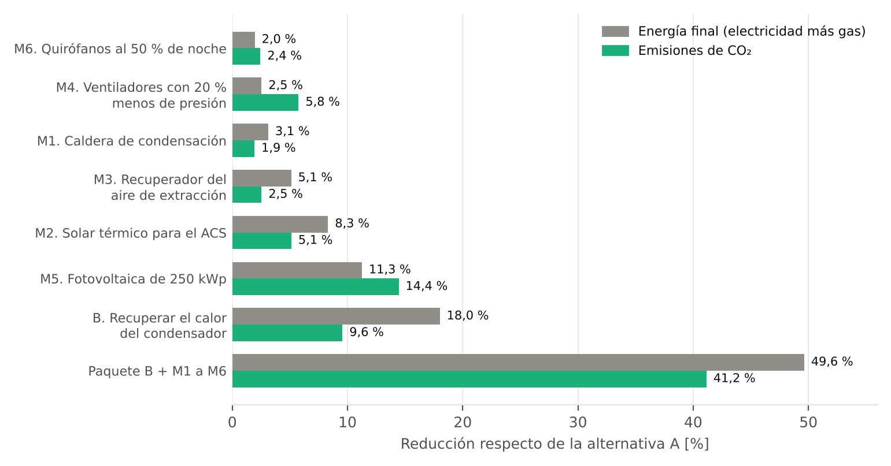

::: {custom-style="Nota"}
**Niveles de respaldo.** Cada dato lleva su nivel: **visto** (documento recibido y leído), **cita** (fuente secundaria vista en una búsqueda; falta cotejarla con la original), **propio** (cálculo o criterio nuestro, con su lógica) o **recordado** (de memoria, sin fuente a mano). Las ecuaciones y los estados completos están en la memoria de cálculo. **Siglas:** ACS (agua caliente sanitaria), UTA (unidad de tratamiento de aire), PCI y PCS (poder calorífico inferior y superior del gas), PCA (potencial de calentamiento global), HEPA y MERV-16 (filtros de alta eficiencia), N+1 (una unidad de reserva).
:::

# Resumen

Se diseña y evalúa el sistema térmico de un hospital de alta complejidad del AMBA con el tamaño y el programa del Hospital Favaloro (La Matanza: 18.352 m², 158 camas según la gacetilla provincial, 6 quirófanos). Es un sistema de aire con enfriadora y caldera de gas, porque quirófanos y áreas críticas exigen aire filtrado, muchas renovaciones y humedad controlada. Para cada dato de partida se explica cómo se obtuvo y en qué se apoya.

El sistema consume **3.021 MWh de energía final por año (165 kWh/m²)**. El hallazgo central es que el aire se enfría para quitarle humedad y se recalienta con gas, mientras la enfriadora tira al ambiente 4.198 MWh de calor por año. Aprovecharlo (alternativa B) baja la energía 18,0 % y las emisiones 9,6 %; el paquete de mejoras de sustentabilidad, 49,6 % y 41,2 %. El análisis exergético muestra que se destruye casi toda la exergía que entra: sobre todo en la enfriadora y su entorno en el verano pico (42,4 % de lo que entra) y en la caldera en el máximo recalentamiento (eficiencia exergética de 12,9 %), donde se quema gas con una llama adiabática teórica de 1.848 °C para subir el aire unos kelvin. Los equipos se eligen con redundancia y se ubican pensando en lo civil (azotea, shafts, ruido, izaje). Lo que no tiene fuente citable está marcado y la sensibilidad muestra cuánto pesa.

# 1. Introducción y objetivos

Un hospital funciona todo el año y todo el día, y su climatización es de **proceso**, no de confort: exige temperatura y humedad controladas, presión positiva y aire exterior filtrado. En el AMBA eso tiene una consecuencia termodinámica concreta: el aire exterior de verano (unos 34 °C con 16,3 g de vapor por kg de aire seco) hay que enfriarlo por debajo de su punto de rocío para quitarle vapor, y a esa temperatura ya no se puede impulsar: hay que **recalentarlo**. Se gasta frío para deshumidificar y combustible para devolver temperatura.

**Objetivo:** definir, modelar y evaluar con la Primera y la Segunda Ley el sistema térmico de un hospital del AMBA y proponer alternativas y mejoras que reduzcan su consumo y su impacto ambiental. Específicamente: respaldar cada dato de partida, elegir y ubicar los equipos, calcular cargas, enfriadora, caldera y consumo anual, calcular dónde se destruye exergía, comparar alternativas y responder con números las cinco preguntas de la consigna.

# 2. El edificio y cómo obtuvimos cada dato

Elegimos un hospital porque es el caso donde refrigeración, combustión, aire húmedo y exergía se necesitan a la vez sobre un mismo sistema, y el **Hospital Dr. René Favaloro (SAMIC)** frente a Nordelta (el sanatorio de Swiss Medical en Tigre, el otro candidato) porque es el que trae el dato que dimensiona el modelo: la superficie cubierta. Es un juicio de ponderación: sin la superficie de Nordelta, que no figura en los documentos recibidos, el Favaloro es el único con ese dato. Ningún documento trae datos de climatización ni de consumo del edificio real: el modelo replica su **tamaño y programa**, no sus instalaciones.

| Dato | Valor | Cómo lo obtuvimos | Respaldo |
|----------------|-----------------|-------------------------------------------------|------------------|
| Superficie cubierta | 18.352 m² | Cifra oficial de Presidencia; el intendente habló de «más de 20.000 m²» sin aclarar si es cubierta | Visto [F1, F2] |
| Camas | 144 + 14 = 158 | La gacetilla las atribuye a cuidados progresivos; las tomamos como el total (Presidencia prevé 160 de internación) | Visto [F2, F1]; interpretación nuestra |
| Quirófanos | 6 | Cifra de programa | Visto [F1] |
| Niveles | 3 de 6.117 m² | Presidencia lista tres pisos (1.º guardia, consultorios y diagnóstico; 2.º internación, quirófanos y áreas críticas; 3.º administración y docencia); suponemos tres iguales | Visto [F1] y propio |
| Superficie climatizada | 85 % (15.599 m²) | Casi todo; se excluyen locales técnicos, morgue y depósitos | Propio |
| Quirófano | 42 m² | FGI: al menos 400 ft² (37,2 m²) libres con 6,1 m de lado; sumamos equipamiento fijo (unos 6,5 × 6,5 m) | Cita (FGI) y propio |
| Terapia intensiva | 24 m² por cama | Res. 748/2014: al menos 9 m² por cama de paciente; × 2,7 por apoyo y circulación | Cita (Res. 748/2014) y propio |
| Internación general | 28 m² por cama | Estimación nuestra (habitaciones con baño, office, circulaciones); sin referencia: ±6 m² cambian la energía ±1,6 % | Propio |
| Guardia, imágenes y laboratorio | 35 % de las áreas generales, 24 h | Guardia 24 h según la gacetilla, más imágenes y laboratorio; el resto funciona 12 h de lunes a viernes | Visto [F2] y propio |
| Altura libre | 3 m | Convención de diseño | Propio |

Table: Tabla 1. Datos del edificio, cómo los obtuvimos y en qué nos apoyamos.

**Contraste global.** El Favaloro tiene 116 m² cubiertos por cama, contra 148 del artículo de Hospitecnia [H] (hospitales españoles) y 157 del Hospital El Cruce (visto): es más compacto, una señal para vigilar y no un error de magnitud. **Qué pasa si nos equivocamos:** ±6 m² por cama de internación cambian la energía ±1,6 %; por quirófano, ±1,2 %; por cama de terapia, ±0,3 %; climatizar 95 % o 75 % en vez de 85 %, ±8,0 %; y que la guardia y el diagnóstico ocupen 50 % o 20 % de las áreas generales en vez de 35 %, ±12,8 %. Las áreas de cada zona pesan poco; lo que pesa es **cuánta superficie se climatiza y cuántas horas funciona**.

| Zona | Superficie [m²] | Consigna de verano | Caudal de impulsión [m³/h] | Renovaciones resultantes [1/h] | Funcionamiento |
|------------------------------|-----------|---------------|---------------|---------------|--------------|
| G1 Quirófanos | 252 | 22 °C; 55 % | 15.120 | 20,0 | Continuo |
| G2 Terapia intensiva | 336 | 23 °C; 55 % | 6.048 | 6,0 | Continuo |
| G3 Internación | 4.032 | 24 °C; 55 % | 54.711 | 4,5 | Continuo |
| G4 Guardia, imágenes, laboratorio | 3.843 | 24 °C; 60 % | 92.225 | 8,0 | 24 h |
| G5 Consultorios y administración | 7.136 | 24 °C; 60 % | 96.670 | 4,5 | 12 h, lunes a viernes |

Table: Tabla 2. Zonas térmicas, consignas de verano y caudales. El caudal es el mayor entre el de las renovaciones mínimas y el de la carga sensible, por eso G3 y G5 resultan con más renovaciones que el mínimo (sección 3.2).

# 3. Decisiones de diseño y su respaldo

## 3.1 Temperatura y humedad interiores

**Zonas críticas (G1, G2).** ASHRAE 170 pide para quirófano de 20 a 24 °C y de 20 a 60 % de humedad relativa, con presión positiva y filtro MERV-16 (**cita**: extracto de un adendo visto en una búsqueda), y para habitaciones de pacientes de 21 a 24 °C y hasta 60 % (**cita**: tabla de muestra del capítulo de hospitales del Handbook); un cirujano o un procedimiento pueden pedir otros valores. No pudimos abrir la norma. Elegimos 22 °C para el quirófano y 23 °C para la terapia, con humedad de consigna de **55 %**: el máximo de 60 % menos 5 puntos de margen de control (**propio**). Pesa: con 5 puntos menos en todas las zonas la energía sube +22,7 %.

**Zonas de confort (G3, G4, G5).** Usamos 24 °C y 55 a 60 %. Para respaldarlo usamos la **carta bioclimática de Givoni**, una carta psicrométrica con la zona de confort dibujada (figura 1): 18 a 29 °C, 20 a 80 % de humedad y 4 a 17 g/kg (**cita**: valores de Givoni (1992) que da una herramienta de carta bioclimática, vistos en una búsqueda; falta cotejar con el artículo). Nuestras cinco consignas caen **dentro** de la zona. **Cómo se lee:** el eje horizontal es la temperatura de bulbo seco y el vertical la humedad específica; el polígono es donde la mayoría de la gente está cómoda sin equipos. Elegimos 24 °C y no 22 °C porque está en la parte media-alta de la zona (menos frío que producir); subir las consignas de G3 a G5 a 26 °C, todavía dentro de la zona, bajaría la energía −11,0 %.

{width=9.5cm}

La carta también explica el problema: el clima medio de octubre a abril cae dentro de la zona de confort o muy cerca, pero el **estado exterior de diseño de verano** (34 °C y 16 g/kg) queda fuera, y para llevarlo a las consignas hay que enfriarlo y quitarle vapor; en invierno queda a la izquierda y hay que calentarlo.

## 3.2 Renovaciones por hora: de dónde salen y qué significan

Los quirófanos llevan **20 renovaciones totales por hora, de las cuales 4 son de aire exterior** (ASHRAE 170; **cita**: extracto de un adendo y una guía que la resume; la cátedra indicó en la corrección que están bien; falta anotar edición y tabla de la norma). Cumplen funciones distintas: las 20 mueven el aire por filtros de alta eficiencia, diluyen contaminantes y mantienen la sobrepresión; las 4 de aire exterior aseguran el aire fresco mínimo (olores, gases anestésicos, CO₂) (**propio**: es nuestra explicación). La relación 20/4 = **5** significa que el aire exterior es el 20 % del que se mueve y el 80 % restante se recircula filtrado: solo hay que tratar con las condiciones exteriores un quinto del aire.

Un detalle: un adendo reciente de ASHRAE 170 reconoce que las 20 renovaciones no tienen una justificación científica definitiva, aunque tampoco pudo rechazarlas, y recomienda una evaluación de riesgo antes de cambiarlas (**cita**). Por eso las mantenemos como dato normativo y mostramos su peso: pasar a 15 o 25 cambia la energía −2,3 % y +2,4 %; con 6 de aire exterior en vez de 4, +0,6 %.

**Nuestra comprobación.** Con 60 W/m² de ganancia sensible (supuesto propio), el caudal que haría falta solo por carga es 4.927 m³/h, o sea 6,5 renovaciones por hora; la norma pide 20, 3,1 veces más. **En el quirófano manda la norma, no la carga térmica**, y por eso su consumo por m² es alto.

| Zona | Total / aire exterior | De dónde sale | Respaldo |
|---|---|---|---|
| G1 Quirófanos | 20 / 4 | ASHRAE 170 | Cita; la cátedra lo dio por bueno |
| G2 Terapia intensiva | 6 / 2 | ASHRAE 170 | Recordado |
| G3 Internación | 4 / 2 | ASHRAE 170, habitación de pacientes | Cita |
| G4 Guardia, imágenes, laboratorio | 8 / 2 | Promedio ponderado: 25 % sala de espera y triage (12), 5 % shock (15), 70 % imágenes y laboratorio (6) = 0,25·12 + 0,05·15 + 0,70·6 ≈ 8 | Propio con valores recordados |
| G5 Consultorios y administración | 3 / 1 | Supuesto nuestro, sin contrastar con la norma | Propio |

Table: Tabla 3. Renovaciones por hora y su respaldo. En internación (G3) y consultorios (G5) el caudal real sale de la carga sensible y da 4,5 renovaciones por hora.

## 3.3 Clima y agua caliente

**Clima.** Usamos medias mensuales de Buenos Aires partidas en mitad diurna y nocturna (amplitud de 9 K). Las contrastamos con el Observatorio Central del SMN, 1991 a 2020, a través de una página que reproduce la tabla (**cita**): enero 24,9 °C, julio 11,0 °C y diciembre 23,6 °C, contra 24,9, 10,9 y 23,4 °C nuestros. La humedad media anual de esa fuente es de unos 68 % contra 72 % nuestros: usamos algo más de humedad y **sobreestimamos** un poco el consumo (cada 4 puntos son unos 3,6 %). El estado de diseño de verano (**34 °C de bulbo seco y 25 °C de bulbo húmedo**) es un valor habitual que **recordamos** y no pudimos cotejar con ASHRAE.

**Agua caliente.** 100 L por cama y día de 17 a 60 °C, más 30 % por pérdidas de acumulación y recirculación (factor 1,3, **propio**), lo que da 43 kW medios. El artículo de Hospitecnia [H] (hospitales españoles) da una guía técnica de 55 L a 60 °C (**visto**, cita secundaria dentro del artículo) y un caso de 540 camas que sale en unos 51 L, derivados de un caudal punta medido y de un perfil horario supuesto (**visto**); y ratios de diseño de 200 a 300 L (**visto**), de 4 a 6 veces más. Elegimos un valor intermedio y mostramos los extremos: 55 L −6,9 % y 200 L +15,3 %.

::: {custom-style="Largo"}
| Parámetro | Valor | Por qué | Peso en la energía |
|----------------------|----------------------|--------------------------------|------------------------|
| Ventiladores: presión y rendimiento | 900 a 1.800 Pa; 0,60 | 1.800 Pa en quirófanos por filtro HEPA, dos serpentinas y conductos; todo el calor del ventilador va al aire | presión +30 %: +4,6 %; sin el calor del ventilador: +18,3 % |
| Enfriadora: evaporación y rendimiento isentrópico | 3 °C (agua 7/12 °C); 0,72 | Aproximación habitual del evaporador; rendimiento típico de un tornillo | 0,65: +2,6 %; 0,78: −1,9 % |
| Condensación | exterior + 12 K, mínimo 32 °C | Condensador por aire; el mínimo lo pide el control de la presión de descarga | incluido en el COP |
| Caldera: exceso de aire y gases de escape | 15 %; 190 °C; 2 % de pérdidas | Caldera sin condensación habitual | gases a 230 °C: +0,9 %; exceso de 30 %: +0,4 % |
| Ganancias internas por m² | 60, 40, 25, 35 y 25 W/m² (G1 a G5) | Actividad típica de cada zona, sin dato propio | ±30 %: menos de 0,7 % |
| Cambio de estación | 18 °C | Umbral entre consignas de verano e invierno, sin histéresis | 21 °C: −14,3 % |

Table: Tabla 4. Otros parámetros del modelo que mueven el resultado, su motivo y su peso (todos **propios**).
:::

## 3.4 Por qué elegimos este sistema

::: {custom-style="Largo"}
| Decisión | Alternativas | Elegimos y por qué | Respaldo |
|----------------|----------------------|----------------------------------------------|----------------|
| Tipo de sistema de aire | Todo aire con recalentamiento; splits o VRF; fancoils con aire exterior aparte | Todo aire de caudal constante: las zonas críticas necesitan filtrado, muchas renovaciones y control de humedad y de presiones, que un split no da. La auditoría de HCWH encontró en hospitales argentinos splits instalados «porque el aire central no alcanzaba» | Propio; [A] visto |
| Producción de frío | Enfriadora por aire o por agua con torre | Por aire: sin torre no hay consumo de agua, tratamiento ni riesgo de legionela; el COP es algo menor | Propio |
| Redundancia | Sin reserva o N+1 | N+1 en la producción de frío y de calor (3+1 enfriadoras, 2 calderas al 100 %): un hospital no puede parar la climatización de quirófanos y terapia. Las UTAs no tienen reserva (una por quirófano): queda abierto | Propio |
| Combustible y base | Gas, electricidad o gasoil; caldera o recuperación de calor | Gas natural (hay red en el AMBA y es el combustible dominante en el artículo [H]); caldera como base (A) y recuperación como alternativa B para medir cuánto se gana | Propio; [H] visto |

Table: Tabla 5. Decisiones de diseño del sistema, alternativas consideradas y motivos.
:::

# 4. Equipos y ubicación

{width=11cm}

## 4.1 Qué elegimos

| Equipo | Qué elegimos | Por qué | Respaldo |
|-------------|--------------------------------------|---------------------------------|----------------|
| Enfriadoras | 4 unidades iguales de tornillo condensadas por aire (3 en servicio y 1 de reserva). Ejemplo: Carrier AquaForce 30XA 1002, R-134a, 988 kW nominales | Cada unidad en servicio debe dar al menos 662,4 kW (un tercio de 1.987 kW); la reserva mantiene el servicio si una falla | Cita (catálogo, búsqueda web) y propio |
| Calderas | 2 calderas de agua caliente a gas de 734 kW cada una (100 % cada una). Ejemplo de condensación: 4 Viessmann Vitocrossal 300 CM3C de 311 kW | Carga de diseño 734 kW = 649 kW de invierno + 86 kW de punta de ACS (el doble de la media, supuesto) | Cita (catálogo) y propio |
| Unidades de tratamiento de aire | 18 unidades: una por quirófano (6 × 2.520 m³/h, con filtro HEPA), una para terapia intensiva (6.048 m³/h) y 11 en cubierta para las demás zonas (hasta 25.000 m³/h cada una) | Las críticas junto a su zona (continuidad, presiones y recorridos cortos); las demás en cubierta, cerca de las enfriadoras | Propio |
| Cañería de agua helada | Principal DN 250 (342 m³/h a 1,93 m/s) y ramal por enfriadora DN 150 | Caudal de la carga con salto de 5 K y velocidad de diseño de 2 m/s | Propio |
| Shafts de aire | 14 shafts de unos 2 m² (21,5 m² verticales en total), apilados en un núcleo técnico | Áreas con 6 m/s en impulsión y 5 m/s en retorno | Propio |

Table: Tabla 6. Equipos elegidos. Los datos de catálogo son **citas de búsquedas web** (no pudimos abrir los catálogos): hay que cotejarlos con el fabricante.

**La enfriadora de ejemplo cumple, pero con un margen grande.** La Carrier 30XA 1002 da 988 kW nominales con 288,2 kW de compresores a 35 °C de aire y agua 12/7 °C (la familia va de 267 a 1.682 kW). Con 3 unidades en servicio y 1 de reserva quedan **2.964 kW con una unidad parada contra 1.987,2 kW de carga (+49 %)**, y cada unidad en servicio trabaja al 67,0 % de su capacidad. **Por qué 3+1 y no 2+1:** con 2+1 y la misma unidad quedan 1.976 kW y **faltan 11,2 kW (0,6 %)**, así que no cumple; la alternativa más ajustada sería 2+1 con una unidad de al menos 994 kW (la 30XA 1102, cuya designación y capacidad **no verificamos**). Elegimos 3+1 porque es la única configuración con datos de catálogo que podemos citar, y lo decimos: queda sobredimensionada. El margen cubre el calor de las bombas (39,6 kW, que la carga no incluye) y la diferencia entre los 34 °C del diseño y los 35 °C del catálogo. **Calderas:** la carga de diseño incluye 92 kW de vapor de humidificación, que una caldera de agua caliente **no produce** (hacen falta humidificadores o un generador de vapor); la dejamos completa, del lado seguro. Con la caldera de condensación de ejemplo hacen falta 3 unidades en servicio más 1 de reserva: con una parada quedan 933 kW, suficiente; con 3 unidades en total (una parada) quedan 622 kW y no alcanza.

## 4.2 Dónde ponerlos

Como ingenieros civiles, la ubicación depende del aire, el ruido, la estructura, el izaje, las cañerías y el mantenimiento. Armamos un esquema con tres niveles iguales de 6.117 m² brutos (5.200 climatizados y 918 de locales técnicos, morgue y depósitos) y ubicamos las zonas según la presentación del hospital (figura 3) y, para ver cómo quedan en planta, las dibujamos a escala (figura 4).

**Cómo leer la planta.** El núcleo técnico (918 m², de 30,8 × 29,8 m) ocupa la esquina sudeste, del lado de la calle y **en el mismo lugar en cada nivel**: los shafts se apilan, el agua helada baja por ellos desde la azotea y las enfriadoras se izan desde la calle. En el 2.º piso quirófanos y terapia intensiva quedan **contiguos al núcleo**, donde están sus 7 UTAs (conductos cortos); la internación (G3) va en dos alas, y la guardia y los consultorios, en el 1.er piso con acceso desde la calle. Los pasillos están dentro de la superficie de cada zona. Es un esquema para razonar la ubicación, no un plano del hospital.

- **Enfriadoras en la azotea**, junto al núcleo técnico: necesitan aire libre (en un patio rodeado por el edificio recirculan el aire caliente) y el ruido queda por encima del 3.er piso, separado de la internación por una losa. Son 4 unidades (3 en servicio y 1 de reserva) que ocupan 196 m², el 3,2 % de la cubierta de 6.117 m². Las tomas de aire exterior de las UTAs de cubierta deben quedar lejos de las descargas de extracción y de la chimenea: la distancia mínima la fija la norma y **no la fijamos acá**.
- **Carga estructural.** Con un peso supuesto de 12 t por unidad, la carga media sobre su huella es de 2,40 kN/m², 1,20 veces una sobrecarga de referencia de azotea de 2,0 kN/m² (**supuesta**; recordamos un rango de 1 a 5 kN/m² según el uso en el CIRSOC 101, sin haberlo consultado). La carga bajo los apoyos es mayor: hace falta plataforma o vigas y la verificación del calculista; el peso de 12 t es supuesto: hay que cambiarlo por el del catálogo.
- **UTAs y shafts.** Las 7 críticas (quirófanos y terapia) van en el cuarto técnico del 2.º piso, junto a su zona; las 11 restantes, en cubierta. Los 264.774 m³/h de impulsión necesitan 21,5 m² netos de shafts verticales; con shafts de unos 2 m² agrupados por zona resultan 14 (28 m²), dentro del núcleo técnico que se apila en los tres niveles (por área pura saldrían 11).
- **Calderas en un anexo a nivel de calle**: acceso, medidor y regulador de gas, ventilación y chimenea (DN 300) por fuera del edificio. **Izaje:** unidades de 14 m y 12 t a unos 15 m de altura exigen grúa móvil grande y corte de calle; es el costo de la azotea.

**La decisión no es robusta.** Puntuamos azotea y patio a nivel con seis criterios: gana la azotea (3,25 contra 3,05), pero con pesos iguales empatan y si estructura e izaje valen el doble gana el patio (3,38 contra 2,96). Elegimos la azotea por el aire libre y los recorridos cortos hacia las 11 UTAs de cubierta; si el calculista descarta la losa, el patio es la alternativa. Las reservas para solar térmico (300 m²) y fotovoltaica (unos 1.250 m²) caben, pero **no dimensionamos las UTAs ni la sala de calderas**.

{width=12.5cm}

{width=13cm}

# 5. Cálculo y resultados

## 5.1 El método y un caso paso a paso

Cada zona es un sistema de aire de caudal constante. Para cada estado exterior se sigue el aire por la mezcla, la serpentina que enfría y quita vapor, el recalentador y el ventilador (que además lo calienta); de ahí salen la carga frigorífica (sensible y latente) y el calor de recalentamiento. La carga de las serpentinas es la que vence la enfriadora (ciclo de R134a: trabajo, COP, calor rechazado) y el calor de recalentamiento, calefacción y agua caliente se convierte en gas con el rendimiento de la caldera (balance de la reacción y de los gases). Cada mes se parte en una mitad diurna y otra nocturna y se repite el cálculo. **Las ecuaciones y los estados completos están en la memoria.**

**El quirófano en verano pico.** Con el exterior a 34 °C y 25 °C de bulbo húmedo, el aire exterior (A) se mezcla con el de retorno (B) y queda a 24,4 °C (C); la serpentina lo enfría hasta 13,0 °C y le quita vapor (D); el recalentador lo sube a 16,6 °C (E) y el ventilador, que le agrega 2,4 K, lo deja a 19,1 °C (F). La serpentina entrega 79,5 kW (58,8 sensibles y 20,7 latentes) y el recalentador, 18,7 kW. En el punto de diseño todo el edificio recalienta solo 19 kW: **el recalentamiento aparece a carga parcial, y dimensionar su recuperación con el pico subestimaría el potencial**.

{width=8.5cm}

## 5.2 Enfriadora y caldera

La capacidad frigorífica de diseño es **1.987 kW** (108 W/m²). El R134a evapora a 3 °C y condensa a 46 °C porque el condensador es enfriado por aire a 34 °C. El COP eléctrico del compresor es **3,56**, el 55 % del de Carnot (6,42), y el compresor consume 559 kW. El catálogo de la enfriadora del ejemplo da un COP de 3,43 contando solo los compresores a 35 °C: del mismo orden. Con gas natural y 15 % de exceso de aire, el poder calorífico superior es de 9.196 kcal/m³ y el inferior de 9,656 kWh/m³; los gases salen a 190 °C, por encima de su rocío (56,1 °C), la pérdida es 8,0 % del PCI y la caldera rinde **90,0 % sobre PCI** (81,2 % sobre PCS) con 2 % de pérdidas supuestas; el artículo de Hospitecnia [H] usa 90 % sin aclarar la base, así que la coincidencia es de resultado y no una comparación directa. Cada kWh de PCI del gas emite 0,202 kg de CO₂, de la propia reacción (0,183 por kWh de PCS, que es la base de la energía final).

## 5.3 Consumo anual

La energía final es **3.021 MWh por año**: 1.736 de electricidad y 1.285 de gas (por su PCS, unos 120.000 m³), **165 kWh/m²**; suma kWh a kWh, sin ponderar por energía primaria. Las emisiones son 895 t de CO₂ por año (235 del gas y 660 de la electricidad). El factor de la electricidad (0,38 t/MWh, meta de CAMMESA 2023) es el más incierto: otras fuentes dan 0,29 y 0,40, con lo que el paquete de mejoras reduce las emisiones 44,0 % y 40,6 %.

{width=9.5cm}

**Primero**, con los supuestos actuales los ventiladores consumen más que el compresor (28,0 % contra 23,6 %), por ser un sistema todo aire con muchas renovaciones; el orden depende de la presión y el rendimiento supuestos (con 20 % menos de presión el compresor pasa adelante, pero el gas de recalentamiento sube y el ahorro neto es de solo 2,5 %). **Segundo**, el recalentamiento es casi la mitad del calor útil de la caldera (511 de 1.044 MWh; 129 MWh en enero contra 46 en julio). **Tercero**, el COP anual de la planta con ventiladores del condensador y bombas (3,96) coincide con el COP 4 de Hospitecnia [H] por casualidad y no por ajuste (el del compresor solo es 3,56 al diseño y 4,94 como media anual).

**Qué tan seguro es el número.** Variando un supuesto por vez, la intensidad queda entre 141 y 202 kWh/m² y año; **eso no es un intervalo de confianza**. Lo que más mueve el resultado:

| Variación de un supuesto | Energía final [MWh/año] | Diferencia |
|--------------------------------------------------------------|------------------|------------|
| Humedad de consigna de verano 5 puntos menor en todas las zonas | 3.706 | +22,7 % |
| Consultorios y administración funcionan también las 24 h | 3.644 | +20,6 % |
| Sin calor del ventilador en el aire | 3.574 | +18,3 % |
| ACS de 200 L por cama y día (en vez de 100) | 3.483 | +15,3 % |
| Temperatura media mensual +2 K | 3.463 | +14,6 % |
| Cambio de estación (consignas de invierno) bajo 21 °C en vez de 18 °C | 2.589 | −14,3 % |

Table: Tabla 7. Supuestos que más mueven la energía final (caso base: 3.021 MWh). Ganancias internas y envolvente (±30 %) mueven menos de 3 %.

# 6. Exergía: dónde se pierde la capacidad de hacer trabajo

**Qué calculamos y con qué criterio.** Para cada equipo planteamos exergía que entra (F), exergía útil que entrega (P), pérdida al ambiente (L) y exergía destruida (D), con F = P + L + D, en kW. Tomamos como **estado muerto el aire exterior** de cada caso (lo que el ambiente da gratis) y analizamos dos casos con la misma función: el **verano pico** (exterior a 34,0 °C, el que dimensiona la enfriadora) y el **momento del año con más recalentamiento** (diciembre, de noche, exterior a 18,9 °C, con 272 kW de recalentamiento). Entre los dos se ven las dos mitades del sistema. La exergía química del gas es 1,037 veces su PCI, con exergías químicas estándar que **recordamos** y hay que cotejar con el libro de la cátedra. La figura 7 muestra el reparto con sus cifras; el balance por equipo está en la memoria.

1. **Casi toda la exergía se destruye**: 85,6 % en el verano pico y 95,4 % en el recalentamiento. En climatización es lo esperable: el sistema trabaja con calor y frío a temperaturas cercanas a la del ambiente, que valen poco en exergía.
2. **En el verano pico manda la enfriadora y su entorno.** El compresor con su motor (19,8 %), el condensador, la válvula y el evaporador (22,6 %) destruyen el 42,4 % de lo que entra, y los ventiladores y bombas con sus pérdidas de carga otro 27,3 %. La eficiencia exergética de la enfriadora es de **30,8 %** contando el compresor (26,1 % con ventiladores del condensador y bombas) aunque su COP de 3,56 sea alto: el frío de agua a 9,5 °C con exterior a 34,0 °C vale solo el 8,7 % de su energía en exergía.
3. **En el recalentamiento manda la caldera** (aire y ACS). Destruye el 57,1 % de lo destruido y su eficiencia exergética es de **12,9 %**: el 30,2 % del combustible se destruye en la combustión (llama adiabática teórica de 1.848 °C, calculada sin disociación) y el 52,5 % al pasar el calor al agua a 80/60 °C, **todo para subir el aire unos kelvin**. El calor de 32 a 46 °C que la enfriadora rechaza (32 a 41 °C en los estados medios del año) vale poco en exergía, igual que el que pide el recalentamiento: por eso la alternativa B es buena también desde la Segunda Ley. Con un circuito de 50/40 °C en vez del de 80/60 °C que supusimos, la destrucción en la transferencia baja, y eso refuerza a B.
4. **Hay que leer las eficiencias con cuidado.** La global del verano pico es de 7,4 %; en el recalentamiento no se puede definir (el aire sale casi con la exergía con que entra). Con otro estado muerto la destrucción total varía menos de 4,4 % y el equipo que más destruye no cambia, pero los rangos de eficiencia sí.

{width=11cm}

# 7. Alternativas y mejoras de sustentabilidad

**Alternativa A** (base): enfriadora, caldera de gas y recalentamiento. **Alternativa B:** el recalentamiento y la calefacción del aire se cubren con el **calor del condensador**, que hoy se tira, en lugar de quemar gas. Sale directo del hallazgo central: el calor existe (4.198 MWh por año, unas 8,2 veces el de recalentamiento) y alcanza con agua tibia a 45 °C. **Es honesta:** entregar agua a 45 °C exige condensar a 50 °C, más caliente que los 32 a 41 °C de un condensador por aire, y eso **cuesta trabajo del compresor**. En cada estado del año se elige el mejor entre no recuperar, recuperar solo el sobrecalentamiento de la descarga o poner a condensar el recuperador. B recupera 499 MWh de calor, ahorra 615 MWh de gas y gasta 70 MWh más de electricidad (81 del compresor, menos 11 de los ventiladores del condensador): **la energía baja 18,0 % y las emisiones 9,6 %**. El modelo supone que calor y demanda coinciden dentro de cada estado; con coincidencia de 75 % o 50 % el ahorro baja a 13,5 % y 8,5 %, que es el rango realista. Hay antecedentes: un hospital de Texas calienta con agua a 46 °C (115 °F) de enfriadoras de recuperación de calor en lugar de agua de caldera a 82 °C (180 °F), y el fabricante informa 80 % menos de gas (**cita**: caso de Trane). B necesita una enfriadora con condensador de recuperación y un circuito de agua a 45 °C hacia los recalentadores, que el ejemplo de la sección 4 no incluye (a confirmar con el catálogo).

La cátedra pidió énfasis en mejoras que consuman menos y sean más verdes. Las evaluamos con el mismo modelo, una por vez:

| Medida | Por qué ahorra | Energía final | CO₂ |
|--------------------|------------------------------------------------|----------------|----------------|
| Alternativa B: recuperar el calor del condensador | Aprovecha el calor que se rechaza a 32 a 41 °C (hasta 50 °C cuando recupera) en vez de quemar gas con una llama adiabática teórica de 1.848 °C; cuesta trabajo extra del compresor | −18,0 % (544 MWh) | −9,6 % (86 t) |
| M5. Fotovoltaica de 250 kWp | Produce 340 MWh por año (1.360 kWh por kWp) que descuentan electricidad de la red. La irradiación de 1.700 kWh/m² es una cita de un punto a unos 300 km (cota alta); con 1.500 serían 300 MWh | −11,3 % (340 MWh) | −14,4 % (129 t) |
| M2. Solar térmico para el ACS | 300 m² de colectores cubren el 54 % del calor del ACS, una demanda constante de 43 kW medios que el sol atiende bien | −8,3 % (251 MWh) | −5,1 % (46 t) |
| M3. Recuperador del aire de extracción | Precalienta o preenfría el aire exterior con el que sale, sin mezclar las corrientes (circuito de agua, efectividad 0,50). Supone compuertas de bypass para trabajar solo cuando conviene (a confirmar); sin ellas el ahorro es de 0,4 % en energía y las emisiones 3,6 % | −5,1 % (154 MWh) | −2,5 % (23 t) |
| M1. Caldera de condensación | Los gases salen a 45 °C, por debajo del rocío (56,1 °C): condensa el 47 % del agua formada y recupera su calor latente; el rendimiento sobre PCS pasa de 81,2 a 91,8 %. Supone un circuito de 50/40 °C para el aire; con agua de retorno a 60 °C no condensa | −3,1 % (94 MWh) | −1,9 % (17 t) |
| M6. Quirófanos al 50 % de noche | El quirófano no tiene actividad de noche: con la mitad del caudal la potencia del ventilador baja al cubo (leyes de los ventiladores) y hay menos aire que enfriar y recalentar. El adendo de ASHRAE 170 recomienda una evaluación de riesgo antes de ajustar la ventilación de un quirófano | −2,0 % (59 MWh) | −2,4 % (22 t) |
| M4. Ventiladores con 20 % menos de presión | La potencia del ventilador es proporcional a la presión; pero el calor que ya no cede al aire hay que reponerlo con gas, por eso el ahorro neto es chico | −2,5 % (77 MWh) | −5,8 % (51 t) |
| Paquete B + M1 a M6 | Combinación de todas; el aporte de cada una depende de las demás | −49,6 % (1.500 MWh) | −41,2 % (368 t) |

Table: Tabla 8. Mejoras respecto de A (3.021 MWh y 895 t de CO₂ por año).

{width=9.5cm}

**Cómo leer la tabla.** En el total las medidas casi se suman (las sueltas ahorran 1.520 MWh y el paquete 1.500 MWh), pero porque unos efectos se compensan con otros: con B la caldera de condensación ahorra 24 MWh en vez de 94, y los ventiladores de menor presión ahorran 128 MWh en vez de 77 porque hay más gas que recuperar. Por eso el aporte de cada medida **depende de las demás**. Las que ahorran gas bajan más la energía que las emisiones (el gas emite 0,183 t/MWh y la red 0,38, cita secundaria); las que ahorran electricidad (fotovoltaica, ventiladores) bajan más las emisiones. **Lo que no conviene priorizar:** aislar la envolvente un 30 % baja solo 2,5 % y reducir las ganancias internas un 30 % (por ejemplo LED), 0,7 %: el consumo está en el aire, no en la envolvente.

**Refrigerante.** El R134a tiene un PCA de 1.430 (**cita**) y la Enmienda de Kigali obliga a reducir los HFC (Argentina la ratificó en 2019 y puso los HFC bajo licencia de importación en 2020; **cita**). Con el modelo de ciclo y el mismo rendimiento isentrópico supuesto, el R1234ze(E) (PCA menor que 1, **cita**) da el mismo COP (3,55 contra 3,56; en una máquina real puede ser algo menor) pero 26 % menos capacidad volumétrica, o sea un compresor 35 % más grande, y es ligeramente inflamable (A2L, **recordado**), lo que pesa en un hospital. El R513A (PCA 631, **cita**) no está en la biblioteca que usamos.

# 8. Conclusiones

1. **¿La alternativa seleccionada satisface los requerimientos?** Sí, con las verificaciones hechas: la serpentina alcanza las consignas de las cinco zonas (sale a 13 °C con 95 % de humedad y se recalienta), cada zona recibe al menos sus renovaciones mínimas, y los equipos elegidos cubren 1.987 kW de frío con redundancia (3 + 1 enfriadoras Carrier 30XA 1002: 2.964 kW con una parada, 49 % sobre la carga), 557 kW de calefacción del aire (92 kW más de humidificación, que necesita vapor) y 43 kW medios de ACS. Lo que **no** satisface bien es la eficiencia: consume 3.021 MWh y tira 4.198 MWh de calor; B cumple lo mismo con 18,0 % menos.
2. **¿Cuáles son las principales variables que condicionan su desempeño?** La humedad de consigna (5 puntos menos, +22,7 %), los horarios (consultorios 24 h, +20,6 %), el ACS por cama (200 L, +15,3 %), la temperatura media (±2 K, +14,6 % y −13,7 %) y el calor del ventilador (sin él, +18,3 %). Los rendimientos y parámetros del ciclo mueven menos de 3 % cada uno y la presión de los ventiladores (+30 %), +4,6 %. El COP del compresor depende sobre todo de la temperatura de condensación (3,56 al diseño y 4,94 como media anual).
3. **¿Qué procesos presentan mayores pérdidas de energía o destrucción de exergía?** **En energía:** los ventiladores (28,0 % de la energía final), el compresor (23,6 %) y el gas del recalentamiento (20,8 %) son los mayores consumos (el orden de los dos primeros depende de la presión y el rendimiento supuestos de los ventiladores); las pérdidas son el calor que el condensador rechaza (4.198 MWh por año, 8,2 veces el de recalentamiento), los gases de escape (8,0 % del PCI) y la irreversibilidad del compresor. **En exergía:** en el verano pico se destruye el 85,6 % de lo que entra, sobre todo en la enfriadora y su entorno (42,4 %) y en ventiladores y bombas (27,3 %); en el máximo recalentamiento la caldera (aire y ACS) destruye el 57,1 % del total destruido (eficiencia exergética de 12,9 %), porque calienta aire unos kelvin con una llama adiabática teórica de 1.848 °C.
4. **¿Qué modificaciones permitirían mejorar el aprovechamiento de los recursos?** Recuperar el calor del condensador (B: 18,0 % de energía y 9,6 % de CO₂), fotovoltaica (11,3 %), solar térmico (8,3 %), recuperador del aire de extracción (5,1 %), caldera de condensación (3,1 %), ventiladores de menor presión (2,5 %) y quirófanos a caudal reducido de noche (2,0 %); el paquete, 49,6 % menos de energía y 41,2 % menos de emisiones. Están ordenadas por ahorro de energía (por CO₂ la fotovoltaica es primera); sin costos no se puede ordenar por retorno, y la consigna no pide presupuesto. No conviene priorizar la envolvente ni la iluminación.
5. **¿Qué limitaciones presenta el análisis y qué información haría falta?** El resultado se mueve entre 141 y 202 kWh/m² con un supuesto por vez. Faltan datos citables de clima (SMN) y de la norma (ASHRAE 170), que no pudimos abrir; los consumos del hospital real; las curvas de carga parcial; los efectos omitidos (economizador, ventiladores de retorno, caldera a carga parcial, humidificación de invierno); y la coincidencia en el tiempo entre calor disponible y demanda de B. No hay análisis de costos.

# Anexo A. Referencias y su nivel de verificación

| Referencia | Qué se usó | Nivel |
|---|---|---|
| [F1] Presidencia de la Nación, presentación del Hospital SAMIC «Dr. René Favaloro»; [F2] Gobierno de la Provincia de Buenos Aires, gacetilla del 28/07/2020 | Superficie, quirófanos, niveles, camas, guardia 24 h | Visto |
| [H] Gallostra Isern, Sánchez-Vaqué y Túnica Buira, *Caracterización de consumos energéticos y suministros en hospitales*, Hospitecnia, 2022 (hospitales españoles: órdenes de magnitud, no valores de diseño); [A] HCWH y K-CEP, *Energy efficiency and cooling audits in health care facilities in Argentina, China, and the Philippines*, 2021; El Cruce (Medina y Marini, 2010) | ACS, m²/cama, COP y rendimiento de referencia; consumos y hallazgos de tres hospitales argentinos | Visto |
| ASHRAE 170 (adendo de 2025) y Handbook, capítulo de hospitales; FGI Guidelines (quirófano de 400 ft²); Resolución 748/2014 (terapia, 9 m² por cama); Givoni (1992) según Lamberts, Dutra y Pereira | Renovaciones, temperaturas, humedades, superficies, zona de confort | Cita (extractos de búsquedas); no se pudieron abrir |
| SMN, normales 1991-2020 (vía una página que reproduce la tabla); Global Solar Atlas; CAMMESA (meta 2023, vista en el perfil de DitchCarbon), Climate Transparency vía Carbon Footprint y Ember | Clima, irradiación, factor de emisión de la electricidad (de 0,29 a 0,40 t/MWh) | Cita (búsquedas) |
| Carrier (enfriadora AquaForce 30XA), Viessmann (Vitocrossal 300 CM3C), Trane y *Consulting-Specifying Engineer* (recuperación de calor del condensador en hospitales), Kigali y Resolución 104/2020 | Equipos de ejemplo, antecedentes de la alternativa B, estado de los HFC | Cita (búsquedas) |
| CoolProp y psychrolib | Propiedades del refrigerante, los gases y el aire húmedo | Visto (código) |

Table: Tabla A1. Fuentes y nivel de verificación. **Las páginas de ASHRAE, SMN, NOAA y otras no se pudieron abrir desde el entorno de trabajo**; todo lo marcado «cita» hay que cotejarlo con la fuente original antes de la entrega.
