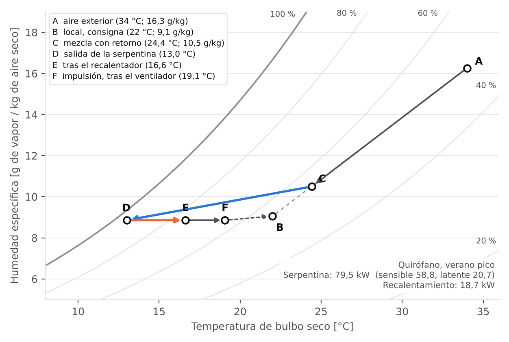
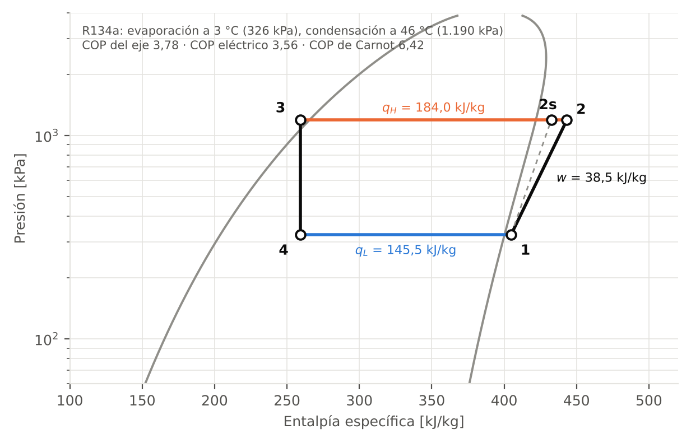
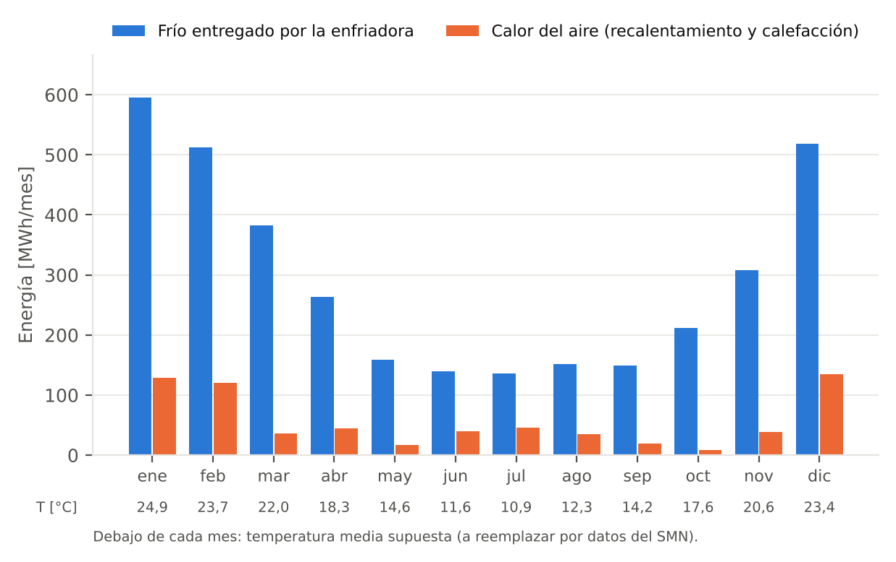
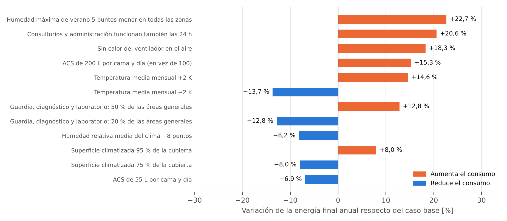
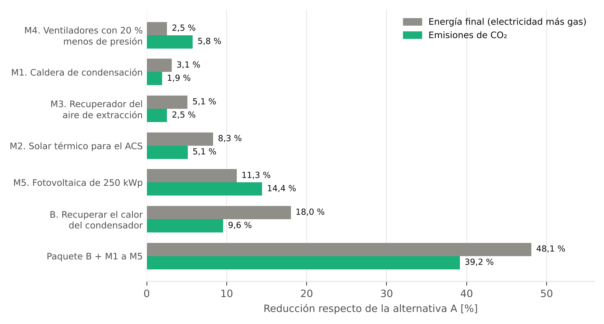

::: {custom-style="Nota"}
**Cómo se lee esta memoria.** El informe técnico explica las decisiones y sus motivos; acá están el desarrollo ordenado de las ecuaciones, los datos, las hipótesis, las unidades y los resultados. Los cálculos principales se resuelven con números (secciones 3 a 6) para poder seguirlos a mano: las diferencias de una unidad en la última cifra se deben al redondeo y, donde la cuenta lo exige, se imprimen más cifras. **Respaldo de cada dato:** [n] indica una fuente de la lista del anexo D (con asterisco, [n]\*, la fuente se conoce solo por un extracto de búsqueda y no se abrió el original); «supuesto» marca toda decisión o valor propio, con su motivo al lado; lo que calcula el modelo no lleva marca. **Unidades:** SI; potencias en kW, energías anuales en MWh, temperaturas en °C (diferencias en K), presiones en kPa y humedad específica ω en g de vapor por kg de aire seco en las tablas (kg/kg en las ecuaciones).
:::

**Contenido.**

1. [Sistemas de estudio, frontera e hipótesis](#sec-sistemas)
2. [Estados de las corrientes y propiedades usadas](#sec-estados)
3. [Aire húmedo: ecuaciones, caso resuelto (quirófanos) y cargas de diseño por zona](#sec-aire)
4. [Refrigeración: ciclo de R134a, COP y calor rechazado](#sec-refrigeracion)
5. [Combustión: reacción, poder calorífico, rendimiento y consumo de gas](#sec-combustion)
6. [Agua caliente sanitaria y consumo anual](#sec-anual)
7. [Sensibilidad](#sec-sensibilidad)
8. [Alternativa B y mejoras](#sec-mejoras)
9. [Exergía: modelo y resultados](#sec-exergia)
10. [Selección de equipos y ubicación](#sec-equipos)

Anexos: A, cifras del informe y dónde se calculan; B, verificación del cálculo; C, datos de entrada; D, referencias.

**Nomenclatura.**

| Símbolo | Significado y unidad | Símbolo | Significado y unidad |
|-----------|---------------------------------------|-----------|---------------------------------------|
| $\dot m_a$ | caudal de aire seco [kg/s] | $\dot X_F,\ \dot X_P,\ \dot X_L,\ \dot X_D$ | exergía del combustible, del producto, perdida y destruida [kW] |
| $\omega$ | humedad específica [kg/kg de aire seco; g/kg en tablas] | $T_0$ | temperatura del estado muerto, la del aire exterior [K] |
| $h$ | entalpía específica [kJ/kg; kJ/kmol en la combustión] | $\rho$ | densidad [kg/m³] |
| $T$, $P$ | temperatura [°C] y presión [kPa] | $\Delta p$ | caída de presión [Pa o kPa] |
| $\dot Q$ | flujo de calor [kW]; $\dot Q_L$ es el frío de la enfriadora | $f_{act}$ | actividad: fracción de la ganancia interna de plena actividad [–] |
| $\dot W$ | potencia eléctrica o mecánica [kW] | $f_{env}$, $U$ | fracción de envolvente expuesta [–]; conductancia [W/(m² K)] |
| $\eta$ | rendimiento [–]: $\eta_{is}$ isentrópico, $\eta_{mot}$ del motor, $\eta_{vent}$ del ventilador | $q_s$, $q_l$ | ganancias internas sensible y latente a plena actividad [W/m²] |
| $q_L$, $q_H$, $w$ | efecto frigorífico, calor rechazado y trabajo de compresión por kg de refrigerante [kJ/kg] | $\lambda$ | relación de aire de la combustión (1 = estequiométrico) [–] |
| $COP$ | coeficiente de desempeño [–] | $y_i$, $n_i$ | fracción molar [–] y moles por kmol de gas [kmol/kmol] |
| $PCI$, $PCS$ | poder calorífico inferior y superior [kJ/kmol; kWh/m³ estándar] | $E$ | energía anual [MWh]; final = electricidad + gas (PCS) |

**Siglas.** ACS: agua caliente sanitaria; UTA: unidad de tratamiento de aire; PCI y PCS: poder calorífico inferior y superior del gas natural; HEPA: filtro de alta eficiencia; N+1: una unidad de reserva por encima de las necesarias; PCA: potencial de calentamiento atmosférico. Subíndices: *serp* serpentina, *rec* recalentador, *lat* y *sens* latente y sensible, *mez* mezcla, *imp* impulsión, *ev* evaporador, *cond* condensador, *mot* motor.

# 1. Sistemas de estudio, frontera e hipótesis {#sec-sistemas}

## 1.1 Sistemas de estudio y límites

El sistema térmico se divide en cuatro sistemas de estudio, cada uno un volumen de control en régimen permanente en cada estado considerado. La tabla M1 da sus límites y los flujos que los cruzan; la figura M1 los muestra en conjunto (las letras A a F son los estados del aire de la tabla M4).

{width=11.5cm}

| Sistema | Límite del volumen de control | Entra | Sale |
|--------------|--------------------------|------------------------------|------------------------------|
| **Unidad de tratamiento de aire** (una por zona) | Mezcla de aire exterior y de retorno, serpentina de enfriamiento, recalentador, ventilador de impulsión y humidificador de vapor | Aire exterior y aire de retorno; electricidad del ventilador; calor del agua caliente (recalentador y calefacción); vapor de humidificación (invierno) | Aire de impulsión; calor retirado por el agua helada (7 → 12 °C); condensado de la serpentina |
| **Enfriadora** (R134a) | Compresor, condensador, válvula de expansión y evaporador | Calor del agua helada (12 → 7 °C) en el evaporador; electricidad del compresor | Calor rechazado al aire exterior en el condensador (hoy se pierde) |
| **Caldera de gas natural** | Cámara de combustión e intercambiador de calor | Gas natural (25 °C) y aire de combustión (15 °C), a 101,3 kPa | Gases de escape (190 °C); calor útil al agua caliente (80 → 60 °C); pérdidas por radiación (2,0 % del PCI) |
| **Producción de ACS** | Acumulación y recirculación del agua caliente sanitaria | Agua de red (17 °C); calor de la caldera | Agua caliente a 60 °C; pérdidas de acumulación y recirculación (30 % del calor útil) |

Table: Tabla M1. Sistemas de estudio, límites y flujos que los cruzan. Los ventiladores del condensador y las bombas de agua helada quedan fuera de los límites y se cuentan como electricidad auxiliar.

Cada sistema tiene su balance: masa y energía del aire húmedo en la UTA (sección 3), primera ley del ciclo en la enfriadora (sección 4), balance molar y de energía de la reacción en la caldera (sección 5) y demanda de calor del ACS (sección 6). La exergía se evalúa sobre los mismos sistemas (sección 9).

## 1.2 Frontera del modelo

El modelo es el **sistema térmico** (frío, recalentamiento, calefacción, humidificación y ACS) **y sus auxiliares** (ventiladores de las unidades, ventiladores del condensador y bombas de agua helada). Por eso los 3.021 MWh por año (165 kWh/m² de superficie cubierta) **no son el consumo total del hospital**: no incluyen iluminación, equipos médicos, cocina, lavandería ni esterilización. No se modelan economizador, ventiladores de retorno y extracción, bombas de agua caliente ni pérdidas de distribución. Con las participaciones del sistema térmico en el consumo total que cita [3] (45,6 a 73 %), el edificio completo equivaldría a 226 a 361 kWh/m² (cálculo propio: 165 dividido por la participación).

## 1.3 Hipótesis y simplificaciones

1. En cada estado considerado el régimen es permanente; cada mes se parte en una mitad diurna y una nocturna.
2. El aire húmedo es una mezcla de aire seco y vapor, ambos gases ideales, a 101,325 kPa.
3. Cada zona (G1 a G5) es un sistema de aire de caudal constante con serpentina y recalentamiento, sin economizador ni recuperación de calor: es la línea de base (alternativa A). El retorno está en el estado de consigna de la zona y no hay exfiltración.
4. El ventilador de impulsión aspira después de la serpentina y toda su potencia eléctrica se disipa como calor en el aire.
5. El refrigerante cumple un ciclo de compresión de vapor con compresor adiabático de rendimiento isentrópico constante, expansión isoentálpica y sin pérdidas de presión. La evaporación es fija a 3 °C, el COP depende de la temperatura de condensación del estado y no de la carga (no hay curva de carga parcial) y el motor del compresor está fuera de la corriente de refrigerante.
6. Combustión completa del gas natural, gases ideales y sin disociación; el aire tiene 21 % de O₂ y 79 % de N₂; los gases de escape salen a 190 °C sin condensar.
7. **Punto de diseño de verano:** exterior a 34 °C de bulbo seco y 25 °C de bulbo húmedo, ganancias internas a plena actividad en todas las zonas a la vez ($f_{act}$ = 1) y ganancia solar pico ($q_{sol}$ = 20 W/m²). **Punto de diseño de invierno:** 2 °C y 80 % de humedad relativa, sin ganancias internas ni solares.

# 2. Estados de las corrientes y propiedades usadas {#sec-estados}

## 2.1 Estados de las demás corrientes

Los estados del aire húmedo (A a F) están en la tabla M4 y los del refrigerante (1 a 4), en la tabla M6. La tabla M2 da los de las demás corrientes. Para el agua, $h = c_p\,T$ con $c_p$ = 4,186 kJ/(kg K) (referencia: líquido a 0 °C); para el aire de combustión y los gases, $h$ es la entalpía sensible por kmol respecto de 25 °C, que es la referencia de las entalpías de formación.

| Corriente | T [°C] | P [kPa] | $h$ o $c_p$ | Observaciones y respaldo |
|-------------|--------------|------------|--------------------------|-----------------------------------|
| Gas natural | 25 | 101,3 | $h$ = 0 (referencia); energía química: PCI = 9,656 kWh/m³ = 34.762 kJ/m³ | supuesto: composición típica (91 % de CH₄); entra a la referencia de las entalpías y no aporta calor sensible |
| Aire de combustión | 15 | 101,3 | $h$ = −291,7 kJ/kmol; $c_p$ ≈ 29,2 kJ/(kmol K) | supuesto: aire de la sala de calderas; 21 % de O₂ y 79 % de N₂; $\lambda$ = 1,15 |
| Gases de escape | 190 | 101,3 | $h$ = 5.119 kJ/kmol; $c_p$ ≈ 31,0 kJ/(kmol K) | 16,4 % de agua (CO₂ 8,6 %, N₂ 72,5 %, O₂ 2,5 %); punto de rocío 56,1 °C: no condensan |
| Agua helada | 7 (impulsión) y 12 (retorno) | no se calcula (solo $\Delta p$ = 250 kPa de las bombas) | $c_p$ = 4,186 kJ/(kg K); $h$ = 29,3 y 50,2 kJ/kg | supuesto: agua 7/12 °C (salto de 5 K); $\dot m_w$ = 94,9 kg/s para 1.987 kW de frío |
| Agua caliente | 80 (impulsión) y 60 (retorno) | idem | $c_p$ = 4,186 kJ/(kg K); $h$ = 334,9 y 251,2 kJ/kg | supuesto: circuito de recalentamiento, calefacción y ACS que el modelo base no fija; $\dot m$ = 8,8 kg/s para 734 kW |
| ACS | 17 (entrada) y 60 (salida) | idem | $c_p$ = 4,186 kJ/(kg K); $h$ = 71,2 y 251,2 kJ/kg | 100 L por cama y día (supuesto); $\dot m$ = 0,183 kg/s; $\dot Q$ = 42,8 kW con $f_{perd}$ = 1,3 |
| Aire exterior de invierno (diseño) | 2 | 101,3 | $\omega$ = 3,49 g/kg; $h$ = 10,7 kJ/kg | supuesto (valor de uso corriente; a contrastar con la fuente): 80 % de humedad relativa |

Table: Tabla M2. Estados de las corrientes de combustible, aire de combustión, gases de escape, agua helada, agua caliente, ACS y aire exterior de invierno. En los circuitos cerrados la presión absoluta no interviene en el cálculo.

## 2.2 Propiedades usadas y de dónde salen

| Sustancia | Propiedades | Fuente | Dónde se usa |
|--------------|------------------------------|-------------------------------|-------------------------|
| Aire húmedo | $\omega$, $h$, humedad relativa, temperatura de rocío y de bulbo húmedo a 101,325 kPa; $c_{p,a}$ = 1,006 y $c_{p,v}$ = 1,86 kJ/(kg K); $h_{fg}$ = 2.501 kJ/kg | psychrolib 2.5.0 [17] (psicrometría de ASHRAE en unidades SI); las tres constantes son las de su ecuación de entalpía | Estados del aire, cargas de serpentina y recalentador (sección 3) |
| Agua líquida y vapor | $c_p$ = 4,186 kJ/(kg K); $h_g$ = 2.676 kJ/kg (vapor saturado a 101,3 kPa); calor latente a 25 °C: 44.010 kJ/kmol; presión de saturación | constantes del modelo: supuesto (valor de uso corriente; a contrastar con la fuente); presión de saturación de CoolProp 8.0.0 [17] | ACS, humidificación, agua helada y caliente, rocío y caldera de condensación |
| R134a | presión de saturación, $h$, $s$, $T$ a partir de ($P$, $h$), título y densidad | CoolProp 8.0.0 [17] | Ciclo de la enfriadora (sección 4); comparación con R1234ze(E) y R1234yf (sección 8) |
| CO₂, H₂O, N₂ y O₂ (aire y gases de combustión) | $c_p$ de gas ideal (término ideal de CoolProp), integrado desde 25 °C hasta $T$ | CoolProp 8.0.0 [17] | Pérdida por gases, temperatura de llama, caldera de condensación (sección 5) |
| CH₄, C₂H₆, C₃H₈, CO₂, H₂O | entalpías de formación a 25 °C [kJ/kmol]: −74.850; −84.680; −103.850; −393.520; −241.820 (vapor) y −285.830 (líquido) | tablas de termodinámica: supuesto (valor de uso corriente; a contrastar con la fuente) | PCI, PCS y temperatura de llama (sección 5) |
| Gas natural | composición 91/5/1/2/1 % molar (CH₄, C₂H₆, C₃H₈, N₂, CO₂); PCS y PCI se calculan | supuesto: composición típica; a contrastar con la fuente | Combustión y consumo de gas (sección 5) |
| Exergía química estándar | valores por kmol de cada componente del gas natural, del aire y de los gases (sección 9) | supuesto (valor de uso corriente; a contrastar con la fuente): los atribuidos a Szargut | Exergía del combustible (sección 9) |

Table: Tabla M3. Propiedades termodinámicas usadas, su fuente y dónde se aplican.

**Contraste del R134a.** En dos puntos de saturación, a 0 °C, 292,8 kPa y $h_{fg}$ = 198,6 kJ/kg (CoolProp) contra 293 kPa y 198,6 kJ/kg de la tabla; a 40 °C, 1.016,6 kPa y $h_{fg}$ = 163,0 kJ/kg (CoolProp) contra 1.017 kPa y 163,0 kJ/kg de la tabla (diferencias menores que 0,1 %); los valores de tabla son los de uso corriente y están sin contrastar con el texto (supuesto: a contrastar con la fuente).

# 3. Aire húmedo {#sec-aire}

## 3.1 Ecuaciones

La humedad específica y la entalpía del aire húmedo, por kg de aire seco, son

$$\omega = 0\text{,}622\,\frac{p_v}{P - p_v}, \qquad h = 1\text{,}006\,T + \omega\,(2501 + 1\text{,}86\,T)$$

con $T$ en °C y $h$ en kJ/kg. La mezcla de aire exterior y de retorno conserva la masa de aire seco, la masa de agua y la entalpía: $\dot m_a = \dot m_{ae} + \dot m_{ar}$, $\dot m_a\,\omega_{mez} = \dot m_{ae}\,\omega_{ext} + \dot m_{ar}\,\omega_{ret}$ y $\dot m_a\,h_{mez} = \dot m_{ae}\,h_{ext} + \dot m_{ar}\,h_{ret}$. La serpentina enfría hasta $T_c$ y deshumidifica hasta $\omega_c$, con el aire a la salida al 95 % de humedad relativa, y retira el condensado $\dot m_{cond} = \dot m_a\,(\omega_{mez} - \omega_c)$:

$$\dot Q_{serp} = \dot m_a\left[(h_{mez} - h_c) - (\omega_{mez} - \omega_c)\,h_f\right]$$

$$\dot Q_{lat} = \dot m_a\,(\omega_{mez} - \omega_c)\,h_{fg}$$

donde $h_f = 4\text{,}186\,T_c$ es la entalpía del condensado y la parte sensible es la diferencia. El recalentador lleva el aire a $T_{obj}$, que es la temperatura de impulsión menos el calentamiento que producirá el ventilador:

$$\dot Q_{rec} = \dot m_a\,c_{p,ah}\,(T_{obj} - T_c)\qquad T_{obj} = T_{imp} - \frac{\dot W_{vent}}{\dot m_a\,c_{p,ah}}$$

$$c_{p,ah} = 1\text{,}006 + 1\text{,}86\,\omega$$

El estado de impulsión sale del balance de la zona. Con la actividad $f_{act}$, la fracción de envolvente expuesta $f_{env}$, la conductancia $U$ por m² de piso expuesto (0,6 W/(m² K)) y la ganancia solar $q_{sol}$ (en W/m², como las ganancias internas de plena actividad $q_s$ y $q_l$):

$$\dot Q_s = A\left[q_s\,f_{act} + f_{env}\,\big(U\,(T_{ext} - T_r) + q_{sol}\big)\right]$$

$$\dot Q_l = A\,q_l\,f_{act}$$

$$T_{imp} = T_r - \frac{\dot Q_s}{\dot m_a\,c_{p,ah}}\qquad \omega_{imp} = \omega_r - \frac{\dot Q_l}{\dot m_a\,h_{fg}}$$

$$\dot W_{vent} = \frac{\dot V\,\Delta p}{\eta_{vent}}$$

con $T_r$ y $\omega_r$ la temperatura y la humedad específica de consigna de la zona (el retorno está en ese estado), $\dot V = \dot m_a/\rho$ y las cargas pasadas a kW al dividir por $\dot m_a\,c_{p,ah}$; $T_{imp}$ queda limitada entre 13 y 35 °C, $h_{fg} = 2501$ kJ/kg, $\eta_{vent} = 0\text{,}60$ y $\rho = 1\text{,}2$ kg/m³. La serpentina lleva el aire a $\omega_c = \omega_{imp}$ con la temperatura de salida que corresponde a la saturación parcial indicada; si esa temperatura supera $T_{obj}$, enfría hasta $T_{obj}$. El caudal de impulsión es el mayor entre el que fijan las renovaciones y el que pide la carga sensible, $\dot m_{sens} = \dot Q_s/[c_{p,ah}\,(T_r - 13)]$, y el de aire exterior se fija en valor absoluto. En invierno, si el aire sale más seco que la humedad mínima de la zona, se humidifica con vapor.

## 3.2 Caso resuelto: quirófanos (G1) en verano pico

**Punto de diseño.** Es el que dimensiona la enfriadora y los caudales: exterior a 34 °C de bulbo seco y 25 °C de bulbo húmedo ($\omega_{ext}$ = 16,263 g/kg), ganancias internas a **plena actividad** ($f_{act}$ = 1 en todas las zonas a la vez) y ganancia solar pico ($q_{sol}$ = 20 W/m²). El 0,8 de actividad diurna que figura para G1 en la tabla de zonas (anexo C) y los 8 W/m² de ganancia solar media pertenecen al cálculo anual, que usa la actividad y la radiación medias de cada mitad del día; el punto de diseño es deliberadamente más exigente. En G1, sin envolvente expuesta ($f_{env}$ = 0), la conducción y el sol no intervienen: solo importa $f_{act}$.

**Datos de G1** (los seis quirófanos juntos): $A$ = 252 m²; altura libre de 3 m; 20 renovaciones totales por hora y 4 de aire exterior [6]\*; consigna de 22 °C y 55 % de humedad relativa; $q_s$ = 60 W/m² y $q_l$ = 10 W/m² (supuestos, actividad típica de un quirófano); $\Delta p$ = 1.800 Pa y $\eta_{vent}$ = 0,60.

**1. Caudales.** El caudal de impulsión lo fijan las renovaciones:

$$\dot V = 20 \cdot 252 \cdot 3 = 15\,120\ \text{m}^3/\text{h} = 4\text{,}200\ \text{m}^3/\text{s}$$

$$\dot m_a = \rho\,\dot V = 1\text{,}2 \cdot 4\text{,}200 = 5\text{,}04\ \text{kg/s}$$

El aire exterior son 4 de las 20 renovaciones: $\dot m_{ae}$ = 1,008 kg/s y $x_{ae} = \dot m_{ae}/\dot m_a$ = 0,20. El caudal que pediría solo la carga sensible es $\dot m_{sens} = \dot Q_s/[c_{p,ah}\,(T_r - 13)] = 15\text{,}12/[1\text{,}0228\,(22 - 13)] = 1\text{,}64\ \text{kg/s}$ (4.927 m³/h, 6,5 renovaciones por hora), 3,1 veces menos que las 20 de la norma: **en el quirófano manda la norma, no la carga térmica**.

**2. Estados del aire** (tabla M4). El exterior (A) y el retorno (B, en el estado de consigna) se mezclan (C):

$$h_{mez} = x_{ae}\,h_{ext} + (1 - x_{ae})\,h_{ret} = 0\text{,}20 \cdot 75\text{,}91 + 0\text{,}80 \cdot 45\text{,}16 = 51\text{,}31\ \text{kJ/kg}$$

$$\omega_{mez} = 0\text{,}20 \cdot 16\text{,}263 + 0\text{,}80 \cdot 9\text{,}059 = 10\text{,}500\ \text{g/kg}$$

$$T_{mez} = 24\text{,}43\ °\text{C}$$

**3. Cargas de la zona y estado de impulsión.** Con $f_{env}$ = 0:

$$\dot Q_s = A\,q_s\,f_{act} = 252 \cdot 60 \cdot 1 = 15\text{,}12\ \text{kW}, \qquad \dot Q_l = 252 \cdot 10 \cdot 1 = 2\text{,}52\ \text{kW}$$

$$c_{p,ah} = 1\text{,}006 + 1\text{,}86 \cdot 0\text{,}009059 = 1\text{,}0228\ \text{kJ/(kg K)}$$

$$T_{imp} = 22 - \frac{ 15\text{,}12 }{ 5\text{,}04 \cdot 1\text{,}0228 } = 19\text{,}07\ °\text{C}$$

$$\omega_{imp} = 9\text{,}059 - \frac{ 2\text{,}52 }{ 5\text{,}04 \cdot 2501 } \cdot 10^3 = 8\text{,}859\ \text{g/kg}$$

**4. Ventilador y temperatura objetivo del recalentador.**

$$\dot W_{vent} = \frac{\dot V\,\Delta p}{\eta_{vent}} = \frac{ 4\text{,}200 \cdot 1\text{,}8 }{ 0\text{,}60 } = 12\text{,}6\ \text{kW}$$

$$\Delta T_{vent} = \frac{ 12\text{,}6 }{ 5\text{,}04 \cdot 1\text{,}0228 } = 2\text{,}444\ \text{K}$$

$$T_{obj} = T_{imp} - \Delta T_{vent} = 19\text{,}067 - 2\text{,}444 = 16\text{,}623\ °\text{C}$$

**5. Serpentina.** La serpentina lleva el aire a $\omega_c$ = 8,859 g/kg; con 95 % de humedad relativa a la salida resulta $T_c$ = 13,00 °C y $h_c$ = 35,45 kJ/kg, y el condensado sale a esa temperatura: $h_f = 4\text{,}186 \cdot 13\text{,}000 = 54\text{,}42$ kJ/kg. Se condensan $\dot m_{cond} = 5\text{,}04 \cdot (10\text{,}500 - 8\text{,}859) \cdot 10^{-3} = 8\text{,}27$ g/s (29,8 kg/h).

$$\dot Q_{serp} = 5\text{,}04\,\big[(51\text{,}31 - 35\text{,}45) - 0\text{,}001641 \cdot 54\text{,}42\big] = 5\text{,}04 \cdot 15\text{,}77 = 79\text{,}5\ \text{kW}$$

$$\dot Q_{lat} = 5\text{,}04 \cdot 0\text{,}001641 \cdot 2501 = 20\text{,}7\ \text{kW}$$

$$\dot Q_{sens} = 79\text{,}5 - 20\text{,}7 = 58\text{,}8\ \text{kW}$$

**6. Recalentador.** Con $c_{p,ah} = 1\text{,}006 + 1\text{,}86 \cdot 0\text{,}008859 = 1\text{,}0225$ kJ/(kg K):

$$\dot Q_{rec} = \dot m_a\,c_{p,ah}\,(T_{obj} - T_c) = 5\text{,}04 \cdot 1\text{,}0225 \cdot (16\text{,}623 - 13\text{,}000) = 5\text{,}04 \cdot 1\text{,}0225 \cdot 3\text{,}622 = 18\text{,}7\ \text{kW}$$

El aire sale del recalentador a 16,62 °C, el ventilador lo calienta 2,44 K y se impulsa a 19,07 °C con 64 % de humedad relativa.

| Estado | Descripción | T [°C] | ω [g/kg] | h [kJ/kg] | HR [%] |
|--------|--------------------------------------|-----------|------------|------------|---------|
| A | Aire exterior | 34,00 | 16,263 | 75,91 | 48 |
| B | Local (consigna) y retorno | 22,00 | 9,059 | 45,16 | 55 |
| C | Mezcla con el retorno (20 % de aire exterior) | 24,43 | 10,500 | 51,31 | 55 |
| D | Salida de la serpentina (95 % de HR) | 13,00 | 8,859 | 35,45 | 95 |
| E | Tras el recalentador | 16,62 | 8,859 | 39,15 | 75 |
| F | Impulsión, tras el ventilador (+2,444 K) | 19,07 | 8,859 | 41,65 | 64 |

Table: Tabla M4. Estados del aire en el quirófano (A a F), verano pico, con las cifras necesarias para repetir a mano las cuentas de este apartado.

{width=9.5cm}

## 3.3 Cargas de diseño de verano por zona

La misma cuenta, con $f_{act}$ = 1 y $q_{sol}$ = 20 W/m², da la carga de cada zona (tabla M5). En G2 a G5 la envolvente expuesta ($f_{env}$ = 0,5 en G2 y 1 en las demás) suma conducción y sol: $\dot Q_s = A\,[q_s + f_{env}\,(U\,(T_{ext} - T_r) + q_{sol})]$. Solo G1 recalienta en el punto de diseño: en las demás zonas el aire sale de la serpentina a $T_{obj}$ (el calor del ventilador alcanza para llegar a la temperatura de impulsión) y no hace falta recalentar. La carga frigorífica de diseño es la suma de las serpentinas:

$$\dot Q_L = \sum_{zona} \dot Q_{serp} = 79\text{,}5 + 46\text{,}8 + 526\text{,}8 + 524\text{,}6 + 809\text{,}5 = 1\,987\text{,}2\ \text{kW}\quad(108\ \text{W/m}^2\text{ cubierto})$$

| Zona | Serpentina [kW] | Sensible [kW] | Latente [kW] | Recalentamiento (verano) [kW] | Calefacción (invierno) [kW] | Humidificación (invierno) [kW] |
|---------------------------|------------|-----------|-----------|--------------|-------------|--------------|
| G1 Quirófanos | 79,5 | 58,8 | 20,7 | 18,7 | 7,9 | 3,7 |
| G2 Terapia intensiva | 46,8 | 29,7 | 17,1 | 0,0 | 12,2 | 3,0 |
| G3 Internación general | 526,8 | 310,7 | 216,1 | 0,0 | 188,7 | 29,9 |
| G4 Guardia, imágenes y laboratorio | 524,6 | 355,0 | 169,6 | 0,0 | 159,0 | 28,5 |
| G5 Consultorios y administración | 809,5 | 475,4 | 334,2 | 0,0 | 189,4 | 26,4 |
| **Total** | **1.987,2** | **1.229,5** | **757,7** | **18,7** | **557,2** | **91,6** |

Table: Tabla M5. Cargas de diseño por zona: serpentina en verano pico (sensible y latente) y recalentador; calefacción y humidificación en el punto de diseño de invierno. Los totales pueden diferir en 1 kW de la suma de las filas por redondeo.

# 4. Refrigeración: ciclo de R134a, COP y calor rechazado {#sec-refrigeracion}

## 4.1 Ecuaciones

Para el ciclo con entalpías $h_1$ a $h_4$ (estados de la tabla M6), por kg de refrigerante:

$$q_L = h_1 - h_4, \qquad w = h_2 - h_1 = \frac{h_{2s} - h_1}{\eta_{is}}, \qquad q_H = h_2 - h_3$$

$$COP_{eje} = \frac{q_L}{w}, \qquad COP_{el} = \frac{q_L}{w/\eta_{mot}}, \qquad COP_{Carnot} = \frac{T_{ev}}{T_{cond} - T_{ev}}$$

$$\dot W_{comp} = \frac{\dot Q_L}{COP_{el}}\qquad \dot m_{ref} = \frac{\dot Q_L}{q_L}\qquad \dot Q_{cond} = \dot Q_L + \eta_{mot}\,\dot W_{comp} = \dot m_{ref}\,q_H$$

El rendimiento del motor es $\eta_{mot} = 0\text{,}94$ y el COP de Carnot usa temperaturas absolutas (K). La temperatura de condensación sigue al clima: $T_{cond} = \max(T_{ext} + 12\ \text{K},\ 32\ °C)$. Los ventiladores del condensador consumen el 2,5 % del calor rechazado, $\dot W_{cond} = 0\text{,}025\,\dot Q_{cond}$, y las bombas se calculan con el caudal de agua helada (salto de 5 K), 250 kPa de presión y 0,60 de rendimiento total:

$$\dot m_w = \frac{\dot Q_L}{c_p\,\Delta T}, \qquad \dot W_{bomba} = \frac{\dot m_w}{\rho_w}\,\frac{\Delta p}{\eta_{bomba}}$$

## 4.2 Caso resuelto: punto de diseño de verano

Con $\dot Q_L$ = 1.987,2 kW, $T_{ev}$ = 3 °C (326,0 kPa) y $T_{cond}$ = máx(34 + 12; 32) = 46 °C (1.190,3 kPa). El estado 2 sale de $h_2 = h_1 + (h_{2s} - h_1)/\eta_{is} = 404\text{,}88 + (432\text{,}56 - 404\text{,}88)/0\text{,}72 = 443\text{,}33$ kJ/kg.

| Estado | Descripción | T [°C] | P [kPa] | h [kJ/kg] |
|--------|--------------------------------------------------|-----------|------------|------------|
| 1 | Salida del evaporador (vapor sobrecalentado 5 K) | 8,00 | 326,0 | 404,88 |
| 2s | Salida del compresor, isentrópica | – | 1.190,3 | 432,56 |
| 2 | Salida del compresor, real (rendimiento isentrópico 0,72) | 64,86 | 1.190,3 | 443,33 |
| 3 | Salida del condensador (subenfriado 4 K) | 42,00 | 1.190,3 | 259,38 |
| 4 | Salida de la válvula de expansión (título 0,28) | 3,00 | 326,0 | 259,38 |

Table: Tabla M6. Estados del ciclo de refrigeración al punto de diseño de verano (R134a).

$$q_L = h_1 - h_4 = 404\text{,}88 - 259\text{,}38 = 145\text{,}50\ \text{kJ/kg}$$

$$w = h_2 - h_1 = 443\text{,}33 - 404\text{,}88 = 38\text{,}45\ \text{kJ/kg}$$

$$q_H = h_2 - h_3 = 443\text{,}33 - 259\text{,}38 = 183\text{,}95\ \text{kJ/kg}$$

$$COP_{eje} = \frac{ 145\text{,}50 }{ 38\text{,}45 } = 3\text{,}784\qquad COP_{el} = 3\text{,}784 \cdot 0\text{,}94 = 3\text{,}557$$

$$COP_{Carnot} = \frac{ 276\text{,}15 }{ 319\text{,}15 - 276\text{,}15 } = 6\text{,}422$$

El COP eléctrico es el 55,4 % del de Carnot. Con ellos:

$$\dot W_{comp} = \frac{ 1\,987\text{,}2 }{ 3\text{,}557 } = 558\text{,}7\ \text{kW}$$

$$\dot m_{ref} = \frac{ 1\,987\text{,}2 }{ 145\text{,}50 } = 13\text{,}658\ \text{kg/s}$$

$$\dot Q_{cond} = 1\,987\text{,}2 + 0\text{,}94 \cdot 558\text{,}7 = 2\,512\text{,}4\ \text{kW} \quad (= 13\text{,}658 \cdot 183\text{,}95\ \text{kW})$$

Auxiliares:

$$\dot W_{cond} = 0\text{,}025 \cdot 2\,512\text{,}4 = 62\text{,}8\ \text{kW}$$

$$\dot m_w = \frac{ 1\,987\text{,}2 }{4\text{,}186 \cdot 5 } = 94\text{,}95\ \text{kg/s}$$

$$\dot W_{bomba} = \frac{ 94\text{,}95 }{1.000} \cdot \frac{ 250 }{ 0\text{,}60 } = 39\text{,}6\ \text{kW}$$

{width=9.5cm}

# 5. Combustión: reacción, poder calorífico, rendimiento y consumo de gas {#sec-combustion}

## 5.1 Reacción y poder calorífico

La reacción por kmol de gas natural, con relación de aire $\lambda$ = 1,15 (el oxígeno estequiométrico es $a_{st}$ = 2,045 kmol y el real, $\lambda\,a_{st}$; coeficientes en kmol, redondeados a tres decimales), es

$$\begin{aligned}0\text{,}91\,\text{CH}_4 + 0\text{,}05\,\text{C}_2\text{H}_6 + 0\text{,}01\,\text{C}_3\text{H}_8 + 0\text{,}02\,\text{N}_2 + 0\text{,}01\,\text{CO}_2 + 2\text{,}352\left(\text{O}_2 + \tfrac{79}{21}\,\text{N}_2\right) \\ {}\rightarrow 1\text{,}050\,\text{CO}_2 + 2\text{,}010\,\text{H}_2\text{O} + 8\text{,}867\,\text{N}_2 + 0\text{,}307\,\text{O}_2\end{aligned}$$

**Control de la reacción:** el balance de átomos cierra (C 1,050; H 4,020; O 4,723; N 17,734 kmol de átomos por kmol de gas, iguales a la entrada y a la salida); el aire estequiométrico es 9,738 kmol por kmol de gas.

Los poderes caloríficos salen de las entalpías de formación, con agua líquida en los productos para el superior (PCS) y vapor para el inferior (PCI). Para cada hidrocarburo $\text{C}_x\text{H}_y$, $PCI_i = x\,(-\Delta h_{f,CO_2}) + \tfrac{y}{2}\,(-\Delta h_{f,H_2O(g)}) + \Delta h_{f,i}$ y el de la mezcla es la suma ponderada por las fracciones molares:

$$PCI = \sum_i y_i\,PCI_i = 0\text{,}91 \cdot 802\,310 + 0\text{,}05 \cdot 1\,427\,820 + 0\text{,}01 \cdot 2\,043\,990 = 821\,933\ \text{kJ/kmol}$$

| Componente | $y_i$ [kmol/kmol] | $PCI_i$ [kJ/kmol] | $y_i\,PCI_i$ [kJ/kmol de gas] | $PCS_i$ [kJ/kmol] | $y_i\,PCS_i$ [kJ/kmol de gas] |
|------------------|--------------|----------------|------------------|----------------|------------------|
| CH₄ | 0,91 | 802.310 | 730.102 | 890.330 | 810.200 |
| C₂H₆ | 0,05 | 1.427.820 | 71.391 | 1.559.850 | 77.992 |
| C₃H₈ | 0,01 | 2.043.990 | 20.440 | 2.220.030 | 22.200 |
| N₂ y CO₂ (inertes) | 0,03 | 0 | 0 | 0 | 0 |
| **Mezcla** | **1,00** |  | **821.933** |  | **910.393** |

Table: Tabla M7. Poder calorífico inferior y superior de la mezcla: $PCI_i$ y $PCS_i$ de cada componente con las entalpías de formación de la tabla M3; los inertes (N₂ y CO₂) no aportan.

El volumen molar a 15 °C y 101,325 kPa es $v = R\,T/P = 8\text{,}3145 \cdot 288\text{,}15/101\text{,}325 = 23\text{,}645$ m³/kmol, de modo que

$$PCI = \frac{ 821\,933 }{ 23\text{,}645 } = 34\,762\ \text{kJ/m}^3 = 9\text{,}656\ \text{kWh/m}^3$$

$$PCS = \frac{ 910\,393 }{ 23\text{,}645 } = 38\,503\ \text{kJ/m}^3 = 10\text{,}695\ \text{kWh/m}^3 = 9\,196\ \text{kcal/m}^3$$

## 5.2 Pérdida por gases, rendimiento y consumo de gas

El rendimiento de la caldera se calcula por el balance de los gases de escape, y el combustible necesario para entregar un calor útil $Q_{util}$ es

$$\eta = 1 - q_{gases} - f_{rad}\qquad q_{gases} = \frac{H_{prod}(T_{gases}) - H_{reac}(T_{aire})}{PCI}$$

$$E_{PCS} = \frac{Q_{util}}{\eta}\cdot\frac{PCS}{PCI}$$

donde $H$ son las entalpías sensibles respecto de 25 °C (calores específicos de gas ideal de CoolProp), $T_{aire}$ = 15 °C y $f_{rad}$ = 2,0 % del PCI son las pérdidas por radiación y funcionamiento (supuesto). Con los productos a 190 °C (tabla M8):

$$H_{prod} = \sum_i n_i\,\Delta h_i(190\ °\text{C}) = 62\,631\ \text{kJ/kmol}$$

$$H_{reac} = 2\text{,}352 \cdot (−293\text{,}5) + 8\text{,}847 \cdot (−291\text{,}2) = −3\,267\ \text{kJ/kmol}$$

$$q_{gases} = \frac{ 62\,631 - (−3\,267) }{ 821\,933 } = 0\text{,}0802$$

$$\eta = 1 - 0\text{,}0802 - 0\text{,}02 = 0\text{,}8998$$

| Especie | $n_i$ [kmol/kmol de gas] | $\Delta h_i$ [kJ/kmol] | $n_i\,\Delta h_i$ [kJ/kmol de gas] |
|------------------------------|----------------------|--------------------|----------------------------|
| CO₂ (producto) | 1,050 | 6.684 | 7.019 |
| H₂O (producto) | 2,010 | 5.633 | 11.323 |
| N₂ (producto) | 8,867 | 4.824 | 42.772 |
| O₂ (producto) | 0,307 | 4.946 | 1.517 |
| **Σ productos: $H_{prod}$** | **12,234** |  | **62.631** |
| O₂ del aire (15 °C) | 2,352 | −293,5 | −690 |
| N₂ del aire (15 °C) | 8,847 | −291,2 | −2.577 |
| **Σ reactivos: $H_{reac}$** | **11,199** |  | **−3.267** |

Table: Tabla M8. Entalpía sensible de los gases de escape a 190 °C respecto de 25 °C, por kmol de gas natural quemado.

El **consumo de gas de diseño** se calcula con la carga de la planta de calor, que es la de invierno más la punta de ACS (el doble de la media, supuesto):

$$\dot Q_{cal} = 648\text{,}8 + 2 \cdot 42\text{,}8 = 648\text{,}8 + 85\text{,}6 = 734\text{,}4\ \text{kW}$$

$$\dot E_{PCI} = \frac{ 734\text{,}4 }{ 0\text{,}8998 } = 816\text{,}2\ \text{kW}$$

$$\dot V_{gas} = \frac{\dot E_{PCI}}{PCI} = \frac{ 816\text{,}2\ \text{kW} }{ 9\text{,}656\ \text{kWh/m}^3 } = 84\text{,}5\ \text{m}^3/\text{h estándar}$$

La **temperatura de llama adiabática** (combustión completa, sin disociación) es la que cumple $\sum_i n_i\,\Delta h_i(T_{llama}) = PCI + H_{reac}$ con los productos de la tabla M8; se resuelve numéricamente y da 1.848 °C.

| Magnitud | Valor |
|---|---|
| Poder calorífico superior | 9.196 kcal/m³ = 10,695 kWh/m³ (m³ estándar a 15 °C) |
| Poder calorífico inferior | 9,656 kWh/m³ (relación PCS/PCI = 1,108) |
| Pérdida por gases de escape (190 °C) | 8,0 % del PCI |
| Pérdida por radiación y funcionamiento (supuesto) | 2,0 % del PCI |
| **Rendimiento de la caldera** | **90,0 % sobre PCI** (81,2 % sobre PCS) |
| Temperatura de rocío de los gases | 56,1 °C (fracción molar de agua: 16,4 %) |
| Temperatura de llama adiabática teórica (sin disociación) | 1.848 °C |
| Gas por kWh de calor útil | 0,1151 m³ |
| Emisión de CO₂ del gas, de la reacción | 0,202 kg por kWh de PCI (56,2 kg/GJ) |

Table: Tabla M9. Combustión del gas natural y rendimiento de la caldera. El rocío sale de la presión parcial del agua, $y_{H_2O}\,P$ = 16,65 kPa; el CO₂ del gas, de 1,050 kmol de CO₂ por kmol de gas a 44,01 kg/kmol, con 821.933 kJ/kmol de PCI (3.600 kJ por kWh).

## 5.3 Caldera de condensación

Si los gases salen por debajo del punto de rocío, condensa parte del agua formada y se recupera su calor latente. Por kmol de combustible, con entalpías de formación:

$$Q_{util} = PCI + n_{cond}\,L - \sum_i n_i\,\Delta h_i(T_{gases}) + H_{reac} - f_{rad}\,PCI$$

$$n_{cond} = n_{H_2O} - n_{seco}\,\frac{p_{sat}(T_{gases})/P}{1 - p_{sat}(T_{gases})/P}$$

con $L$ = 44.010 kJ/kmol el calor latente del agua a 25 °C. A 45 °C condensan 47 % del agua y el rendimiento sube a 101,6 % sobre PCI (91,8 % sobre PCS).

# 6. Agua caliente sanitaria y consumo anual {#sec-anual}

## 6.1 Agua caliente sanitaria

El ACS se calcula desde el consumo por cama, no desde una potencia por m²:

$$\dot Q_{ACS} = \frac{L\cdot N_{camas}\cdot 4\text{,}186\,(T_{ACS} - T_{red})\cdot f_{perd}}{86\,400} = \frac{ 100 \cdot 158 \cdot 4\text{,}186 \cdot (60 - 17) \cdot 1\text{,}3 }{86\,400} = 42\text{,}8\ \text{kW}$$

con $L$ = 100 L/(cama día), $N_{camas}$ = 158, $T_{ACS}$ = 60 °C, $T_{red}$ = 17 °C, $f_{perd}$ = 1,3, agua de 1 kg/L y resultado en kW (media de las 8.760 h del año, que da 374,9 MWh de calor útil; el modelo no calcula el pico).

## 6.2 Método anual y consumo por uso final

Cada mes se representa con dos estados de $12\,d_i$ horas ($d_i$ son los días del mes): uno diurno $(T_i + 4\text{,}5\,\text{K})$ y uno nocturno $(T_i - 4\text{,}5\,\text{K})$, con la humedad específica media del mes limitada a la saturación. La estación de cada estado se decide por su temperatura exterior: verano (consignas de verano, con deshumidificación y recalentamiento) si $T \geq$ 18 °C e invierno (consignas de invierno, con calefacción y humidificación) si no, sin histéresis; el resultado es sensible a ese umbral. En cada estado se calculan las cargas de las cinco zonas, la planta de frío con la temperatura exterior del estado y el calor de la caldera, y se multiplican por las horas. Se prefirió este método a las horas equivalentes a plena carga porque la ventilación es continua y un número de horas la representa mal.

{width=11cm}

| Uso final | Energético | MWh/año | % del total | kWh/m² y año |
|--------------------------------------------|--------------|------------|------------|------------|
| Ventiladores de las unidades de tratamiento de aire | Electricidad | 847 | 28,0 % | 46,1 |
| Compresor de la enfriadora | Electricidad | 714 | 23,6 % | 38,9 |
| Recalentamiento después de la serpentina | Gas | 629 | 20,8 % | 34,3 |
| Agua caliente sanitaria | Gas | 461 | 15,3 % | 25,1 |
| Calefacción del aire | Gas | 194 | 6,4 % | 10,6 |
| Ventiladores del condensador | Electricidad | 105 | 3,5 % | 5,7 |
| Bombas de agua helada | Electricidad | 70 | 2,3 % | 3,8 |
| **Total** |  | **3.021** | 100 % | **164,6** |

Table: Tabla M10. Consumo anual por uso final. Los totales pueden diferir en 1 MWh de la suma de las filas por redondeo. La humidificación con vapor no aparece porque, con estados medios mensuales, el aire exterior nunca queda lo bastante seco; en el día de diseño de invierno pediría 92 kW.

La energía final suma electricidad y gas (PCS) kWh a kWh, sin ponderar por energía primaria.

## 6.3 Calor útil, gas, frío y calor rechazado del año

Con los resultados anuales del cálculo anterior (en MWh):

$$Q_{util} = Q_{rec} + Q_{cal} + Q_{hum} + Q_{ACS} = 511 + 158 + 0 + 375 = 1\,044\ \text{MWh}$$

El recalentamiento es el 49 % del calor útil de la caldera. El gas y la electricidad son

$$E_{PCS} = \frac{Q_{util}}{\eta}\cdot\frac{PCS}{PCI} = \frac{ 1\,044 }{ 0\text{,}8998 } \cdot 1\text{,}1076 = 1\,285\ \text{MWh} = 120\,148\ \text{m}^3$$

$$E_{elec} = 714 + 105 + 70 + 847 = 1\,736\ \text{MWh}$$

con los usos finales de la tabla M10 (compresor, ventiladores del condensador, bombas y ventiladores de las unidades). La energía final es $E$ = 1.736 + 1.285 = 3.021 MWh, que sobre los 18.352 m² cubiertos son 164,6 kWh/m².

El **frío entregado** y el **calor rechazado por el condensador** salen de sumar los estados del año (cada uno con su COP y su temperatura de condensación). Como $\dot Q_{cond,i} = \dot Q_{L,i} + \eta_{mot}\,\dot W_{comp,i}$ en cada estado, la suma conserva la misma relación:

$$Q_L = \sum_i \dot Q_{L,i}\,h_i = 3\,526\text{,}4\ \text{MWh}\quad\left(1\,775\ \text{h equivalentes a plena carga: } \frac{ 3\,526\text{,}4\ \text{MWh} }{ 1\,987\text{,}2\ \text{kW} }\right)$$

$$Q_{cond} = \sum_i \big(\dot Q_{L,i} + \eta_{mot}\,\dot W_{comp,i}\big)\,h_i = Q_L + \eta_{mot}\,W_{comp} = 3\,526\text{,}40 + 0\text{,}94 \cdot 714\text{,}25 = 4\,197\text{,}79\ \text{MWh}$$

Son unos 4.198 MWh, 8,2 veces el calor de recalentamiento: hoy se tira al ambiente. Los COP anuales son

$$COP_{compresor} = \frac{Q_L}{W_{comp}} = \frac{ 3\,526\text{,}40 }{ 714\text{,}25 } = 4\text{,}94$$

$$COP_{planta} = \frac{Q_L}{W_{comp} + W_{cond} + W_{bomba}} = \frac{ 3\,526\text{,}40 }{ 714\text{,}25 + 104\text{,}94 + 70\text{,}20 } = 3\text{,}96$$

El COP anual del compresor es mayor que el de diseño (3,56) porque la mayor parte del año se condensa a menos de 46 °C: entre 32 y 41 °C en los estados medios del año.

# 7. Sensibilidad {#sec-sensibilidad}

## 7.1 Variaciones de un supuesto por vez

| Variación de un supuesto (los demás quedan en su valor base) | Energía final [MWh/año] | Diferencia |
|--------------------------------------------------------------|----------------|------------|
| Humedad de consigna de verano 5 puntos menor en todas las zonas | 3.706 | +22,7 % |
| Consultorios y administración funcionan también las 24 h | 3.644 | +20,6 % |
| Sin calor del ventilador en el aire | 3.574 | +18,3 % |
| ACS de 200 L por cama y día (en vez de 100) | 3.483 | +15,3 % |
| Temperatura media mensual +2 K | 3.463 | +14,6 % |
| Cambio de estación (consignas de invierno) bajo 21 °C en vez de 18 °C | 2.589 | −14,3 % |
| Temperatura media mensual −2 K | 2.608 | −13,7 % |
| Guardia, diagnóstico y laboratorio: 50 % de las áreas generales | 3.409 | +12,8 % |
| Guardia, diagnóstico y laboratorio: 20 % de las áreas generales | 2.633 | −12,8 % |
| Humedad relativa media del clima −8 puntos | 2.773 | −8,2 % |
| Superficie climatizada 95 % de la cubierta | 3.263 | +8,0 % |
| Superficie climatizada 75 % de la cubierta | 2.780 | −8,0 % |

Table: Tabla M11. Las 12 variaciones que más mueven la energía final (caso base: 3.021 MWh). Cada una cambia un supuesto y deja los demás en su valor base; con todas las variaciones del modelo, la intensidad queda entre 141 y 202 kWh/m² y año, que no es un intervalo de confianza.

{width=11cm}

## 7.2 Qué pasa si nos equivocamos con los m²

Las superficies por unidad son supuestos sin referencia directa. Cambiar la superficie de una zona reasigna el resto de la superficie climatizada a las áreas generales. ±6 m² por cama de internación general cambian la energía ±1,6 %; por quirófano, ±1,2 %; por cama de terapia intensiva, ±0,3 %; climatizar el 95 % o el 75 % de la superficie cubierta en vez del 85 % la cambia ±8,0 %; y que la guardia, el diagnóstico y el laboratorio ocupen el 50 % o el 20 % de las áreas generales en vez del 35 % la cambia ±12,8 %. Las áreas de cada zona pesan poco; lo que pesa es cuánta superficie se climatiza y cuántas horas funciona.

## 7.3 Otros parámetros del modelo y su peso

::: {custom-style="Largo"}
| Parámetro | Valor | Por qué | Peso en la energía |
|----------------------|----------------------|--------------------------------|------------------------|
| Ventiladores: presión y rendimiento | 900 a 1.800 Pa; 0,60 | 1.800 Pa en quirófanos por filtro HEPA, dos serpentinas y conductos; todo el calor del ventilador va al aire | presión +30 %: +4,6 %; sin el calor del ventilador: +18,3 % |
| Enfriadora: evaporación y rendimiento isentrópico | 3 °C (agua 7/12 °C); 0,72 | Aproximación habitual del evaporador; rendimiento típico de un tornillo | 0,65: +2,6 %; 0,78: −1,9 % |
| Condensación | exterior + 12 K, mínimo 32 °C | Condensador por aire; el mínimo lo pide el control de la presión de descarga | incluido en el COP |
| Caldera: exceso de aire y gases de escape | 15 %; 190 °C; 2 % de pérdidas | Caldera sin condensación habitual | gases a 230 °C: +0,9 %; exceso de 30 %: +0,4 % |
| Ganancias internas por m² | 60, 40, 25, 35 y 25 W/m² (G1 a G5) | Actividad típica de cada zona, sin dato propio | ±30 %: menos de 0,7 % |
| Cambio de estación | 18 °C | Umbral entre consignas de verano e invierno, sin histéresis | 21 °C: −14,3 % |

Table: Tabla M12. Otros parámetros del modelo que mueven el resultado, su motivo y su peso en la energía final (todos supuestos; el motivo figura en la columna «Por qué»).
:::

## 7.4 Otras variaciones

| Variación de un supuesto (los demás quedan en su valor base) | Energía final [MWh/año] | Diferencia |
|------------------------------------------------------------------|------------------|------------|
| Quirófanos: 15 renovaciones totales por hora (en vez de 20) | 2.952 | −2,3 % |
| Quirófanos: 25 renovaciones totales por hora | 3.094 | +2,4 % |
| Quirófanos: 6 renovaciones de aire exterior por hora (en vez de 4) | 3.040 | +0,6 % |
| Consignas de verano de G3, G4 y G5 a 26 °C (en vez de 24 °C) | 2.690 | −11,0 % |
| ACS de 55 L por cama y día (en vez de 100) | 2.814 | −6,9 % |
| Humedad relativa media del clima 4 puntos menor | 2.913 | −3,6 % |
| M3, recuperador del aire de extracción, sin compuertas de bypass (las emisiones cambian +3,6 %) | 3.008 | −0,4 % |
| M5, fotovoltaica, con 1.500 kWh/m² de irradiación (en vez de 1.700) | 2.721 | −9,9 % |

Table: Tabla M13. Otras variaciones respecto del caso base (3.021 MWh por año), un supuesto por vez.

# 8. Alternativa B y mejoras {#sec-mejoras}

## 8.1 Modelo

Todas las variantes se calculan con el mismo modelo, que repite el cálculo anual con opciones y da exactamente el caso base si no se activa ninguna (lo verifica un chequeo automático).

- **B, recuperación del calor del condensador.** En cada estado con demanda de recalentamiento y calefacción $\dot Q_{dem}$ y frío en marcha, se elige el mejor entre tres modos: (1) sin recuperar; (2) solo el sobrecalentamiento de la descarga del compresor, sin cambiar la condensación; (3) un condensador de recuperación que condensa a $T_{cond,rec} = T_{agua} + \Delta T_{min}$ = 50 °C, con el compresor funcionando a esa presión. El criterio es el mayor ahorro neto en energía final: $\dot Q_{rec}/\eta_{cald} - \Delta\dot W_{comp} - \Delta\dot W_{vent.cond}$. El calor recuperado es $\dot Q_{rec} = \min(f\,\dot Q_{dem},\ \dot Q_{cond})$ con $f$ la fracción de la demanda que coincide con el calor disponible ($f$ = 1 en el caso central; se prueba 0,75 y 0,5).
- **M1, caldera de condensación:** aplica a la calefacción y el recalentamiento del aire (agua a 50/40 °C); el ACS y el vapor se dejan con el rendimiento base.
- **M2, solar térmico para el ACS:** el calor útil mensual es $A\,\eta_{col}\,H_m\,d_m$ con $H_m$ la irradiación horizontal diaria media del mes, que se calcula con la irradiación extraterrestre de Duffie y Beckman (latitud -34,7°) y un índice de claridad único, $K_t$ = 0,55, calibrado para que la suma anual sea 1.700 kWh/m². Nunca se usa más calor solar que la demanda del mes. Con 300 m² y $\eta_{col}$ = 0,40 se cubre el 54 % del calor del ACS (204 de 374,9 MWh por año).
- **M3, recuperador de calor del aire de extracción** con circuito de agua (sin mezcla de corrientes): el aire exterior entra a la mezcla a $T_{oa} = T_{ext} + \varepsilon\,(T_r - T_{ext})$ con $\varepsilon$ = 0,50; tiene bypass y trabaja solo en los estados en que baja el costo de energía, y suma la potencia de ventiladores por su caída de presión. Sin compuertas de bypass, el recuperador trabajaría siempre: la energía cambia −0,4 % y las emisiones, +3,6 %.
- **M4, ventiladores:** la presión de diseño de cada zona se multiplica por 0,8; el calor que el ventilador ya no cede al aire lo repone la caldera.
- **M5, fotovoltaica:** energía anual $= kWp \cdot GHI \cdot PR = 250 \cdot 1\,700 \cdot 0\text{,}80$ = 340 MWh (1.360 kWh por kWp), descontada de la electricidad del sistema; con 1.500 kWh/m² serían 300 MWh.
- **M6, quirófanos al 50 % de noche:** el caudal de G1 en la mitad nocturna se multiplica por 0,5 y la potencia del ventilador, por $0\text{,}5^3$ (leyes de los ventiladores).
- **Emisiones:** CO₂ del gas = energía de PCI por el factor de la reacción (0,202 kg/kWh de PCI, 0,183 kg/kWh de PCS); CO₂ de la electricidad = energía por el factor de la red (0,38 t/MWh, meta de CAMMESA para 2023 [12]\*; con 0,29 y 0,40 t/MWh el paquete reduce las emisiones 44,0 y 40,6 %). En el caso base: 1.160 MWh de PCI · 0,2024 = 235 t del gas y 1.736 MWh · 0,38 = 660 t de la electricidad, 895 t en total.

## 8.2 Resultados

| Variante | Energía final [MWh] | Electricidad [MWh] | Gas (PCS) [MWh] | CO₂ [t] | Energía | CO₂ |
|----------------------------------|------------|------------|------------|---------|---------|---------|
| A. Caso base | 3.021 | 1.736 | 1.285 | 895 | – | – |
| B. Recuperación del condensador | 2.477 | 1.807 | 670 | 809 | −18,0 % | −9,6 % |
| M1. Caldera de condensación | 2.927 | 1.736 | 1.191 | 877 | −3,1 % | −1,9 % |
| M2. Solar térmico para el ACS | 2.770 | 1.736 | 1.034 | 849 | −8,3 % | −5,1 % |
| M3. Recuperador del aire de extracción | 2.867 | 1.764 | 1.103 | 872 | −5,1 % | −2,5 % |
| M4. Ventiladores, 20 % menos de presión | 2.944 | 1.547 | 1.398 | 843 | −2,5 % | −5,8 % |
| M5. Fotovoltaica | 2.681 | 1.396 | 1.285 | 765 | −11,3 % | −14,4 % |
| M6. Quirófanos al 50 % de noche | 2.962 | 1.680 | 1.282 | 873 | −2,0 % | −2,4 % |
| Paquete B + M1 a M6 | 1.522 | 1.259 | 263 | 526 | −49,6 % | −41,2 % |

Table: Tabla M14. Resultados de cada variante respecto de la alternativa A.

{width=10cm}

**Alternativa B.** Recupera 499 MWh por año de calor del condensador, en 5.460 h; ahorra 615 MWh de gas (PCS) y gasta 70 MWh más de electricidad (81 más en el compresor, que condensa más caliente cuando recupera, y 11 menos en los ventiladores del condensador): la energía baja 18,0 % y las emisiones, 9,6 %. El modelo supone que calor y demanda coinciden dentro de cada estado; con coincidencia de 75 % o 50 % el ahorro baja a 13,5 % y 8,5 %, que es el rango realista.

## 8.3 Cómo leer la tabla de mejoras

**Las medidas casi se suman, pero cada una depende de las demás.** Sueltas, las siete medidas (B y M1 a M6) ahorran 1.520 MWh y el paquete, 1.500 MWh. Que los totales casi coincidan no significa que las medidas sean independientes: unos efectos se compensan con otros. Con B, la caldera de condensación (M1) ahorra 24 MWh en vez de 94, porque B ya quitó gran parte del gas del recalentamiento y queda menos gas al que mejorarle el rendimiento. Con B, los ventiladores de menor presión (M4) ahorran 128 MWh en vez de 77: el calor que el ventilador deja de ceder al aire hay que reponerlo, y con B lo repone el calor del condensador, que de otro modo se tiraría, y no el gas.

**M4, ventiladores con 20 % menos de presión.** A caudal constante la potencia $\dot W = \dot V\,\Delta p/\eta$ es proporcional a la presión: los ventiladores consumen 169 MWh menos y el compresor y los ventiladores del condensador, 20 MWh menos (donde la serpentina solo enfría hasta $T_{obj}$, que ahora es más alta, hay menos carga). Pero toda esa potencia se disipaba como calor en el aire de impulsión, y ahora el recalentador y la calefacción deben aportarlo: la caldera usa 113 MWh más de gas (PCS). La energía final baja solo 2,5 %, porque se cambia trabajo por calor que se paga con gas; las emisiones bajan 5,8 %, porque el gas emite menos CO₂ por kWh que la electricidad de la red (0,202 kg por kWh de PCI contra 0,38 kg por kWh). Desde la Segunda Ley, la potencia de un ventilador es trabajo puro que se degrada a calor a baja temperatura dentro del aire: evitarla es ganar exergía, aunque la energía neta cambie poco.

**M6, quirófanos al 50 % de noche.** De noche el quirófano no tiene actividad ($f_{act}$ = 0) y se baja el caudal de G1 a la mitad. La potencia del ventilador sigue las leyes de los ventiladores, $\dot W \propto \dot V^3$ para un mismo sistema de conductos: a la mitad del caudal queda en $0{,}5^3$ = 12,5 % y se ahorra el 87,5 % de la potencia de G1 en esas horas (48 MWh por año); además hay menos aire exterior que enfriar o calentar (8 MWh menos de electricidad en el compresor y los ventiladores del condensador y 3 MWh menos de gas). El ahorro es chico (energía 2,0 %, emisiones 2,4 %) porque G1 ocupa 252 m² y el ajuste vale solo 12 h por día. El adendo de ASHRAE 170 recomienda una evaluación de riesgo antes de ajustar la ventilación de un quirófano [6]\*; el modelo no calcula la presurización de la sala.

**Qué no conviene priorizar.** Reducir un 30 % la conductancia de la envolvente cambia la energía −2,5 % y reducir un 30 % las ganancias internas (por ejemplo, con iluminación LED), +0,7 %: con menos calor interno el aire se recalienta más. El consumo está en el aire (renovaciones, humedad y ventiladores), no en la envolvente. Las medidas que ahorran gas bajan más la energía que las emisiones; las que ahorran electricidad (fotovoltaica, ventiladores) bajan más las emisiones.

## 8.4 Refrigerante

El R134a tiene un PCA de 1.430 y la Enmienda de Kigali obliga a reducir los HFC [16]\* (Argentina la ratificó en 2019 y puso los HFC bajo licencia de importación en 2020). Con el modelo de ciclo y el mismo rendimiento isentrópico supuesto, a las mismas temperaturas de evaporación y condensación (3 y 46 °C), el R1234ze(E) (PCA menor que 1) da el mismo COP (3,55 contra 3,56; en una máquina real puede ser algo menor) pero 26 % menos capacidad volumétrica, o sea un compresor 35 % más grande, y es ligeramente inflamable (clase A2L), lo que pesa en un hospital. El R513A (PCA 631) no está en la biblioteca de propiedades que se usó, así que no se calculó. Los PCA y la clasificación de seguridad son supuestos (valores de uso corriente; a contrastar con la fuente).

## 8.5 Parámetros de las mejoras

::: {custom-style="Largo"}
| ID | Parámetro | Valor | Unidad | Respaldo: marca y motivo |
|-----|------------------------------|--------|---------|------------------------------------------------|
| PM1 | Temperatura del agua caliente del recuperador de calor del condensador | 45 | °C | supuesto: la serpentina de recalentamiento lleva el aire de unos 13 °C a 17-19 °C y alcanza con agua tibia; un hospital con enfriadoras de recuperación usa agua a 46 °C (115 °F) en vez de 82 °C (180 °F) de caldera [15]\* |
| PM2 | Diferencia mínima entre la condensación y el agua caliente del recuperador | 5 | K | supuesto: intercambiador de placas típico |
| PM3 | Temperatura de los gases de escape de la caldera de condensación | 45 | °C | supuesto: agua de retorno a 40 °C y 5 K de aproximación; por debajo del rocío de los gases (unos 56 °C) |
| PM4 | Superficie de colectores solares para el ACS | 300 | m² | supuesto: unos 5 % de la azotea (6.117 m² por nivel); tamaño que no produce excedentes en verano |
| PM5 | Rendimiento medio anual de los colectores (sobre irradiación horizontal) | 0,4 | – | supuesto: colector plano a 40-60 °C con pérdidas ópticas y térmicas, sin dato de catálogo |
| PM6 | Irradiación global horizontal anual | 1.700 | kWh/(m² año) | [11]\* informe de un punto de la provincia de Buenos Aires a unos 300 km: es una cota alta para la ciudad; a contrastar con la fuente para las coordenadas del hospital |
| PM7 | Latitud del hospital | -34,7 | ° | supuesto: La Matanza, Buenos Aires |
| PM8 | Potencia fotovoltaica instalada | 250 | kWp | supuesto: unos 1.250 m² de paneles (5 m²/kWp) sobre una azotea de 6.117 m² con equipos |
| PM9 | Relación de rendimiento (performance ratio) de la instalación fotovoltaica | 0,8 | – | supuesto: valor habitual de instalaciones nuevas (0,75 a 0,85) |
| PM10 | Efectividad del recuperador del aire de extracción con circuito de agua | 0,5 | – | supuesto: valor de uso corriente (45 a 55 % con aislación total entre corrientes); a contrastar con la fuente |
| PM11 | Caída de presión adicional del recuperador (cada lado) | 250 | Pa | supuesto: serpentina de 4 filas en cada corriente |
| PM12 | Factor sobre la presión de los ventiladores en la mejora M4 | 0,8 | – | supuesto: filtros y conductos de menor pérdida, ventiladores de velocidad variable |
| PM13 | Factor de emisión de la electricidad de la red | 0,38 | t CO₂/MWh | [12]\* meta de 380 kg CO₂e/MWh para 2023: es una meta y no un dato medido; otras citas dan 0,29 y 0,40 t/MWh (se prueba el rango en la sección 8) |
| PM14 | Temperatura mínima de descarga del compresor para recuperar calor sin subir la condensación | 50 | °C | supuesto: agua a 45 °C más 5 K de aproximación |

Table: Tabla M15. Parámetros de las mejoras y su respaldo.
:::

# 9. Exergía: modelo y resultados {#sec-exergia}

## 9.1 Método

Para cada equipo se plantea el esquema combustible–producto–pérdida, $\dot X_F = \dot X_P + \dot X_L + \dot X_D$, en kW. El **estado muerto** es el del aire exterior de cada caso ($T_0$, $\omega_0$, $P_0$ = 101,325 kPa). Exergía de flujo y del calor:

$$\dot X = \dot m\,[(h - h_0) - T_0\,(s - s_0)], \qquad \dot X_Q = \dot Q\,\left(1 - \frac{T_0}{T}\right), \qquad \dot X_D = T_0\,\dot S_{gen}$$

Para el aire húmedo se usa la expresión por kg de aire seco como mezcla de gases ideales, con término térmico $(c_{p,a} + \omega\,c_{p,v})\,T_0\,(T/T_0 - 1 - \ln T/T_0)$ y término de mezcla en función de $\omega$ y $\omega_0$; vale 0 en el estado muerto y es no negativa. La exergía del condensado incluye el término químico respecto del vapor ambiente, $R_v T_0 \ln(p_{sat}(T_0)/p_{v0})$, unos 102 kJ/kg a 34 °C y 48 % de humedad (sin él la destrucción de la serpentina se sobreestimaría un 50 % (de 62 a 93 kW)). La exergía química del gas natural es la de la mezcla ideal, $\sum y_i\,ex_i + R\,T_0 \sum y_i \ln y_i$, con las exergías químicas estándar de Szargut (CH₄ 831.650; C₂H₆ 1.495.840; C₃H₈ 2.154.000; N₂ 720; CO₂ 19.870; O₂ 3.970; H₂O gas 9.500 kJ/kmol): **supuesto** (valores de uso corriente; a contrastar con la fuente).

**Eficiencias.** Enfriadora: producto = exergía del frío, $\dot Q_L\,(T_0/T_{cw} - 1)$ con $T_{cw}$ la temperatura media logarítmica del agua helada (9,5 °C); caldera: producto = exergía del calor entregado al agua a 80/60 °C. Para el recalentador y el aire el producto puede ser negativo (se calienta aire que está por debajo del estado muerto): ahí solo se informa la destrucción.

## 9.2 Resultados por equipo

| Exergía [kW] | Verano pico (exterior 34,0 °C): kW | % | Máximo recalentamiento (dic, noche, 18,9 °C): kW | % |
|----------------------------------------------|------------------|--------|--------------------|--------|
| **Exergía que entra** (electricidad más gas) | **854** | 100 | **550** | 100 |
| Exergía útil (aire tratado y ACS) | 63 | 7,4 | 2 | 0,3 |
| Pérdidas al ambiente (condensado, aire del condensador, gases) | 60 | 7,0 | 24 | 4,3 |
| Destruida en: Compresor y motor | 169 | 19,8 | 25 | 4,5 |
| Destruida en: Condensador, válvula y evaporador | 193 | 22,6 | 36 | 6,5 |
| Destruida en: Ventiladores y bombas (con sus pérdidas de carga) | 233 | 27,3 | 105 | 19,1 |
| Destruida en: Mezcla, serpentina y recalentador | 71 | 8,3 | 56 | 10,3 |
| Destruida en: Caldera y ACS | 65 | 7,6 | 303 | 55,1 |
| **Destruida en total** | **731** | **85,6** | **525** | **95,4** |

Table: Tabla M16. Reparto de la exergía de entrada en los dos casos analizados.

**Verano pico** (exterior a 34,0 °C; entrada 854 kW: 784 de electricidad y 71 de gas). Cierre del balance global: error relativo menor que $10^{-12}$ (es un cierre contable; la verificación física es $D = T_0 \dot S_{gen}$ en la serpentina, el compresor y la válvula).

| Equipo | F [kW] | P [kW] | L [kW] | D [kW] | % de D | η exergética |
|----------------------------------|---------|---------|---------|---------|---------|-------------|
| Mezcla de aire exterior y retorno | 5,8 | 0,0 | 0,0 | 5,8 | 0,8 | – |
| Serpentina de enfriamiento y deshumidificación | 172,3 | 78,2 | 32,1 | 62,0 | 8,5 | – |
| Recalentador y calefacción (agua 80/60 °C) | 2,0 | -1,2 | 0,0 | 3,2 | 0,4 | – |
| Humidificador de vapor | 0,0 | 0,0 | 0,0 | 0,0 | 0,0 | – |
| Ventiladores de impulsión | 122,6 | 73,5 | 0,0 | 49,0 | 6,7 | 60,0 % |
| Pérdidas de carga del aire (filtros, serpentinas, conductos) | 73,5 | -8,4 | 0,0 | 82,0 | 11,2 | – |
| Motor eléctrico del compresor | 558,7 | 525,2 | 0,0 | 33,5 | 4,6 | 94,0 % |
| Compresor (compresión real) | 525,2 | 389,6 | 0,0 | 135,6 | 18,5 | 74,2 % |
| Condensador por aire | 101,8 | 0,0 | 24,2 | 77,6 | 10,6 | – |
| Válvula de expansión | 65,3 | 0,0 | 0,0 | 65,3 | 8,9 | – |
| Evaporador (agua helada / R134a) | 222,5 | 172,3 | 0,0 | 50,2 | 6,9 | 77,5 % |
| Ventiladores del condensador | 62,8 | 0,0 | 0,0 | 62,8 | 8,6 | – |
| Bombas de agua helada | 39,6 | 23,7 | 0,0 | 15,8 | 2,2 | 60,0 % |
| Pérdidas de carga del agua helada | 23,7 | 0,0 | 0,0 | 23,7 | 3,2 | – |
| Caldera de gas natural (combustión y transferencia) | 70,8 | 6,4 | 2,8 | 61,6 | 8,4 | 9,1 % |
| Calentamiento de ACS (intercambiador y acumulación) | 4,5 | 0,4 | 0,8 | 3,3 | 0,4 | 9,5 % |

Table: Tabla M17. Balance exergético por equipo, verano pico.

**Máximo recalentamiento del año** (diciembre, noche; exterior a 18,9 °C; entrada 550 kW: 188 de electricidad y 363 de gas).

| Equipo | F [kW] | P [kW] | L [kW] | D [kW] | % de D | η exergética |
|----------------------------------|---------|---------|---------|---------|---------|-------------|
| Mezcla de aire exterior y retorno | 0,6 | 0,0 | 0,0 | 0,6 | 0,1 | – |
| Serpentina de enfriamiento y deshumidificación | 15,8 | 0,7 | 0,7 | 14,4 | 2,7 | – |
| Recalentador y calefacción (agua 80/60 °C) | 40,4 | -1,0 | 0,0 | 41,4 | 7,9 | – |
| Humidificador de vapor | 0,0 | 0,0 | 0,0 | 0,0 | 0,0 | – |
| Ventiladores de impulsión | 82,3 | 49,4 | 0,0 | 32,9 | 6,3 | 60,0 % |
| Pérdidas de carga del aire (filtros, serpentinas, conductos) | 49,4 | 0,5 | 0,0 | 48,8 | 9,3 | – |
| Motor eléctrico del compresor | 82,3 | 77,4 | 0,0 | 4,9 | 0,9 | 94,0 % |
| Compresor (compresión real) | 77,4 | 57,4 | 0,0 | 20,0 | 3,8 | 74,2 % |
| Condensador por aire | 24,6 | 0,0 | 6,1 | 18,5 | 3,5 | – |
| Válvula de expansión | 5,7 | 0,0 | 0,0 | 5,7 | 1,1 | – |
| Evaporador (agua helada / R134a) | 27,1 | 15,8 | 0,0 | 11,4 | 2,2 | 58,1 % |
| Ventiladores del condensador | 13,8 | 0,0 | 0,0 | 13,8 | 2,6 | – |
| Bombas de agua helada | 9,4 | 5,7 | 0,0 | 3,8 | 0,7 | 60,0 % |
| Pérdidas de carga del agua helada | 5,7 | 0,0 | 0,0 | 5,7 | 1,1 | – |
| Caldera de gas natural (combustión y transferencia) | 362,7 | 46,8 | 15,9 | 300,0 | 57,1 | 12,9 % |
| Calentamiento de ACS (intercambiador y acumulación) | 6,4 | 2,0 | 1,2 | 3,1 | 0,6 | 31,8 % |

Table: Tabla M18. Balance exergético por equipo, máximo recalentamiento.

**Eficiencia exergética de la enfriadora (verano pico).** El producto es la exergía del frío, $\dot X_{frío} = \dot Q_L\,(T_0/T_{cw} - 1)$ = 1.987,2 · (307,15/282,64 − 1) = 172,3 kW, con $T_{cw}$ = 9,5 °C la temperatura media logarítmica del agua helada (7 y 12 °C). Contra la electricidad del compresor (558,7 kW) da $\eta$ = 30,8 %; con los ventiladores del condensador y las bombas (62,8 y 39,6 kW), 26,1 %. El frío a 9,5 °C con exterior a 34 °C vale solo el 8,7 % de su energía en exergía: por eso la eficiencia exergética es tan baja aunque el COP (3,56) sea alto.

**Cómo leer las dos cifras de la caldera en el máximo recalentamiento.** La fila «Caldera» de la tabla por equipo es la caldera sola: destruye 300,0 kW (= 109,5 + 190,5, tabla siguiente), el 57,1 % de lo destruido en total (524,9 kW) y el 54,5 % de la entrada (550,4 kW). El grupo «Caldera y ACS» del reparto por grupos suma además el calentamiento del ACS (3,1 kW): 303,1 kW, el 57,7 % de lo destruido y el 55,1 % de la entrada. La eficiencia exergética de la caldera es $\dot X_P/\dot X_F$ = 46,8/362,7 = 12,9 %, con una llama adiabática teórica de 1.848 °C.

| Caldera, máximo recalentamiento | Exergía [kW] | % de la exergía del combustible |
|----------------------------------------------------|--------------------|----------------------------|
| Exergía del combustible ($\dot X_F$) | 362,7 | 100,0 |
| Aporte del aire de combustión | 0,7 | 0,2 |
| Destruida en la combustión | 109,5 | 30,2 |
| Destruida en la transferencia de calor al agua | 190,5 | 52,5 |
| Calor útil al agua ($\dot X_P$) | 46,8 | 12,9 |
| Gases de escape (química y térmica) | 15,6 | 4,3 |
| Radiación y funcionamiento | 1,0 | 0,3 |

Table: Tabla M19. Balance de exergía de la caldera en el máximo recalentamiento (diciembre, noche). El aire de combustión aporta una fracción mínima; los porcentajes suman 100,2 % con él.

## 9.3 Sensibilidad al estado muerto

Repetición del verano pico con otros estados muertos (el aire exterior queda fijo en 34 °C; la humedad de referencia a $T_0 \neq 34$ °C es la del aire a $T_0$ con la humedad relativa media anual):

| T0 [°C] | D total [kW] | P total [kW] | L total [kW] | η global | η planta de frío (compresor, ventiladores del condensador y bombas) | η caldera |
|----------|--------------|--------------|--------------|--------------|----------------|--------------|
| 34,0 | 731 | 63,2 | 60 | 7,4 % | 26,1 % | 9,1 % |
| 25,0 | 714 | 25,2 | 115 | 3,0 % | 16,5 % | 11,4 % |
| 17,5 | 700 | -20,8 | 176 | no definida | 8,5 % | 13,3 % |

Table: Tabla M20. Sensibilidad al estado muerto. Con $T_0$ menor que el aire tratado, el producto del aire pasa a ser negativo y la eficiencia global deja de estar definida.

## 9.4 Supuestos y convenciones

- Circuito de agua caliente 80/60 °C para el recalentador, la calefacción y el ACS (supuesto; el modelo base no lo fija). Agua helada 7/12 °C (coherente con el modelo).
- Efectividad 0,5 del condensador: el aire sale a $T_{ext} + 0{,}5\,(T_{cond} - T_{ext})$; solo reparte la pérdida y la destrucción del condensador, no cambia el total.
- La pérdida del motor del compresor se cuenta como destrucción (calor disipado a una temperatura cercana a $T_0$). Convención adoptada (supuesto): otra la llamaría pérdida.
- Ventiladores y bombas: producto = trabajo de flujo $\dot V\,\Delta p$, que se disipa después en filtros, serpentinas y conductos (fila de pérdidas de carga). Los ventiladores del condensador no tienen producto.
- Limitaciones: la humidificación del modelo base inyecta vapor a 2.676 kJ/kg de forma isotérmica y no conserva la energía exacta (cerca de 0,7 % de la carga de invierno); el modelo no tiene el caudal de aire del condensador, por eso el reparto entre pérdida y destrucción ahí depende de la efectividad supuesta.

# 10. Selección de equipos y ubicación {#sec-equipos}

## 10.1 Enfriadoras

Carga de diseño $\dot Q_L$ = 1.987,2 kW (suma de las serpentinas, tabla M5). Con 3 unidades en servicio cada una debe dar $\dot Q_L/3$ = 662,4 kW. La Carrier AquaForce 30XA 1002 da 988 kW nominales a 35 °C de aire exterior y agua 12/7 °C, con 288,2 kW de compresores [13]\*. Con una unidad parada quedan $3 \cdot 988$ = 2.964 kW: margen de +976,8 kW (+49 %), con cada unidad en servicio al 67,0 % de su capacidad nominal. Con el calor de las bombas (39,6 kW, que la carga no incluye) la carga sería 2.026,8 kW y sobran 937,2 kW. La configuración 2+1 con la misma unidad da 1.976 kW y no cumple (faltan 11,2 kW, 0,6 %); necesitaría una unidad de al menos 994 kW, cuya existencia en el catálogo no se verificó.

**COP del catálogo contra el del modelo.** COP de catálogo (compresores solos, 35 °C de aire) [13]\*: 988/288,2 = 3,43. COP del modelo (compresor solo, 34 °C de aire exterior, condensación a 46 °C): 3,56, 3,7 % por encima. Al mismo aire de 35 °C (condensación a 47 °C) el modelo da 3,45, 0,7 % respecto del catálogo: el 82 % de la diferencia viene de comparar 34 °C con 35 °C. Esa coincidencia a 35 °C no valida el modelo: $\eta_{is}$ = 0,72 y $\eta_{mot}$ = 0,94 son supuestos, el modelo no incluye componentes de una máquina real (por ejemplo, economizador y variador) y la pendiente del COP con la temperatura de la máquina real no está verificada. Ninguno de los dos COP incluye ventiladores del condensador ni bombas.

## 10.2 Calderas

Carga de diseño $\dot Q_{cal}$ = 648,8 + 85,6 = 734,4 kW (calefacción y humidificación de invierno más la punta de ACS, el doble de la media: supuesto). El vapor de humidificación son 91,6 kW; sin él, el agua caliente necesita 557,2 kW. Con el rendimiento del modelo (90,0 % sobre PCI) el consumo de gas de diseño es de 84,5 m³/h estándar (sección 5). Chimenea: gases de 1.662 m³/h a 190 °C con 8 m/s dan un diámetro de 271 mm, es decir DN 300. Condensación como cota superior: 98 % sobre PCS [14]\* contra 81,2 % del modelo, hasta 17,1 % menos de gas, solo si el retorno baja del punto de rocío de 56,1 °C. Con la caldera de condensación de ejemplo hacen falta 3 unidades en servicio de 311 kW más 1 de reserva: con una parada quedan 933 kW, suficiente; con 3 unidades en total quedarían 622 kW y no alcanza.

## 10.3 Unidades de tratamiento de aire

| Zona | Unidades | Caudal por unidad [m³/h] | Caudal de la zona [m³/h] | Ubicación | HEPA |
|--------|-----------|-----------------|-----------------|--------------------------------------|---------|
| G1 | 6 | 2.520 | 15.120 | cuarto técnico del 2.º piso | sí |
| G2 | 1 | 6.048 | 6.048 | cuarto técnico del 2.º piso | sí |
| G3 | 3 | 18.237 | 54.711 | cubierta | no |
| G4 | 4 | 23.056 | 92.225 | cubierta | no |
| G5 | 4 | 24.167 | 96.670 | cubierta | no |
| **Total** | **18** |  | **264.774** | 11 en cubierta, 7 en cuartos técnicos |  |

Table: Tabla M21. Unidades de tratamiento de aire (criterio: una por quirófano y hasta 25.000 m³/h por unidad en las demás zonas).

## 10.4 Hidráulica y conductos

Caudal de agua helada $\dot m_w = \dot Q_L/(c_p\,\Delta T)$ = 94,9 kg/s (342 m³/h). Diámetro para 2,0 m/s: $D = \sqrt{4\dot V/(\pi v)}$ = 246 mm, por lo que DN 250 con una velocidad real de 1,93 m/s; el ramal por enfriadora (un tercio del caudal, 114 m³/h), DN 150 (1,79 m/s); si una unidad trabajara a su capacidad nominal el caudal sería mayor y convendría DN 200.

| Zona | Impulsión [m³/h] | A impulsión [m²] | A retorno [m²] | Shaft vertical [m²] | Shafts | Modo |
|-------|------------|-----------|-----------|------------|------------|-----------------------------------|
| G1 | 15.120 | 0,70 | 0,67 | 0,31 | 1 (compartido con G2) | UTA en el nivel: el shaft lleva aire exterior y extracción |
| G2 | 6.048 | 0,28 | 0,22 | 0,21 | en el de G1 | UTA en el nivel: el shaft lleva aire exterior y extracción |
| G3 | 54.711 | 2,53 | 1,70 | 4,23 | 3 | UTA en cubierta: el shaft lleva impulsión y retorno |
| G4 | 92.225 | 4,27 | 3,84 | 8,11 | 5 | UTA en cubierta: el shaft lleva impulsión y retorno |
| G5 | 96.670 | 4,48 | 4,18 | 8,66 | 5 | UTA en cubierta: el shaft lleva impulsión y retorno |
| **Total** | **264.774** | **12,26** | **10,62** | **21,51** | **14** |  |

Table: Tabla M22. Shafts de aire (impulsión a 6 m/s y retorno a 5 m/s; para las zonas con la UTA en su nivel el shaft vertical lleva solo aire exterior y extracción). G1 y G2 comparten un shaft (0,51 m² juntos, menos de los 2 m² de un shaft): por eso las filas suman 1 + 3 + 5 + 5 = 14 y no 15.

## 10.5 Azotea y ubicación

Huella de 14 × 3,5 = 49 m² por unidad, 4 unidades (196 m² en total, 3,2 % de la cubierta de 6.117 m²). Carga media $q = 12 \cdot 9{,}81 / 49$ = 2,40 kN/m² contra 2,0 kN/m² de sobrecarga de referencia de una azotea de uso corriente (supuesto: valor de uso corriente, entre 1 y 5 kN/m² según el acceso; a contrastar con la fuente), es decir 1,20 veces. La carga bajo los apoyos es mayor: hace falta plataforma o vigas y la verificación del calculista, y el peso de 12 t por unidad es supuesto.

El núcleo técnico (918 m², de 30,8 × 29,8 m) ocupa la esquina sudeste, del lado de la calle y en el mismo lugar en cada nivel: los shafts se apilan, el agua helada baja por ellos desde la azotea y las enfriadoras se izan desde la calle. En el 2.º piso, quirófanos y terapia intensiva quedan contiguos al núcleo, donde están sus 7 UTAs (conductos cortos); la internación va en dos alas y la guardia y los consultorios, en el 1.er piso, con acceso desde la calle. Las calderas van en un anexo a nivel de calle (acceso, medidor y regulador de gas, ventilación permanente y chimenea por fuera del edificio).

{width=11.5cm}

| Criterio | Peso | Azotea (1 a 5) | Patio (1 a 5) | Razón |
|--------------------|-------|---------|---------|-------------------------------------------------------|
| Aire libre para el condensador | 20 % | 5 | 2 | En azotea el aire circula sin obstáculos. Un patio técnico rodeado por el edificio recircula el aire caliente de descarga |
| Ruido hacia internación y terapia intensiva | 20 % | 3 | 2 | En azotea el ruido queda arriba del 3.er piso (administración y docencia), separado de la internación por una losa. En el patio a nivel el equipo queda frente a ventanas del 1.er y 2.º piso |
| Carga estructural | 15 % | 2 | 5 | La azotea exige losa y vigas para equipos (ver la carga en kN/m²). A nivel el suelo la absorbe sin problema |
| Izaje y montaje | 15 % | 2 | 4 | Cuatro unidades de 14 m y 12 t a unos 15 m de altura: grúa móvil grande y corte de calle. A nivel basta una grúa menor para descargar del camión |
| Recorrido de cañerías hacia las UTAs | 15 % | 4 | 2 | 11 de las 18 UTAs están en cubierta: las cañerías horizontales son cortas. Desde un patio a nivel habría que subir todo el agua helada por el núcleo técnico |
| Acceso para mantenimiento | 15 % | 3 | 4 | Azotea: acceso por escalera o montacargas, protección contra caídas, sin camión. Patio: acceso directo, reemplazo de componentes más fácil |

Table: Tabla M23. Matriz de decisión entre azotea y patio a nivel (puntajes de 1 a 5, supuestos: juicio de ingeniería). Puntaje ponderado: azotea 3,25, patio 3,05; con pesos iguales 3,17 en ambos; con estructura e izaje al doble, azotea 2,96 y patio 3,38.

**La decisión no es robusta.** Con los pesos de la tabla gana la azotea (3,25 contra 3,05), pero con pesos iguales empatan (3,17 en ambos) y si estructura e izaje valen el doble gana el patio (3,38 contra 2,96). Se elige la azotea por el aire libre para el condensador y los recorridos cortos hacia las 11 UTAs de cubierta; si el calculista descarta la losa, el patio a nivel es la alternativa. Las reservas para solar térmico (300 m²) y fotovoltaica (unos 1.250 m²) caben junto con las enfriadoras (196 m²): suman 1.746 m² de los 6.117 m² de la cubierta. No se dimensionaron las UTAs ni la sala de calderas.

## 10.6 Supuestos de la selección de equipos

::: {custom-style="Largo"}
| ID | Parámetro | Valor | Unidad | Respaldo: marca y motivo |
|--------|-----------------------------|------------------|--------|-------------------------------------|
| Q1–Q3 | Niveles del edificio | 3 niveles iguales | – | supuesto: [1] lista tres pisos y no menciona planta baja; cada nivel tiene 6.117 m² brutos y 5.200 m² climatizados; el 1.er piso se toma a nivel de calle |
| Q4–Q6 | Planta tipo: forma, orientación y calle | rectángulo 4:3; norte arriba; calle al sur | – | supuesto: sin plano de implantación; solo ubica el dibujo (el modelo térmico no distingue orientaciones) |
| Q7–Q9 | Planta tipo: núcleo técnico, zonas y circulación | núcleo en la esquina sudeste; zonas por franjas | – | supuesto: el núcleo (locales técnicos, morgue y depósitos: 918 m² por nivel) se agrupa del lado de la calle y se apila en los tres niveles; la circulación está dentro de la superficie de cada zona |
| Q10–Q11 | Enfriadoras en servicio / de reserva | 3 / 1 | unidades | supuesto: N+1; con la 30XA 1002 dos en servicio dan 1.976 kW y faltan 11,2 kW (0,6 %) de los 1.987 kW de diseño; con tres cada una trabaja al 67 %; con una parada quedan 2.964 kW (+49 %) |
| Q12–Q19 | Enfriadora de ejemplo: Carrier AquaForce 30XA 1002 | 988 kW; 288,2 kW; R-134a | kW | [13]\* capacidad nominal con aire exterior a 35 °C y agua 12/7 °C y potencia de los compresores solos; la familia va de 267 a 1.682 kW |
| Q20 | Margen de diseño sobre la carga pico (solo informativo) | 0,1 | – | supuesto: práctica habitual de selección; no cambia la selección |
| Q21–Q23 | Huella en azotea y peso operativo por enfriadora | 14 × 3,5 m; 12 t | – | supuesto: sin dimensiones de catálogo; la huella es el área reservada por unidad con espacios de servicio |
| Q24 | Sobrecarga de referencia de una azotea de uso corriente | 2 | kN/m² | supuesto (valor de uso corriente, entre 1 y 5 kN/m² según el acceso a la azotea; a contrastar con la fuente) |
| Q25 | Aceleración de la gravedad | 9,81 | m/s² | constante |
| Q30 | Punta de ACS / ACS media | 2 | – | supuesto: el modelo da solo el ACS medio; se suma al punto de diseño de invierno (coincidencia conservadora) |
| Q31–Q32 | Calderas de agua caliente en servicio / de reserva | 1 / 1 | unidades | supuesto: configuración 2 × 100 % (N+1) |
| Q33–Q35 | Caldera de condensación de ejemplo: Viessmann Vitocrossal 300 CM3C | 311 kW máx.; 87 kW mín.; 0,98 sobre PCS | – | [14]\* capacidades por unidad (se pueden poner en cascada) y rendimiento máximo con retorno frío (no es valor de operación) |
| Q36 | Unidades de reserva de la cascada de condensación | 1 | unidades | supuesto: configuración 3+1 |
| Q37 | Velocidad de los gases en la chimenea | 8 | m/s | supuesto: quemador con tiraje forzado; predimensionamiento |
| Q40–Q42 | UTAs: caudal máximo en zonas no críticas; unidades por quirófano; unidades de terapia | 25.000; 1; 1 | m³/h; –; – | supuesto: criterio de predimensionamiento; una UTA con filtro HEPA por quirófano (zona independiente) y una para la terapia intensiva |
| Q50–Q53 | Agua helada: velocidad máxima, serie DN, diámetro interior y densidad | 2 m/s; DN 150 a 350; ID = DN; 1.000 kg/m³ | – | supuesto (velocidad de predimensionamiento; diámetro interior igual al nominal, con lo que la velocidad real es algo menor); serie nominal y densidad: constante |
| Q54–Q57 | Shafts: velocidad de impulsión y de retorno, exfiltración y área de un shaft | 6 y 5 m/s; 0 m³/h; 2 m² | – | supuesto: predimensionamiento; con exfiltración nula todo el aire exterior sale por la extracción; 2 m² es el área neta de conducto (el shaft real ocupa más) |
| Q60 | Pesos y puntajes de la matriz azotea / patio | tabla M23 | – | supuesto: juicio de ingeniería, sin ensayo ni cálculo de ruido; se muestra la sensibilidad a los pesos |

Table: Tabla M24. Supuestos de la selección y ubicación de equipos, con su respaldo.
:::

# Anexo A. Cifras del informe y dónde se calculan {#anexo-a-cifras}

Cada fila es un indicador que cita el informe técnico, con su valor, la ecuación o el cálculo que lo produce y la tabla o el apartado de esta memoria donde se reproduce.

::: {custom-style="Largo"}
| Cifra del informe | Valor | Ecuación o cálculo | Dónde |
|--------------------|---------------------------------|-----------------------------|------------------|
| Capacidad frigorífica de diseño | 1.987 kW (108 W/m² cubierto) | $\dot Q_L = \sum \dot Q_{serp}$ de las cinco zonas, verano pico ($f_{act}$ = 1, $q_{sol}$ = 20 W/m²) | Tabla M5; 3.3 |
| Serpentina y recalentador de los quirófanos | 79,5 kW (58,8 sensibles y 20,7 latentes); 18,7 kW | $\dot m_a[(h_{mez} - h_c) - (\omega_{mez} - \omega_c)\,h_f]$; $\dot m_a\,c_{p,ah}\,(T_{obj} - T_c)$ | 3.2 |
| Temperaturas del aire en el quirófano | mezcla 24,4; serpentina 13,0; recalentador 16,6; impulsión 19,1 °C | balances de la mezcla, de la serpentina y del ventilador | Tabla M4; 3.2 |
| Calefacción y humidificación de invierno (diseño) | 557 y 92 kW (649 kW en total) | suma por zona de calefacción y vapor, 2 °C y 80 % de humedad relativa | Tabla M5 |
| Demanda media de ACS | 42,8 kW (375 MWh por año) | $L\,N_{camas}\,c_p\,\Delta T\,f_{perd}/86.400$ | 6.1 |
| COP del compresor al diseño; COP de Carnot; relación | 3,56; 6,42; 55 % | $q_L\,\eta_{mot}/w$; $T_{ev}/(T_{cond} - T_{ev})$ | Tabla M6; 4.2 |
| Potencia del compresor, calor rechazado y caudal de refrigerante al diseño | 559 kW; 2.512 kW; 13,7 kg/s | $\dot Q_L/COP_{el}$; $\dot Q_L + \eta_{mot}\dot W_{comp}$; $\dot Q_L/q_L$ | 4.2 |
| Temperatura de condensación del diseño | 46 °C (1.190 kPa) | máx($T_{ext} + 12$ K; 32 °C) | Tabla M6; 4.2 |
| Poder calorífico del gas natural | PCS 9.196 kcal/m³; PCI 9,656 kWh/m³ | $\sum y_i\,PCI_i$ y $\sum y_i\,PCS_i$ sobre el volumen molar | Tabla M7; 5.1 |
| Pérdida por gases, rendimiento de la caldera | 8,0 % del PCI; 90,0 % sobre PCI (81,2 % sobre PCS) | $(H_{prod} - H_{reac})/PCI$; $1 - q_{gases} - f_{rad}$ | Tabla M8; 5.2 |
| Punto de rocío y agua en los gases | 56,1 °C; 16,4 % | presión parcial del agua $y_{H_2O}\,P$ | Tabla M9 |
| Temperatura de llama adiabática | 1.848 °C | $\sum n_i\,\Delta h_i(T_{llama}) = PCI + H_{reac}$ | 5.2; Tabla M9 |
| Consumo de gas de diseño | 84,5 m³/h estándar (816 kW de PCI) | $\dot Q_{cal}/\eta/PCI$ | 5.2 |
| Emisión de CO₂ del gas | 0,202 kg por kWh de PCI (56,2 kg/GJ) | $n_{CO_2} \cdot 44{,}01/(PCI/3.600)$ | Tabla M9 |
| Energía final anual; por m² cubierto | 3.021 MWh; 164,6 kWh/m² (95 electricidad + 70 gas) | electricidad + gas (PCS) | Tabla M10; 6.3 |
| Electricidad y gas anuales | 1.736 MWh; 1.285 MWh (120 mil m³) | suma de los usos finales; $Q_{util}/\eta \cdot PCS/PCI$ | Tabla M10; 6.3 |
| Reparto por uso final | ventiladores 28,0 %; compresor 23,6 %; recalentamiento 20,8 %; ACS 15,3 %; calefacción 6,4 %; condensador 3,5 %; bombas 2,3 % | uso final / energía final | Tabla M10 |
| Calor útil de la caldera; parte de recalentamiento | 1.044 MWh; 511 MWh (49 %) | $Q_{rec} + Q_{cal} + Q_{hum} + Q_{ACS}$ | 6.3 |
| Frío entregado; horas equivalentes | 3.526 MWh; 1.775 h | $\sum \dot Q_{L,i}\,h_i$; frío / $\dot Q_L$ | 6.3 |
| Calor rechazado por el condensador en el año | 4.198 MWh (8,2 veces el recalentamiento) | $Q_L + \eta_{mot}\,W_{comp}$ = frío + 0,94 · trabajo del compresor | 6.3 |
| COP anual del compresor y de la planta | 4,94 y 3,96 | $Q_L/W_{comp}$; $Q_L/(W_{comp} + W_{cond} + W_{bomba})$ | 6.3 |
| Rango de la sensibilidad (un supuesto por vez) | 141 a 202 kWh/m² por año | $E_{variante}/A_{cub}$ de todas las variaciones del modelo; los extremos están en la tabla M11 | Tabla M11 |
| Supuestos que más mueven el resultado | Humedad de consigna de verano 5 puntos menor en todas las zonas +22,7 %; Consultorios y administración funcionan también las 24 h +20,6 %; Sin calor del ventilador en el aire +18,3 % | $E_{variante}/E_{base} - 1$ | Tabla M11 |
| Alternativa B: ahorro de energía y de CO₂ | −18,0 % (544 MWh de menos); −9,6 % | $E_B/E_A - 1$ con el mejor modo por estado (sección 8) | Tabla M14; 8.2 |
| Paquete B + M1 a M6: ahorro de energía y de CO₂ | −49,6 % (1.500 MWh de menos); −41,2 % | $E_P/E_A - 1$ | Tabla M14 |
| Emisiones del caso base | 895 t de CO₂ por año (235 del gas y 660 de la electricidad) | $E_{PCI}\cdot 0{,}202 + E_{elec}\cdot 0{,}38$ | Tabla M14; 8.1 |
| Mejoras M1 a M6 (energía final) | M1 −3,1 %; M2 −8,3 %; M3 −5,1 %; M4 −2,5 %; M5 −11,3 %; M6 −2,0 % | $E_{variante}/E_A - 1$ | Tabla M14 |
| Aporte de M1 y M4 con B | M1: 24 MWh en vez de 94; M4: 128 en vez de 77 | ahorro de la variante sobre B | 8.3 |
| Exergía que entra y reparto en el verano pico | 854 kW; destruida 85,6 %; útil 7,4 %; compresor 19,8 %, condensador, válvula y evaporador 22,6 %, ventiladores y bombas 27,3 % | $\dot X_F = \dot X_P + \dot X_L + \dot X_D$ por grupo de equipos | Tabla M16; sección 9 |
| Eficiencia exergética de la enfriadora | 30,8 % (compresor); 26,1 % (con ventiladores del condensador y bombas); el frío vale 8,7 % de su energía | $\dot Q_L(T_0/T_{cw} - 1)/\dot W$ | Tabla M17; sección 9 |
| Exergía de la caldera, máximo recalentamiento | eficiencia 12,9 %; destruida 30,2 % en la combustión y 52,5 % en la transferencia (del combustible); 57,1 % de lo destruido | $D/\dot X_F$ por etapa | Tabla M19; tabla M18 |
| Exergía química del gas natural | 1,037 veces su PCI | $\sum y_i\,ex_i + R\,T_0\sum y_i \ln y_i$ sobre el PCI | Sección 9 |
| Enfriadoras | 3 + 1 de 988 kW: 2.964 kW con una parada (+49 %) | $(N_{total} - 1)\,Q_{unidad}$ contra $\dot Q_L$ | 10.1 |
| Calderas y chimenea | 734,4 kW; DN 300 | $\dot Q_{inv} + 2\,\dot Q_{ACS}$; $D = \sqrt{4\dot V/(\pi v)}$ | 10.2 |
| UTAs, agua helada y shafts | 18 UTAs (11 en cubierta); DN 250; 14 shafts | caudal / velocidad de diseño | Tabla M21; tabla M22; 10.3 y 10.4 |
| Azotea: carga media y puntaje de la matriz | 2,40 kN/m²; azotea 3,25 contra patio 3,05 | peso / huella; promedio ponderado | Tabla M23; 10.5 |

Table: Tabla M25. Cifras del informe técnico y dónde se calculan.
:::

# Anexo B. Verificación del cálculo {#anexo-b-verificacion}

**182 chequeos automáticos** comprueban: primera ley (la carga de diseño es la suma de las serpentinas; el calor rechazado es el frío entregado más el trabajo en el eje), segunda ley (COP menor que el de Carnot, destrucción de exergía no negativa), balance de átomos de la combustión, psicrometría contra CoolProp (dentro de 1,2 %), reproducción de la tabla de supuestos, que las mejoras den el caso base cuando no se activan y que las cuentas resueltas de esta memoria se reproduzcan a mano con los números impresos. El cierre del balance exergético es contable; la verificación física es $D = T_0 \dot S_{gen}$ en serpentina, compresor y válvula. Los chequeos comprueban la coherencia interna, no que la física sea correcta. El núcleo del modelo se reimplementó de forma independiente a partir de una especificación escrita (coincidencia dentro de 0,24 %), lo que comprueba la transcripción del método y no su validez; las mejoras, la exergía y los equipos recibieron revisiones internas independientes pero **no** se reimplementaron. **No están contrastados con fuentes** los valores marcados «supuesto» (su peso se mide en la sección 7) ni las fuentes con asterisco.

# Anexo C. Datos de entrada {#anexo-c-datos}

La tabla M26 da todos los parámetros escalares del modelo con su unidad y su respaldo (marcas [n] y «supuesto», como se explica al inicio); la tabla M27, las zonas con sus renovaciones y caudales; la tabla M28, los demás parámetros de cada zona, y la tabla M29, el clima mensual.

::: {custom-style="Largo"}
| ID | Parámetro | Valor | Unidad | Respaldo: marca y motivo |
|-----|------------------------------|---------|--------|------------------------------------------------|
| E1 | Superficie cubierta total | 18.352 | m² | [1] cifra oficial de la presentación del hospital; otra fuente cita «más de 20.000 m²» sin aclarar si es superficie cubierta [2] |
| E2 | Fracción de la superficie cubierta que se climatiza | 0,85 | – | supuesto: casi todo se climatiza; se excluyen locales técnicos, morgue y depósitos (con 95 y 75 % la energía cambia ±8,0 %) |
| E3 | Camas de internación general | 144 | camas | [2] la atribuye a la sala de cuidados progresivos; se toma como parte del total del hospital (interpretación propia; [1] prevé 160 camas de internación) |
| E4 | Camas de terapia intensiva | 14 | camas | [2] mismo criterio que E3 |
| E5 | Cantidad de quirófanos | 6 | – | [1] cifra de programa |
| E6 | Superficie por quirófano | 42 | m² | supuesto: unos 6,5 × 6,5 m con el equipamiento fijo; [7]\* pide al menos 400 pie² (37,2 m²) libres |
| E7 | Superficie por cama de terapia intensiva | 24 | m²/cama | supuesto: 9 m² por cama de paciente [8]\* por 2,7 de apoyo y circulación |
| E8 | Superficie por cama de internación general | 28 | m²/cama | supuesto: habitación con baño, office y circulaciones, sin referencia (±6 m² cambian la energía ±1,6 %) |
| E9 | Altura libre de los locales | 3 | m | supuesto: convención de diseño |
| E10 | Conductancia de la envolvente por m² de piso expuesto | 0,6 | W/(m² K) | supuesto: tres pisos con 25 % de vidrio; techo, muros y vidrios en conjunto |
| E11 | Ganancia solar del punto de diseño de verano | 20 | W/m² | supuesto: hora pico en las zonas expuestas |
| E12 | Ganancia solar media de las 12 h diurnas | 8 | W/m² | supuesto: promedio diurno anual; 0 de noche |
| E13 | Densidad del aire para convertir caudales | 1,2 | kg/m³ | supuesto: convención (aire a unos 20 °C) |
| E14 | Fracción de las áreas generales que funciona las 24 h | 0,35 | – | supuesto: la guardia atiende las 24 h [2]; el resto (consultorios, administración y docencia) funciona de día |
| C1 | Temperatura de bulbo seco de diseño, verano | 34 | °C | supuesto (valor de uso corriente; a contrastar con la fuente) |
| C2 | Temperatura de bulbo húmedo coincidente, verano | 25 | °C | supuesto (valor de uso corriente; a contrastar con la fuente) |
| C3 | Temperatura de bulbo seco de diseño, invierno | 2 | °C | supuesto (valor de uso corriente; a contrastar con la fuente) |
| C4 | Humedad relativa de diseño, invierno | 0,8 | – | supuesto (valor de uso corriente; a contrastar con la fuente) |
| C5 | Presión atmosférica | 101,325 | kPa | supuesto: nivel del mar (Buenos Aires está a unos 25 m: diferencia de 0,3 %) |
| C6 | Amplitud diaria de temperatura (máxima menos mínima) | 9 | K | supuesto: aproximada; parte cada mes en mitad diurna y nocturna |
| A1 | Temperatura mínima del aire de impulsión | 13 | °C | supuesto: límite de confort y de condensación en difusores |
| A2 | Temperatura máxima del aire de impulsión | 35 | °C | supuesto: límite de calefacción por aire |
| A3 | Humedad relativa del aire a la salida de la serpentina | 0,95 | – | supuesto: serpentina de agua helada con aproximación al saturado |
| A4 | Temperatura exterior bajo la cual rigen las consignas de invierno | 18 | °C | supuesto: criterio de cambio de estación (a 15 y 21 °C la energía cambia +7,0 % y −14,3 %) |
| A5 | Rendimiento total de los ventiladores | 0,6 | – | supuesto: ventilador, motor y transmisión |
| A6 | Temperatura del agua de red para el vapor de humidificación | 17 | °C | supuesto: igual que S3 |
| A7 | Calor latente de vaporización del agua (referencia de 0 °C) | 2.501 | kJ/kg | constante: propiedad del agua |
| A8 | Fracción de la potencia del ventilador que se disipa como calor en el aire | 1 | – | supuesto: el ventilador aspira después de la serpentina; con el motor fuera de la corriente sería 0,85 a 0,95 (sin calor de ventilador la energía sube +18,3 %) |
| R1 | Refrigerante de la enfriadora | R134a | – | supuesto: HFC habitual en enfriadoras de tornillo; propiedades de [17] |
| R2 | Temperatura de evaporación | 3 | °C | supuesto: agua helada 7/12 °C con aproximación del evaporador |
| R3 | Sobrecalentamiento a la salida del evaporador | 5 | K | supuesto (valor de uso corriente; a contrastar con la fuente) |
| R4 | Subenfriamiento a la salida del condensador | 4 | K | supuesto (valor de uso corriente; a contrastar con la fuente) |
| R5 | Rendimiento isentrópico del compresor | 0,72 | – | supuesto: compresor de tornillo (con 0,65 y 0,78 la energía cambia +2,6 % y −1,9 %) |
| R6 | Rendimiento del motor eléctrico del compresor | 0,94 | – | supuesto (valor de uso corriente; a contrastar con la fuente) |
| R7 | Diferencia entre condensación y temperatura exterior | 12 | K | supuesto: condensador enfriado por aire |
| R8 | Temperatura mínima de condensación | 32 | °C | supuesto: el control de presión de descarga del compresor de tornillo exige una diferencia de presión mínima |
| R9 | Potencia de ventiladores del condensador / calor rechazado | 0,025 | – | supuesto (valor de uso corriente; a contrastar con la fuente) |
| R10 | Salto de temperatura del agua helada | 5 | K | supuesto: agua helada 7/12 °C |
| R11 | Diferencia de presión de las bombas de agua helada | 250 | kPa | supuesto: circuitos primario y secundario en conjunto (unos 25 m de columna de agua) |
| R12 | Rendimiento total de las bombas | 0,6 | – | supuesto (valor de uso corriente; a contrastar con la fuente) |
| B1–B5 | Gas natural: CH₄, C₂H₆, C₃H₈, N₂ y CO₂ (fracción molar) | 0,91 / 0,05 / 0,01 / 0,02 / 0,01 | – | supuesto: composición típica del gas natural; a contrastar con la fuente |
| B6 | Relación de aire (1 = estequiométrico) | 1,15 | – | supuesto: 15 % de exceso de aire |
| B7 | Temperatura de los gases de escape | 190 | °C | supuesto: caldera sin condensación |
| B8 | Temperatura del aire de combustión | 15 | °C | supuesto: aire de la sala de calderas; el gas entra a 25 °C (referencia de las entalpías) y no aporta calor sensible |
| B9 | Pérdidas por radiación y funcionamiento / calor liberado | 0,02 | – | supuesto (valor de uso corriente; a contrastar con la fuente) |
| B10 | Temperatura de referencia del volumen de gas | 15 | °C | constante: m³ estándar a 15 °C y 101,325 kPa |
| S1 | Consumo de ACS por cama y día | 100 | L/(cama día) | supuesto: entre los casos medidos (50 a 55) y los ratios de diseño (200 a 300) de [3] |
| S2 | Temperatura del ACS | 60 | °C | [3] 55 L por cama y día a 60 °C |
| S3 | Temperatura del agua fría de entrada | 17 | °C | supuesto: media anual aproximada del agua de red de Buenos Aires |
| S4 | Factor por pérdidas de acumulación y recirculación | 1,3 | – | supuesto: [3] muestra 1,6 veces entre su tabla y el calor sensible; se toma 1,3 |

Table: Tabla M26. Parámetros escalares del modelo.
:::

| Zona | Superficie [m²] | Consigna de verano | Renovaciones mínimas, totales / de aire exterior [1/h] | Caudal de impulsión [m³/h] | Renovaciones resultantes [1/h] | Aire exterior [m³/h] | Funcionamiento |
|--------------------|--------|-----------|--------------|----------|----------|---------|------------------|
| G1 Quirófanos | 252 | 22 °C; 55 % | 20 / 4 | 15.120 | 20,0 | 3.024 | Continuo; actividad de día |
| G2 Terapia intensiva | 336 | 23 °C; 55 % | 6 / 2 | 6.048 | 6,0 | 2.016 | Continuo |
| G3 Internación general | 4.032 | 24 °C; 55 % | 4 / 2 | 54.711 | 4,5 | 24.192 | Continuo |
| G4 Guardia, imágenes y laboratorio | 3.843 | 24 °C; 60 % | 8 / 2 | 92.225 | 8,0 | 23.056 | 24 h |
| G5 Consultorios, administración y docencia | 7.136 | 24 °C; 60 % | 3 / 1 | 96.670 | 4,5 | 21.409 | 12 h, lunes a viernes |

Table: Tabla M27. Zonas, consignas de verano, renovaciones mínimas (totales / de aire exterior), caudales y funcionamiento.

Respaldo: renovaciones de G1 y G3 y rango de las consignas de G1 a G3 según [6]\* (la humedad de consigna de 55 % es el máximo de 60 % menos 5 puntos de margen de control: supuesto); renovaciones de G2, G4 (promedio ponderado de sala de espera y triage, shock, imágenes y laboratorio) y G5, consignas de G4 y G5 (24 °C y 60 %, dentro de la zona de confort de [9]\*) y funcionamiento de cada zona: supuesto (valor de uso corriente; a contrastar con la fuente).

| Zona | Ganancias internas sensible / latente [W/m²] | Actividad de día / de noche | Consigna de invierno (T; HR mínima) | Fracción de envolvente expuesta | Presión del ventilador [Pa] | Días por semana |
|--------------------------|----------------|------------|----------------|----------|----------|----------|
| G1 Quirófanos | 60 / 10 | 0,8 / 0,0 | 22 °C; 30 % | 0,0 | 1.800 | 7 |
| G2 Terapia intensiva | 40 / 8 | 1,0 / 1,0 | 23 °C; 30 % | 0,5 | 1.500 | 7 |
| G3 Internación general | 25 / 5 | 0,9 / 0,7 | 22 °C; 30 % | 1,0 | 900 | 7 |
| G4 Guardia, imágenes y laboratorio | 35 / 8 | 0,9 / 0,5 | 22 °C; 30 % | 1,0 | 1.000 | 7 |
| G5 Consultorios, administración y docencia | 25 / 6 | 0,9 / 0,0 | 22 °C; 30 % | 1,0 | 900 | 5 |

Table: Tabla M28. Parámetros de las zonas (supuestos: actividad típica de cada zona, sin dato propio; las renovaciones mínimas están en la tabla anterior). La actividad es la fracción de la ganancia interna de plena actividad que hay de día y de noche.

| Mes | ene | feb | mar | abr | may | jun |
|------------------------|------------|------------|------------|------------|------------|------------|
| Días | 31 | 28 | 31 | 30 | 31 | 30 |
| T media [°C] | 24,9 | 23,7 | 22,0 | 18,3 | 14,6 | 11,6 |
| HR media [%] | 66 | 70 | 73 | 75 | 78 | 79 |
| **Mes** | **jul** | **ago** | **sep** | **oct** | **nov** | **dic** |
| Días | 31 | 31 | 30 | 31 | 30 | 31 |
| T media [°C] | 10,9 | 12,3 | 14,2 | 17,6 | 20,6 | 23,4 |
| HR media [%] | 77 | 73 | 71 | 70 | 67 | 65 |

Table: Tabla M29. Clima mensual aproximado, en dos semestres (supuesto: valores de conocimiento general, sin datos horarios).

Contraste con las normales 1991-2020 de Buenos Aires [10]\*: enero 24,9 °C, julio 11,0 °C y diciembre 23,6 °C contra 24,9, 10,9 y 23,4 °C del modelo; humedad relativa media anual de 68 % contra 72 %.

# Anexo D. Referencias {#anexo-d-referencias}

[1] Presidencia de la Nación, presentación *Inicio de la puesta en marcha. Hospital SAMIC «Dr. René Favaloro»*, 25 diapositivas (sin fecha explícita).

[2] Gobierno de la Provincia de Buenos Aires, gacetilla *Kicillof participó de la inauguración del Hospital Doctor René Favaloro en La Matanza*, 28/07/2020.

[3] Gallostra Isern, Sánchez-Vaqué y Túnica Buira, *Caracterización de consumos energéticos y suministros en hospitales*, Hospitecnia, octubre de 2022 (hospitales españoles: sirve para órdenes de magnitud, no como valor de diseño).

[4] HCWH y K-CEP, *Energy efficiency and cooling audits in health care facilities in Argentina, China, and the Philippines. Final project report*, marzo de 2021.

[5] Medina y Marini, *Hospital El Cruce «Dr. Néstor Carlos Kirchner»: alta complejidad en red*, Revista Argentina de Salud Pública, vol. 1, n.º 5, diciembre de 2010, págs. 46 a 48.

[6]\* ASHRAE Standard 170 (adendo de 2025) y ASHRAE Handbook, capítulo de hospitales: renovaciones, temperaturas y humedades.

[7]\* FGI Guidelines for Design and Construction of Hospitals: quirófano de 400 pie².

[8]\* Resolución 748/2014 (Argentina), requisitos de terapia intensiva: 9 m² por cama (emisor y texto no verificados).

[9]\* Givoni (1992), carta bioclimática, según Lamberts, Dutra y Pereira.

[10]\* Servicio Meteorológico Nacional, normales 1991-2020 de Buenos Aires (vía una página que reproduce la tabla).

[11]\* Global Solar Atlas: irradiación global horizontal.

[12]\* CAMMESA, factor de emisión de la red eléctrica (meta 2023), visto en el perfil de DitchCarbon; Climate Transparency vía Carbon Footprint y Ember (0,29 a 0,40 t/MWh).

[13]\* Carrier, enfriadora AquaForce 30XA 1002: catálogo.

[14]\* Viessmann, caldera de condensación Vitocrossal 300 CM3C: catálogo.

[15]\* Trane, recuperación de calor del condensador en un hospital, *Consulting-Specifying Engineer*.

[16]\* Enmienda de Kigali al Protocolo de Montreal (ratificada por Argentina en 2019) y Resolución 104/2020 (licencias de importación de HFC).

[17] CoolProp y psychrolib: propiedades del refrigerante, de los gases y del aire húmedo (código).

\* Fuente conocida por un extracto de búsqueda: se usó el dato citado y no se abrió el documento original; el dato está a contrastar con la fuente.
