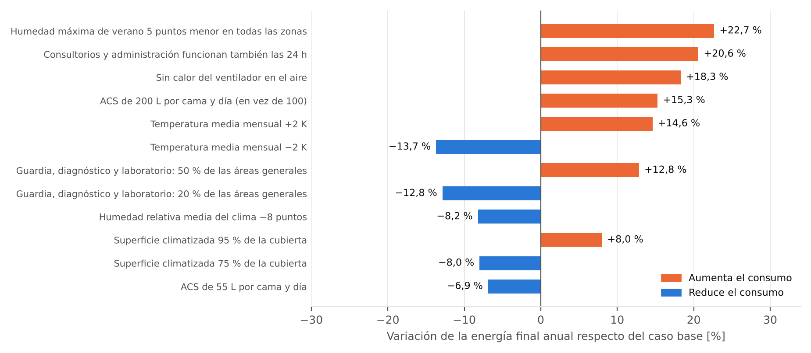

::: {custom-style="Nota"}
**Para qué sirve esta memoria.** El informe técnico explica las decisiones y sus motivos; acá está el desarrollo ordenado de las ecuaciones, los datos, las hipótesis, las unidades y los resultados, como pide la consigna. Todas las cifras salen del código (`calculo/`) y el documento se regenera con él (`python -m calculo.construir_documentos`). Cada dato lleva su nivel de respaldo: **visto** (documento recibido y leído), **cita** (fuente secundaria vista en una búsqueda; falta cotejar con la fuente original), **propio** (cálculo o criterio nuestro con su lógica) o **recordado** (de memoria, sin fuente a mano).
:::

# 1. Hipótesis y frontera

1. En cada estado considerado el régimen es permanente; cada mes se parte en una mitad diurna y una nocturna.
2. El aire húmedo es una mezcla de aire seco y vapor, ambos gases ideales, a 101,325 kPa.
3. Sistema de caudal constante con serpentina y recalentamiento, sin economizador ni recuperación de calor: es la línea de base (alternativa A).
4. El ventilador de impulsión aspira después de la serpentina y toda su potencia eléctrica se disipa como calor en el aire.
5. El refrigerante cumple un ciclo de compresión de vapor con compresor adiabático de rendimiento isentrópico constante, expansión isoentálpica y sin pérdidas de presión. La evaporación es fija a {{T_ev}} °C, el COP depende de la temperatura de condensación del estado y no de la carga (no hay curva de carga parcial) y el motor del compresor está fuera de la corriente de refrigerante.
6. Combustión completa del gas natural, gases ideales y sin disociación; el aire tiene 21 % de O₂ y 79 % de N₂; los gases de escape salen a {{T_gases}} °C sin condensar.
7. **Frontera:** se calcula el sistema térmico y sus auxiliares (ventiladores de las unidades, ventiladores del condensador, bombas de agua helada). No se incluyen iluminación, equipos médicos, cocina, lavandería ni esterilización, por lo que **el resultado no es el consumo total del hospital**. No se modelan economizador, ventiladores de retorno y extracción, bombas de agua caliente ni pérdidas de distribución.

# 2. Aire húmedo

La humedad específica y la entalpía del aire húmedo, por kg de aire seco, son

$$\omega = 0\text{,}622\,\frac{p_v}{P - p_v}, \qquad h = 1\text{,}006\,T + \omega\,(2501 + 1\text{,}86\,T)$$

con $T$ en °C y $h$ en kJ/kg. La mezcla de aire exterior y de retorno conserva entalpía y humedad: $\dot m_a h_{mez} = \dot m_{ae} h_{ext} + \dot m_{ar} h_{ret}$ y la misma relación para $\omega$. La serpentina enfría hasta $T_c$ y deshumidifica hasta $\omega_c$, con el aire a la salida al {{HR_serp}} % de humedad relativa:

$$\dot Q_{serp} = \dot m_a\left[(h_{mez} - h_c) - (\omega_{mez} - \omega_c)\,h_f\right], \qquad \dot Q_{lat} = \dot m_a\,(\omega_{mez} - \omega_c)\,h_{fg}$$

donde $h_f = 4\text{,}186\,T_c$ es la entalpía del condensado y la parte sensible es la diferencia. El recalentador lleva el aire a $T_{obj}$, que es la temperatura de impulsión menos el calentamiento que producirá el ventilador:

$$\dot Q_{rec} = \dot m_a\,c_{p,ah}\,(T_{obj} - T_c), \qquad T_{obj} = T_{imp} - \frac{\dot W_{vent}}{\dot m_a\,c_{p,ah}}, \qquad c_{p,ah} = 1\text{,}006 + 1\text{,}86\,\omega$$

El estado de impulsión sale del balance de la zona. Con la actividad $f_{act}$, la fracción de envolvente expuesta $f_{env}$, la conductancia $U$ por m² de piso expuesto ({{UA}} W/(m² K)) y la ganancia solar $q_{sol}$ (en W/m², como las ganancias internas de plena actividad $q_s$ y $q_l$):

$$\dot Q_s = A\left[q_s\,f_{act} + f_{env}\,\big(U\,(T_{ext} - T_r) + q_{sol}\big)\right], \qquad \dot Q_l = A\,q_l\,f_{act}$$

$$T_{imp} = T_r - \frac{\dot Q_s}{\dot m_a\,c_{p,ah}}, \qquad \omega_{imp} = \omega_r - \frac{\dot Q_l}{\dot m_a\,h_{fg}}, \qquad \dot W_{vent} = \frac{\dot V\,\Delta p}{\eta_{vent}}$$

con $T_r$ y $\omega_r$ la temperatura y la humedad específica de consigna de la zona (el retorno está en ese estado), $\dot V = \dot m_a/\rho$ y las cargas pasadas a kW al dividir por $\dot m_a\,c_{p,ah}$; $T_{imp}$ queda limitada entre 13 y 35 °C, $h_{fg} = 2501$ kJ/kg, $\eta_{vent} = {{eta_vent_m}}$ y $\rho = 1\text{,}2$ kg/m³. La serpentina lleva el aire a $\omega_c = \omega_{imp}$ con la temperatura de salida que corresponde a la saturación parcial indicada; si esa temperatura supera $T_{obj}$, enfría hasta $T_{obj}$. El caudal de impulsión es el mayor entre el que fijan las renovaciones y el que pide la carga sensible, y el de aire exterior se fija en valor absoluto. En invierno, si el aire sale más seco que la humedad mínima de la zona, se humidifica con vapor.

**Estados del aire en el quirófano, verano pico** (zona G1, {{m_sup_G1}} kg/s de aire seco):

{{tabla_psicro}}

Table: Tabla M1. Estados del aire en el quirófano (A a F). Las diferencias de una décima entre valores se deben al redondeo.

{width=13cm}

# 3. Refrigeración

Para el ciclo con entalpías $h_1$ a $h_4$ (estados de la tabla M2), por kg de refrigerante:

$$q_L = h_1 - h_4, \qquad w = h_2 - h_1 = \frac{h_{2s} - h_1}{\eta_{is}}, \qquad q_H = h_2 - h_3$$

$$COP_{eje} = \frac{q_L}{w}, \qquad COP_{el} = \frac{q_L}{w/\eta_{mot}}, \qquad COP_{Carnot} = \frac{T_{ev}}{T_{cond} - T_{ev}}$$

$$\dot W_{comp} = \frac{\dot Q_L}{COP_{el}}, \qquad \dot Q_{cond} = \dot Q_L + \eta_{mot}\,\dot W_{comp}$$

El rendimiento del motor es $\eta_{mot} = {{eta_motor_m}}$ y el COP de Carnot usa temperaturas absolutas (K). La temperatura de condensación sigue al clima: $T_{cond} = \max(T_{ext} + {{dT_cond}}\ \text{K},\ {{T_cond_min}}\ °C)$. Los ventiladores del condensador consumen el {{f_vent_cond}} % del calor rechazado y las bombas se calculan con el caudal de agua helada (salto de {{dT_ah}} K), {{dP_bomba}} kPa de presión y {{eta_bomba}} de rendimiento total.

{{tabla_ciclo}}

Table: Tabla M2. Estados del ciclo de refrigeración al punto de diseño de verano. Las diferencias de una décima entre valores se deben al redondeo.

{width=12cm}

# 4. Combustión

La reacción por kmol de gas natural, con relación de aire $\lambda$ = {{lambda}} (el oxígeno estequiométrico es $a_{st}$ = {{o2_st}} kmol y el real, $\lambda\,a_{st}$; coeficientes en kmol, redondeados a tres decimales), es

$${{gas_CH4_m}}\,\text{CH}_4 + {{gas_C2H6_m}}\,\text{C}_2\text{H}_6 + {{gas_C3H8_m}}\,\text{C}_3\text{H}_8 + {{gas_N2_m}}\,\text{N}_2 + {{gas_CO2_m}}\,\text{CO}_2 + {{o2_reac_m}}\left(\text{O}_2 + \tfrac{79}{21}\,\text{N}_2\right) \rightarrow {{co2_prod_m}}\,\text{CO}_2 + {{h2o_prod_m}}\,\text{H}_2\text{O} + {{n2_prod_m}}\,\text{N}_2 + {{o2_prod_m}}\,\text{O}_2$$

Los poderes caloríficos salen de las entalpías de formación, con agua líquida en los productos para el superior (PCS) y vapor para el inferior (PCI). El rendimiento de la caldera se calcula por el balance de los gases de escape, y el combustible necesario para entregar un calor útil $Q_{util}$ es

$$\eta = 1 - q_{gases} - f_{rad}, \qquad q_{gases} = \frac{H_{prod}(T_{gases}) - H_{reac}(T_{aire})}{PCI}, \qquad E_{PCS} = \frac{Q_{util}}{\eta}\cdot\frac{PCS}{PCI}$$

donde $H$ son las entalpías sensibles respecto de 25 °C (calores específicos de gas ideal de CoolProp), $T_{aire}$ = {{T_aire_comb}} °C y $f_{rad}$ = {{f_rad}} % del PCI son las pérdidas por radiación y funcionamiento (supuesto).

| Magnitud | Valor |
|---|---|
| Poder calorífico superior | {{PCS_kcal}} kcal/m³ = {{PCS_kWh}} kWh/m³ (m³ estándar a 15 °C) |
| Poder calorífico inferior | {{PCI_kWh}} kWh/m³ (relación PCS/PCI = {{PCS_PCI}}) |
| Pérdida por gases de escape ({{T_gases}} °C) | {{q_gases}} % del PCI |
| Pérdida por radiación y funcionamiento (supuesto) | {{f_rad}} % del PCI |
| **Rendimiento de la caldera** | **{{eta_PCI}} % sobre PCI** ({{eta_PCS}} % sobre PCS) |
| Temperatura de rocío de los gases | {{T_rocio}} °C (fracción molar de agua: {{y_H2O}} %) |
| Temperatura de llama adiabática teórica (sin disociación) | {{T_llama}} °C |
| Gas por kWh de calor útil | {{gas_m3_kWh}} m³ |
| Emisión de CO₂ del gas, de la reacción | {{co2_gas_kg}} kg por kWh de PCI ({{co2_gas_GJ}} kg/GJ) |

Table: Tabla M3. Combustión del gas natural y rendimiento de la caldera.

**Caldera de condensación.** Si los gases salen por debajo del punto de rocío, condensa parte del agua formada y se recupera su calor latente. Por kmol de combustible, con entalpías de formación:

$$Q_{util} = PCI + n_{cond}\,L - \sum_i n_i\,\Delta h_i(T_{gases}) + H_{reac} - f_{rad}\,PCI, \qquad n_{cond} = n_{H_2O} - n_{seco}\,\frac{p_{sat}(T_{gases})/P}{1 - p_{sat}(T_{gases})/P}$$

con $L$ = 44.010 kJ/kmol el calor latente del agua a 25 °C. A {{T_gases_cond}} °C condensan {{frac_cond_cald}} % del agua y el rendimiento sube a {{eta_cond_PCI}} % sobre PCI ({{eta_cond_PCS}} % sobre PCS).

# 5. ACS y consumo anual

El ACS se calcula desde el consumo por cama, no desde una potencia por m²:

$$\dot Q_{ACS} = \frac{L\cdot N_{camas}\cdot 4\text{,}186\,(T_{ACS} - T_{red})\cdot f_{perd}}{86\,400}$$

con $L$ = {{L_cama}} L/(cama día), $N_{camas}$ = {{camas_tot}}, $T_{ACS}$ = {{T_acs}} °C, $T_{red}$ = {{T_red}} °C, $f_{perd}$ = {{f_perd}}, agua de 1 kg/L y resultado en kW (media de las 8.760 h del año; el modelo no calcula el pico).

Cada mes se representa con dos estados de $12\,d_i$ horas ($d_i$ son los días del mes): uno diurno $(T_i + {{dT_dia_m}}\,\text{K})$ y uno nocturno $(T_i - {{dT_dia_m}}\,\text{K})$, con la humedad específica media del mes limitada a la saturación. La estación de cada estado se decide por su temperatura exterior: verano (consignas de verano, con deshumidificación y recalentamiento) si $T \geq$ {{T_cambio}} °C e invierno (consignas de invierno, con calefacción y humidificación) si no, sin histéresis; el resultado es sensible a ese umbral. En cada estado se calculan las cargas de las cinco zonas, la planta de frío con la temperatura exterior del estado y el calor de la caldera, y se multiplican por las horas. Se prefirió este método a las horas equivalentes a plena carga porque la ventilación es continua y un número de horas la representa mal.

{width=14cm}

{{tabla_usos}}

Table: Tabla M4. Consumo anual por uso final. Los totales pueden diferir en 1 MWh de la suma de las filas por redondeo. La humidificación con vapor no aparece porque, con estados medios mensuales, el aire exterior nunca queda lo bastante seco; en el día de diseño de invierno pediría {{Q_hum_inv}} kW.

La energía final suma electricidad y gas (PCS) kWh a kWh, sin ponderar por energía primaria.

# 6. Sensibilidad

{{tabla_sens}}

Table: Tabla M5. Las 12 variaciones que más mueven la energía final (caso base: {{E_total_MWh}} MWh).

{width=14.5cm}

# 7. Alternativa B y mejoras: modelo

Todas las variantes se calculan con `calculo/mejoras.py`, que repite el cálculo anual con opciones y da exactamente el caso base si no se activa ninguna (lo verifica un test).

- **B, recuperación del calor del condensador.** En cada estado con demanda de recalentamiento y calefacción $\dot Q_{dem}$ y frío en marcha, se elige el mejor entre tres modos: (1) sin recuperar; (2) solo el sobrecalentamiento de la descarga del compresor, sin cambiar la condensación; (3) un condensador de recuperación que condensa a $T_{cond,rec} = T_{agua} + \Delta T_{min}$ = {{T_cond_rec}} °C, con el compresor funcionando a esa presión. El criterio es el mayor ahorro neto en energía final: $\dot Q_{rec}/\eta_{cald} - \Delta\dot W_{comp} - \Delta\dot W_{vent.cond}$. El calor recuperado es $\dot Q_{rec} = \min(f\,\dot Q_{dem},\ \dot Q_{cond})$ con $f$ la fracción de la demanda que coincide con el calor disponible ($f$ = 1 en el caso central; se prueba 0,75 y 0,5).
- **M1, caldera de condensación:** aplica a la calefacción y el recalentamiento del aire (agua a 50/40 °C); el ACS y el vapor se dejan con el rendimiento base.
- **M2, solar térmico para el ACS:** el calor útil mensual es $A\,\eta_{col}\,H_m\,d_m$ con $H_m$ la irradiación horizontal diaria media del mes, que se calcula con la irradiación extraterrestre de Duffie y Beckman (latitud {{lat}}°) y un índice de claridad único, $K_t$ = {{Kt}}, calibrado para que la suma anual sea {{GHI}} kWh/m². Nunca se usa más calor solar que la demanda del mes.
- **M3, recuperador de calor del aire de extracción** con circuito de agua (sin mezcla de corrientes): el aire exterior entra a la mezcla a $T_{oa} = T_{ext} + \varepsilon\,(T_r - T_{ext})$ con $\varepsilon$ = {{eps_rec}}; tiene bypass y trabaja solo en los estados en que baja el costo de energía, y suma la potencia de ventiladores por su caída de presión.
- **M4, ventiladores:** la presión de diseño de cada zona se multiplica por 0,8; el calor que el ventilador ya no cede al aire lo repone la caldera.
- **M5, fotovoltaica:** energía anual $= kWp \cdot GHI \cdot PR$, descontada de la electricidad del sistema.
- **Emisiones:** CO₂ del gas = energía de PCI por el factor de la reacción ({{co2_gas_kg}} kg/kWh); CO₂ de la electricidad = energía por el factor de la red ({{ef_elec}} t/MWh, cita secundaria: es una meta de CAMMESA para 2023).

{{tabla_mejoras_detalle}}

Table: Tabla M6. Resultados de cada variante respecto de la alternativa A.

{{tabla_params_mejoras}}

Table: Tabla M7. Parámetros de las mejoras y su respaldo.

# 8. Exergía: modelo y resultados

{{seccion_exergia_memoria}}

# 9. Selección de equipos: cálculos

{{seccion_equipos_memoria}}

# Anexo. Datos de entrada

La tabla M8 muestra {{n_anexo}} de los {{n_filas}} parámetros escalares; las tablas M9 y M10, las zonas y el clima. Estado de cada uno: **DATO** (leído de un documento recibido: E1, E3, E4 y E5 son del hospital base y S2 viene del artículo [H]), **SUPUESTO** (fundamentado pero sin fuente citable todavía) o **CONSTANTE** (convención de diseño o propiedad física). La tabla completa, con la justificación de cada uno, está en `informe/supuestos.md`.

::: {custom-style="Largo"}
{{tabla_anexo}}

Table: Tabla M8. Parámetros principales del modelo.
:::

{{tabla_zonas_memoria}}

Table: Tabla M9a. Zonas, consignas de verano, renovaciones mínimas (totales / de aire exterior), caudales y funcionamiento.

{{tabla_anexo_zonas}}

Table: Tabla M9. Parámetros de las zonas (todos supuestos; las renovaciones están en el informe). La actividad es la fracción de la ganancia interna de plena actividad que hay de día y de noche.

{{tabla_anexo_clima}}

Table: Tabla M10. Clima mensual aproximado, en dos semestres (supuesto de conocimiento general, a reemplazar con datos del SMN).
