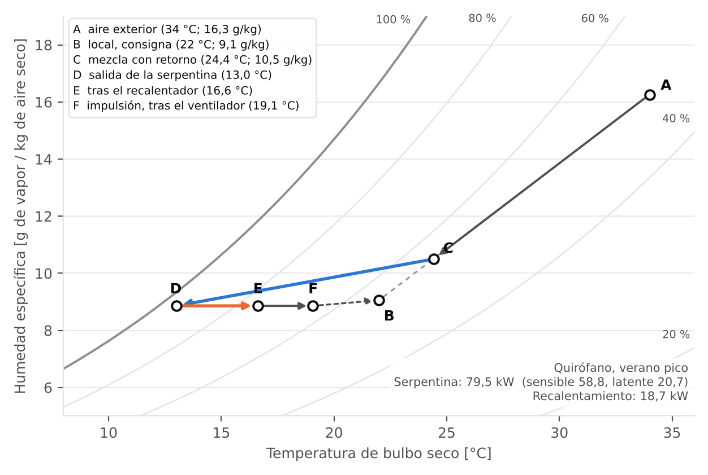
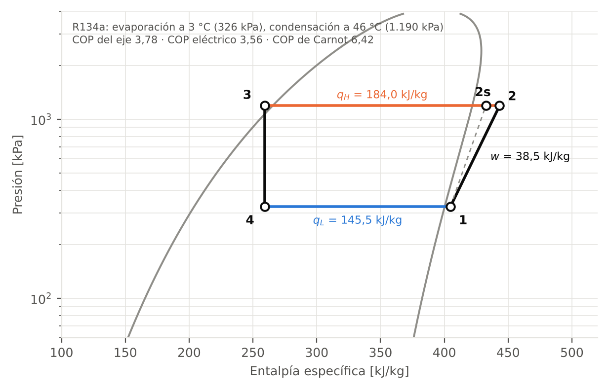
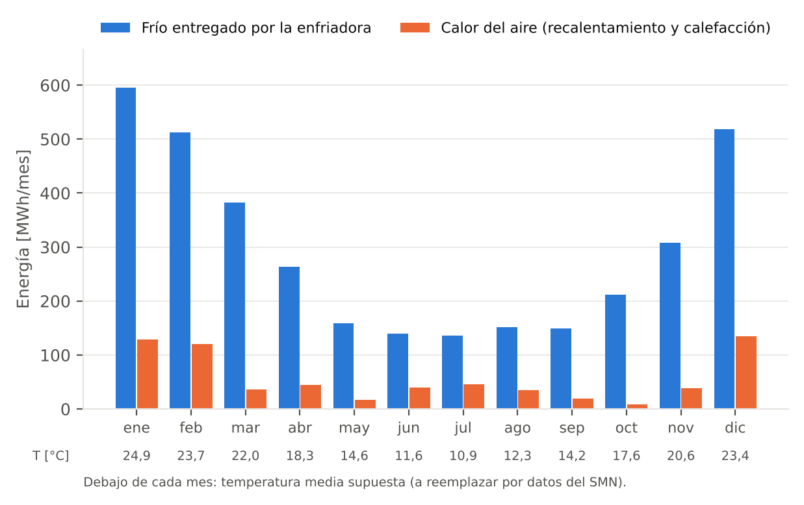
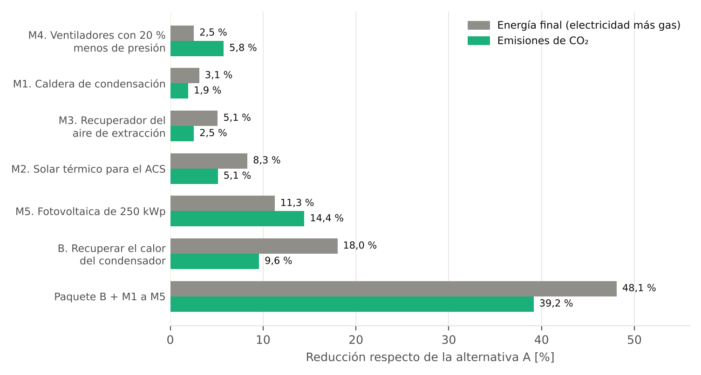

::: {custom-style="Nota"}
**Cómo se lee esta memoria.** El informe técnico explica las decisiones y sus motivos; acá están el desarrollo ordenado de las ecuaciones, los datos, las hipótesis, las unidades y los resultados. Los cálculos principales se resuelven con números (secciones 3 a 6) para poder seguirlos a mano: las diferencias de una unidad en la última cifra se deben al redondeo y, donde la cuenta lo exige, se imprimen más cifras. **Respaldo de cada dato:** [n] indica una fuente de la lista del anexo D (con asterisco, [n]\*, la fuente se conoce solo por un extracto de búsqueda y no se abrió el original); «supuesto» marca toda decisión o valor propio, con su motivo al lado; «constante» marca una constante física o un valor de tabla; lo que calcula el modelo no lleva marca. **Unidades:** SI; potencias en kW, energías anuales en MWh, temperaturas en °C (diferencias en K), presiones en kPa y humedad específica ω en g de vapor por kg de aire seco en las tablas (kg/kg en las ecuaciones).
:::

**Contenido.**

1. [Sistemas de estudio, frontera e hipótesis](#sec-sistemas)
2. [Estados de las corrientes y propiedades usadas](#sec-estados)
3. [Aire húmedo: ecuaciones, caso resuelto (quirófanos) y cargas de diseño por zona](#sec-aire)
4. [Refrigeración: ciclo de R134a, COP y calor rechazado](#sec-refrigeracion)
5. [Combustión: reacción, poder calorífico, rendimiento y consumo de gas](#sec-combustion)
6. [Agua caliente sanitaria y consumo anual](#sec-anual)
7. [Sensibilidad](#sec-sensibilidad)
8. [Alternativa B y mejoras](#sec-mejoras)
9. [Exergía: modelo y resultados](#sec-exergia)
10. [Selección de equipos y ubicación](#sec-equipos)

Anexos: A, cifras del informe y dónde se calculan; B, verificación del cálculo; C, datos de entrada; D, referencias.

**Nomenclatura.**

{{tabla_nomenclatura}}

**Siglas.** ACS: agua caliente sanitaria; UTA: unidad de tratamiento de aire; PCI y PCS: poder calorífico inferior y superior del gas natural; HEPA: filtro de alta eficiencia; N+1: una unidad de reserva por encima de las necesarias; PCA: potencial de calentamiento atmosférico. Subíndices: *serp* serpentina, *rec* recalentador, *lat* y *sens* latente y sensible, *mez* mezcla, *imp* impulsión, *ev* evaporador, *cond* condensador, *mot* motor.

# 1. Sistemas de estudio, frontera e hipótesis {#sec-sistemas}

## 1.1 Sistemas de estudio y límites

El sistema térmico se divide en cuatro sistemas de estudio, cada uno un volumen de control en régimen permanente en cada estado considerado. La tabla Msist da sus límites y los flujos que los cruzan; la figura Mesq los muestra en conjunto (las letras A a F son los estados del aire de la tabla Mpsicro).

{width=14cm}

{{tabla_sistemas}}

Table: Tabla Msist. Sistemas de estudio, límites y flujos que los cruzan. Los ventiladores del condensador y las bombas de agua helada quedan fuera de los límites y se cuentan como electricidad auxiliar.

Cada sistema tiene su balance: masa y energía del aire húmedo en la UTA (sección 3), primera ley del ciclo en la enfriadora (sección 4), balance molar y de energía de la reacción en la caldera (sección 5) y demanda de calor del ACS (sección 6). La exergía se evalúa sobre los mismos sistemas (sección 9).

## 1.2 Frontera del modelo

El modelo es el **sistema térmico** (frío, recalentamiento, calefacción, humidificación y ACS) **y sus auxiliares** (ventiladores de las unidades, ventiladores del condensador y bombas de agua helada). Por eso los {{E_total_MWh}} MWh por año ({{i_cub}} kWh/m² de superficie cubierta) **no son el consumo total del hospital**: no incluyen iluminación, equipos médicos, cocina, lavandería ni esterilización. No se modelan economizador, ventiladores de retorno y extracción, bombas de agua caliente ni pérdidas de distribución. Con las participaciones del sistema térmico en el consumo total que cita {{R_hospitecnia}} ({{part_min}} a {{part_max}} %), el edificio completo equivaldría a {{eq_min}} a {{eq_max}} kWh/m² (cálculo propio: {{i_cub}} dividido por la participación).

## 1.3 Hipótesis y simplificaciones

1. En cada estado considerado el régimen es permanente; cada mes se parte en una mitad diurna y una nocturna.
2. El aire húmedo es una mezcla de aire seco y vapor, ambos gases ideales, a 101,325 kPa.
3. Cada zona (G1 a G5) es un sistema de aire de caudal constante con serpentina y recalentamiento, sin economizador ni recuperación de calor: es la línea de base (alternativa A). El retorno está en el estado de consigna de la zona y no hay exfiltración.
4. El ventilador de impulsión aspira después de la serpentina y toda su potencia eléctrica se disipa como calor en el aire.
5. El refrigerante cumple un ciclo de compresión de vapor con compresor adiabático de rendimiento isentrópico constante, expansión isoentálpica y sin pérdidas de presión. La evaporación es fija a {{T_ev}} °C, el COP depende de la temperatura de condensación del estado y no de la carga (no hay curva de carga parcial) y el motor del compresor está fuera de la corriente de refrigerante.
6. Combustión completa del gas natural, gases ideales y sin disociación; el aire tiene 21 % de O₂ y 79 % de N₂; los gases de escape salen a {{T_gases}} °C sin condensar.
7. **Punto de diseño de verano:** exterior a {{T_ext_ver}} °C de bulbo seco y {{Tbh_ver}} °C de bulbo húmedo, ganancias internas a plena actividad en todas las zonas a la vez ($f_{act}$ = 1) y ganancia solar pico ($q_{sol}$ = {{mx_q_sol_pico}} W/m²). **Punto de diseño de invierno:** 2 °C y 80 % de humedad relativa, sin ganancias internas ni solares.

# 2. Estados de las corrientes y propiedades usadas {#sec-estados}

## 2.1 Estados de las demás corrientes

Los estados del aire húmedo (A a F) están en la tabla Mpsicro y los del refrigerante (1 a 4), en la tabla Mciclo. La tabla Mestcorr da los de las demás corrientes. Para el agua, $h = c_p\,T$ con $c_p$ = 4,186 kJ/(kg K) (referencia: líquido a 0 °C); para el aire de combustión y los gases, $h$ es la entalpía sensible por kmol respecto de 25 °C, que es la referencia de las entalpías de formación.

{{tabla_estados_corrientes}}

Table: Tabla Mestcorr. Estados de las corrientes de combustible, aire de combustión, gases de escape, agua helada, agua caliente, ACS y aire exterior de invierno. En los circuitos cerrados la presión absoluta no interviene en el cálculo.

## 2.2 Propiedades usadas y de dónde salen

{{tabla_propiedades}}

Table: Tabla Mprop. Propiedades termodinámicas usadas, su fuente y dónde se aplican.

{{mx_linea_r134a}}

# 3. Aire húmedo {#sec-aire}

## 3.1 Ecuaciones

La humedad específica y la entalpía del aire húmedo, por kg de aire seco, son

$$\omega = 0\text{,}622\,\frac{p_v}{P - p_v}, \qquad h = 1\text{,}006\,T + \omega\,(2501 + 1\text{,}86\,T)$$

con $T$ en °C y $h$ en kJ/kg. La mezcla de aire exterior y de retorno conserva la masa de aire seco, la masa de agua y la entalpía: $\dot m_a = \dot m_{ae} + \dot m_{ar}$, $\dot m_a\,\omega_{mez} = \dot m_{ae}\,\omega_{ext} + \dot m_{ar}\,\omega_{ret}$ y $\dot m_a\,h_{mez} = \dot m_{ae}\,h_{ext} + \dot m_{ar}\,h_{ret}$. La serpentina enfría hasta $T_c$ y deshumidifica hasta $\omega_c$, con el aire a la salida al {{HR_serp}} % de humedad relativa, y retira el condensado $\dot m_{cond} = \dot m_a\,(\omega_{mez} - \omega_c)$:

$$\dot Q_{serp} = \dot m_a\left[(h_{mez} - h_c) - (\omega_{mez} - \omega_c)\,h_f\right], \qquad \dot Q_{lat} = \dot m_a\,(\omega_{mez} - \omega_c)\,h_{fg}$$

donde $h_f = 4\text{,}186\,T_c$ es la entalpía del condensado y la parte sensible es la diferencia. El recalentador lleva el aire a $T_{obj}$, que es la temperatura de impulsión menos el calentamiento que producirá el ventilador:

$$\dot Q_{rec} = \dot m_a\,c_{p,ah}\,(T_{obj} - T_c), \qquad T_{obj} = T_{imp} - \frac{\dot W_{vent}}{\dot m_a\,c_{p,ah}}, \qquad c_{p,ah} = 1\text{,}006 + 1\text{,}86\,\omega$$

El estado de impulsión sale del balance de la zona. Con la actividad $f_{act}$, la fracción de envolvente expuesta $f_{env}$, la conductancia $U$ por m² de piso expuesto ({{UA}} W/(m² K)) y la ganancia solar $q_{sol}$ (en W/m², como las ganancias internas de plena actividad $q_s$ y $q_l$):

$$\dot Q_s = A\left[q_s\,f_{act} + f_{env}\,\big(U\,(T_{ext} - T_r) + q_{sol}\big)\right], \qquad \dot Q_l = A\,q_l\,f_{act}$$

$$T_{imp} = T_r - \frac{\dot Q_s}{\dot m_a\,c_{p,ah}}, \qquad \omega_{imp} = \omega_r - \frac{\dot Q_l}{\dot m_a\,h_{fg}}, \qquad \dot W_{vent} = \frac{\dot V\,\Delta p}{\eta_{vent}}$$

con $T_r$ y $\omega_r$ la temperatura y la humedad específica de consigna de la zona (el retorno está en ese estado), $\dot V = \dot m_a/\rho$ y las cargas pasadas a kW al dividir por $\dot m_a\,c_{p,ah}$; $T_{imp}$ queda limitada entre 13 y 35 °C, $h_{fg} = 2501$ kJ/kg, $\eta_{vent} = {{eta_vent_m}}$ y $\rho = 1\text{,}2$ kg/m³. La serpentina lleva el aire a $\omega_c = \omega_{imp}$ con la temperatura de salida que corresponde a la saturación parcial indicada; si esa temperatura supera $T_{obj}$, enfría hasta $T_{obj}$. El caudal de impulsión es el mayor entre el que fijan las renovaciones y el que pide la carga sensible, $\dot m_{sens} = \dot Q_s/[c_{p,ah}\,(T_r - 13)]$, y el de aire exterior se fija en valor absoluto. En invierno, si el aire sale más seco que la humedad mínima de la zona, se humidifica con vapor.

## 3.2 Caso resuelto: quirófanos (G1) en verano pico

**Punto de diseño.** Es el que dimensiona la enfriadora y los caudales: exterior a {{T_ext_ver}} °C de bulbo seco y {{Tbh_ver}} °C de bulbo húmedo ($\omega_{ext}$ = {{mx_g1_Wext}} g/kg), ganancias internas a **plena actividad** ($f_{act}$ = 1 en todas las zonas a la vez) y ganancia solar pico ($q_{sol}$ = {{mx_q_sol_pico}} W/m²). El 0,8 de actividad diurna que figura para G1 en la tabla de zonas (anexo C) y los {{mx_q_sol_dia}} W/m² de ganancia solar media pertenecen al cálculo anual, que usa la actividad y la radiación medias de cada mitad del día; el punto de diseño es deliberadamente más exigente. En G1, sin envolvente expuesta ($f_{env}$ = 0), la conducción y el sol no intervienen: solo importa $f_{act}$.

**Datos de G1** (los seis quirófanos juntos): $A$ = {{mx_g1_A}} m²; altura libre de {{mx_g1_h}} m; {{mx_g1_ach}} renovaciones totales por hora y {{mx_g1_ach_oa}} de aire exterior {{R_ashrae170}}; consigna de {{mx_g1_Tr}} °C y {{mx_g1_hr}} % de humedad relativa; $q_s$ = {{mx_g1_qs}} W/m² y $q_l$ = {{mx_g1_ql}} W/m² (supuestos, actividad típica de un quirófano); $\Delta p$ = {{mx_g1_dp}} Pa y $\eta_{vent}$ = {{mx_g1_eta}}.

**1. Caudales.** El caudal de impulsión lo fijan las renovaciones:

$$\dot V = {{mx_g1_ach_m}} \cdot {{mx_g1_A_m}} \cdot {{mx_g1_h_m}} = {{mx_g1_V_m}}\ \text{m}^3/\text{h} = {{mx_g1_Vs_m}}\ \text{m}^3/\text{s}, \qquad \dot m_a = \rho\,\dot V = 1\text{,}2 \cdot {{mx_g1_Vs_m}} = {{mx_g1_ma_m}}\ \text{kg/s}$$

El aire exterior son {{mx_g1_ach_oa}} de las {{mx_g1_ach}} renovaciones: $\dot m_{ae}$ = {{mx_g1_mae}} kg/s y $x_{ae} = \dot m_{ae}/\dot m_a$ = {{mx_g1_xae}}. El caudal que pediría solo la carga sensible es $\dot m_{sens} = \dot Q_s/[c_{p,ah}\,(T_r - 13)] = {{mx_g1_Qs_m}}/[{{mx_g1_cpr_m}}\,({{mx_g1_Tr_m}} - 13)] = {{mx_g1_msens_m}}\ \text{kg/s}$ ({{mx_g1_msens_V}} m³/h, {{mx_g1_msens_ach}} renovaciones por hora), {{mx_g1_ratio}} veces menos que las {{mx_g1_ach}} de la norma: **en el quirófano manda la norma, no la carga térmica**.

**2. Estados del aire** (tabla Mpsicro). El exterior (A) y el retorno (B, en el estado de consigna) se mezclan (C):

$$h_{mez} = x_{ae}\,h_{ext} + (1 - x_{ae})\,h_{ret} = {{mx_g1_xae_m}} \cdot {{mx_g1_hext_m}} + {{mx_g1_xret_m}} \cdot {{mx_g1_hret_m}} = {{mx_g1_hmez_m}}\ \text{kJ/kg}$$

$$\omega_{mez} = {{mx_g1_xae_m}} \cdot {{mx_g1_Wext_m}} + {{mx_g1_xret_m}} \cdot {{mx_g1_Wr_m}} = {{mx_g1_Wmez_m}}\ \text{g/kg}, \qquad T_{mez} = {{mx_g1_Tmez_m}}\ °\text{C}$$

**3. Cargas de la zona y estado de impulsión.** Con $f_{env}$ = 0:

$$\dot Q_s = A\,q_s\,f_{act} = {{mx_g1_A_m}} \cdot {{mx_g1_qs_m}} \cdot 1 = {{mx_g1_Qs_m}}\ \text{kW}, \qquad \dot Q_l = {{mx_g1_A_m}} \cdot {{mx_g1_ql_m}} \cdot 1 = {{mx_g1_Ql_m}}\ \text{kW}$$

$$c_{p,ah} = 1\text{,}006 + 1\text{,}86 \cdot {{mx_g1_Wr_k_m}} = {{mx_g1_cpr_m}}\ \text{kJ/(kg K)}, \qquad T_{imp} = {{mx_g1_Tr_m}} - \frac{ {{mx_g1_Qs_m}} }{ {{mx_g1_ma_m}} \cdot {{mx_g1_cpr_m}} } = {{mx_g1_Timp_m}}\ °\text{C}$$

$$\omega_{imp} = {{mx_g1_Wr_m}} - \frac{ {{mx_g1_Ql_m}} }{ {{mx_g1_ma_m}} \cdot 2501 } \cdot 10^3 = {{mx_g1_Wc_m}}\ \text{g/kg}$$

**4. Ventilador y temperatura objetivo del recalentador.**

$$\dot W_{vent} = \frac{\dot V\,\Delta p}{\eta_{vent}} = \frac{ {{mx_g1_Vs_m}} \cdot {{mx_g1_dp_kPa_m}} }{ {{mx_g1_eta_m}} } = {{mx_g1_Wvent_m}}\ \text{kW}, \qquad \Delta T_{vent} = \frac{ {{mx_g1_Wvent_m}} }{ {{mx_g1_ma_m}} \cdot {{mx_g1_cpr_m}} } = {{mx_g1_dTvent_m}}\ \text{K}$$

$$T_{obj} = T_{imp} - \Delta T_{vent} = {{mx_g1_Timp3_m}} - {{mx_g1_dTvent_m}} = {{mx_g1_Tobj_m}}\ °\text{C}$$

**5. Serpentina.** La serpentina lleva el aire a $\omega_c$ = {{mx_g1_Wc}} g/kg; con 95 % de humedad relativa a la salida resulta $T_c$ = {{mx_g1_Tc2}} °C y $h_c$ = {{mx_g1_hc}} kJ/kg, y el condensado sale a esa temperatura: $h_f = 4\text{,}186 \cdot {{mx_g1_Tc_m}} = {{mx_g1_hf_m}}$ kJ/kg. Se condensan $\dot m_{cond} = {{mx_g1_ma_m}} \cdot ({{mx_g1_Wmez_m}} - {{mx_g1_Wc_m}}) \cdot 10^{-3} = {{mx_g1_mcond_gs_m}}$ g/s ({{mx_g1_mcond_h}} kg/h).

$$\dot Q_{serp} = {{mx_g1_ma_m}}\,\big[({{mx_g1_hmez_m}} - {{mx_g1_hc_m}}) - {{mx_g1_dWk_m}} \cdot {{mx_g1_hf_m}}\big] = {{mx_g1_ma_m}} \cdot {{mx_g1_corchete_m}} = {{mx_g1_Qserp_m}}\ \text{kW}$$

$$\dot Q_{lat} = {{mx_g1_ma_m}} \cdot {{mx_g1_dWk_m}} \cdot 2501 = {{mx_g1_Qlat_m}}\ \text{kW}, \qquad \dot Q_{sens} = {{mx_g1_Qserp_m}} - {{mx_g1_Qlat_m}} = {{mx_g1_Qsens_m}}\ \text{kW}$$

**6. Recalentador.** Con $c_{p,ah} = 1\text{,}006 + 1\text{,}86 \cdot {{mx_g1_Wc_k_m}} = {{mx_g1_cpc_m}}$ kJ/(kg K):

$$\dot Q_{rec} = \dot m_a\,c_{p,ah}\,(T_{obj} - T_c) = {{mx_g1_ma_m}} \cdot {{mx_g1_cpc_m}} \cdot ({{mx_g1_Tobj_m}} - {{mx_g1_Tc_m}}) = {{mx_g1_ma_m}} \cdot {{mx_g1_cpc_m}} \cdot {{mx_g1_dTobj_m}} = {{mx_g1_Qrec_m}}\ \text{kW}$$

El aire sale del recalentador a {{mx_g1_Tobj2}} °C, el ventilador lo calienta {{mx_g1_dTvent2}} K y se impulsa a {{mx_g1_Timp}} °C con {{mx_g1_hr_imp}} % de humedad relativa.

{{tabla_psicro_m}}

Table: Tabla Mpsicro. Estados del aire en el quirófano (A a F), verano pico, con las cifras necesarias para repetir a mano las cuentas de este apartado.

{width=12cm}

## 3.3 Cargas de diseño de verano por zona

La misma cuenta, con $f_{act}$ = 1 y $q_{sol}$ = {{mx_q_sol_pico}} W/m², da la carga de cada zona (tabla Mcargas). En G2 a G5 la envolvente expuesta ($f_{env}$ = 0,5 en G2 y 1 en las demás) suma conducción y sol: $\dot Q_s = A\,[q_s + f_{env}\,(U\,(T_{ext} - T_r) + q_{sol})]$. Solo G1 recalienta en el punto de diseño: en las demás zonas el aire sale de la serpentina a $T_{obj}$ (el calor del ventilador alcanza para llegar a la temperatura de impulsión) y no hace falta recalentar. La carga frigorífica de diseño es la suma de las serpentinas:

$$\dot Q_L = \sum_{zona} \dot Q_{serp} = {{mx_cargas_suma_m}} = {{mx_QL_m}}\ \text{kW}\quad({{mx_QL_wm2}}\ \text{W/m}^2\text{ cubierto})$$

{{tabla_cargas}}

Table: Tabla Mcargas. Cargas de diseño por zona: serpentina en verano pico (sensible y latente) y recalentador; calefacción y humidificación en el punto de diseño de invierno. Los totales pueden diferir en 1 kW de la suma de las filas por redondeo.

# 4. Refrigeración: ciclo de R134a, COP y calor rechazado {#sec-refrigeracion}

## 4.1 Ecuaciones

Para el ciclo con entalpías $h_1$ a $h_4$ (estados de la tabla Mciclo), por kg de refrigerante:

$$q_L = h_1 - h_4, \qquad w = h_2 - h_1 = \frac{h_{2s} - h_1}{\eta_{is}}, \qquad q_H = h_2 - h_3$$

$$COP_{eje} = \frac{q_L}{w}, \qquad COP_{el} = \frac{q_L}{w/\eta_{mot}}, \qquad COP_{Carnot} = \frac{T_{ev}}{T_{cond} - T_{ev}}$$

$$\dot W_{comp} = \frac{\dot Q_L}{COP_{el}}, \qquad \dot m_{ref} = \frac{\dot Q_L}{q_L}, \qquad \dot Q_{cond} = \dot Q_L + \eta_{mot}\,\dot W_{comp} = \dot m_{ref}\,q_H$$

El rendimiento del motor es $\eta_{mot} = {{eta_motor_m}}$ y el COP de Carnot usa temperaturas absolutas (K). La temperatura de condensación sigue al clima: $T_{cond} = \max(T_{ext} + {{dT_cond}}\ \text{K},\ {{T_cond_min}}\ °C)$. Los ventiladores del condensador consumen el {{f_vent_cond}} % del calor rechazado, $\dot W_{cond} = 0\text{,}025\,\dot Q_{cond}$, y las bombas se calculan con el caudal de agua helada (salto de {{dT_ah}} K), {{dP_bomba}} kPa de presión y {{eta_bomba}} de rendimiento total:

$$\dot m_w = \frac{\dot Q_L}{c_p\,\Delta T}, \qquad \dot W_{bomba} = \frac{\dot m_w}{\rho_w}\,\frac{\Delta p}{\eta_{bomba}}$$

## 4.2 Caso resuelto: punto de diseño de verano

Con $\dot Q_L$ = {{mx_QL}} kW, $T_{ev}$ = {{T_ev}} °C ({{mx_cic_pev}} kPa) y $T_{cond}$ = máx({{T_ext_ver}} + {{dT_cond}}; {{T_cond_min}}) = {{mx_cic_Tcond}} °C ({{mx_cic_pc}} kPa). El estado 2 sale de $h_2 = h_1 + (h_{2s} - h_1)/\eta_{is} = {{mx_cic_h1_m}} + ({{mx_cic_h2s_m}} - {{mx_cic_h1_m}})/{{eta_is_m}} = {{mx_cic_h2_m}}$ kJ/kg.

{{tabla_ciclo_m}}

Table: Tabla Mciclo. Estados del ciclo de refrigeración al punto de diseño de verano (R134a).

$$q_L = h_1 - h_4 = {{mx_cic_h1_m}} - {{mx_cic_h4_m}} = {{mx_cic_qL_m}}\ \text{kJ/kg}, \qquad w = h_2 - h_1 = {{mx_cic_h2_m}} - {{mx_cic_h1_m}} = {{mx_cic_w_m}}\ \text{kJ/kg}$$

$$q_H = h_2 - h_3 = {{mx_cic_h2_m}} - {{mx_cic_h3_m}} = {{mx_cic_qH_m}}\ \text{kJ/kg}$$

$$COP_{eje} = \frac{ {{mx_cic_qL_m}} }{ {{mx_cic_w_m}} } = {{mx_cic_copeje_m}}, \qquad COP_{el} = {{mx_cic_copeje_m}} \cdot {{eta_motor_m}} = {{mx_cic_copel_m}}, \qquad COP_{Carnot} = \frac{ {{mx_cic_Tev_K_m}} }{ {{mx_cic_Tc_K_m}} - {{mx_cic_Tev_K_m}} } = {{mx_cic_carnot_m}}$$

El COP eléctrico es el {{mx_cic_etaII}} % del de Carnot. Con ellos:

$$\dot W_{comp} = \frac{ {{mx_QL_m}} }{ {{mx_cic_copel_m}} } = {{mx_cic_Wcomp_m}}\ \text{kW}, \qquad \dot m_{ref} = \frac{ {{mx_QL_m}} }{ {{mx_cic_qL_m}} } = {{mx_cic_mref_m}}\ \text{kg/s}$$

$$\dot Q_{cond} = {{mx_QL_m}} + {{eta_motor_m}} \cdot {{mx_cic_Wcomp_m}} = {{mx_cic_Qcond_m}}\ \text{kW} \quad (= {{mx_cic_mref_m}} \cdot {{mx_cic_qH_m}}\ \text{kW})$$

Auxiliares:

$$\dot W_{cond} = 0\text{,}025 \cdot {{mx_cic_Qcond_m}} = {{mx_cic_Wcond_m}}\ \text{kW}, \qquad \dot m_w = \frac{ {{mx_QL_m}} }{4\text{,}186 \cdot {{dT_ah_m}} } = {{mx_cic_mw_m}}\ \text{kg/s}, \qquad \dot W_{bomba} = \frac{ {{mx_cic_mw_m}} }{1.000} \cdot \frac{ {{dP_bomba_m}} }{ {{eta_bomba_m}} } = {{mx_cic_Wbomba_m}}\ \text{kW}$$

{width=11cm}

# 5. Combustión: reacción, poder calorífico, rendimiento y consumo de gas {#sec-combustion}

## 5.1 Reacción y poder calorífico

La reacción por kmol de gas natural, con relación de aire $\lambda$ = {{lambda}} (el oxígeno estequiométrico es $a_{st}$ = {{o2_st}} kmol y el real, $\lambda\,a_{st}$; coeficientes en kmol, redondeados a tres decimales), es

$${{gas_CH4_m}}\,\text{CH}_4 + {{gas_C2H6_m}}\,\text{C}_2\text{H}_6 + {{gas_C3H8_m}}\,\text{C}_3\text{H}_8 + {{gas_N2_m}}\,\text{N}_2 + {{gas_CO2_m}}\,\text{CO}_2 + {{o2_reac_m}}\left(\text{O}_2 + \tfrac{79}{21}\,\text{N}_2\right) \rightarrow {{co2_prod_m}}\,\text{CO}_2 + {{h2o_prod_m}}\,\text{H}_2\text{O} + {{n2_prod_m}}\,\text{N}_2 + {{o2_prod_m}}\,\text{O}_2$$

{{mx_atomos}}

Los poderes caloríficos salen de las entalpías de formación, con agua líquida en los productos para el superior (PCS) y vapor para el inferior (PCI). Para cada hidrocarburo $\text{C}_x\text{H}_y$, $PCI_i = x\,(-\Delta h_{f,CO_2}) + \tfrac{y}{2}\,(-\Delta h_{f,H_2O(g)}) + \Delta h_{f,i}$ y el de la mezcla es la suma ponderada por las fracciones molares:

$$PCI = \sum_i y_i\,PCI_i = {{mx_pci_suma_m}} = {{mx_pci_m}}\ \text{kJ/kmol}$$

{{tabla_pci}}

Table: Tabla Mpci. Poder calorífico inferior y superior de la mezcla: $PCI_i$ y $PCS_i$ de cada componente con las entalpías de formación de la tabla Mprop; los inertes (N₂ y CO₂) no aportan.

El volumen molar a 15 °C y 101,325 kPa es $v = R\,T/P = 8\text{,}3145 \cdot 288\text{,}15/101\text{,}325 = {{mx_vmolar_m}}$ m³/kmol, de modo que

$$PCI = \frac{ {{mx_pci_m}} }{ {{mx_vmolar_m}} } = {{mx_pci_m3_m}}\ \text{kJ/m}^3 = {{PCI_kWh_m}}\ \text{kWh/m}^3, \qquad PCS = \frac{ {{mx_pcs_m}} }{ {{mx_vmolar_m}} } = {{mx_pcs_m3_m}}\ \text{kJ/m}^3 = {{PCS_kWh_m}}\ \text{kWh/m}^3 = {{PCS_kcal_m}}\ \text{kcal/m}^3$$

## 5.2 Pérdida por gases, rendimiento y consumo de gas

El rendimiento de la caldera se calcula por el balance de los gases de escape, y el combustible necesario para entregar un calor útil $Q_{util}$ es

$$\eta = 1 - q_{gases} - f_{rad}, \qquad q_{gases} = \frac{H_{prod}(T_{gases}) - H_{reac}(T_{aire})}{PCI}, \qquad E_{PCS} = \frac{Q_{util}}{\eta}\cdot\frac{PCS}{PCI}$$

donde $H$ son las entalpías sensibles respecto de 25 °C (calores específicos de gas ideal de CoolProp), $T_{aire}$ = {{T_aire_comb}} °C y $f_{rad}$ = {{f_rad}} % del PCI son las pérdidas por radiación y funcionamiento (supuesto). Con los productos a {{T_gases}} °C (tabla Mgases):

$$H_{prod} = \sum_i n_i\,\Delta h_i({{T_gases}}\ °\text{C}) = {{mx_hprod_m}}\ \text{kJ/kmol}, \qquad H_{reac} = {{o2_reac_m}} \cdot ({{mx_dho2_m}}) + {{mx_n2aire_m}} \cdot ({{mx_dhn2_m}}) = {{mx_hreac_m}}\ \text{kJ/kmol}$$

$$q_{gases} = \frac{ {{mx_hprod_m}} - ({{mx_hreac_m}}) }{ {{mx_pci_m}} } = {{mx_qgases_m}}, \qquad \eta = 1 - {{mx_qgases_m}} - {{mx_frad_m}} = {{mx_eta_m}}$$

{{tabla_gases}}

Table: Tabla Mgases. Entalpía sensible de los gases de escape a {{T_gases}} °C respecto de 25 °C, por kmol de gas natural quemado.

El **consumo de gas de diseño** se calcula con la carga de la planta de calor, que es la de invierno más la punta de ACS (el doble de la media, supuesto):

$$\dot Q_{cal} = {{mx_Qinv_m}} + {{mx_f_punta_m}} \cdot {{mx_Qacs_med_m}} = {{mx_Qinv_m}} + {{mx_Qacs_punta_m}} = {{mx_Qdis_m}}\ \text{kW}, \qquad \dot E_{PCI} = \frac{ {{mx_Qdis_m}} }{ {{mx_eta_m}} } = {{mx_Epci_m}}\ \text{kW}$$

$$\dot V_{gas} = \frac{\dot E_{PCI}}{PCI} = \frac{ {{mx_Epci_m}}\ \text{kW} }{ {{PCI_kWh_m}}\ \text{kWh/m}^3 } = {{mx_Vgas_h_m}}\ \text{m}^3/\text{h estándar}$$

La **temperatura de llama adiabática** (combustión completa, sin disociación) es la que cumple $\sum_i n_i\,\Delta h_i(T_{llama}) = PCI + H_{reac}$ con los productos de la tabla Mgases; se resuelve numéricamente y da {{T_llama}} °C.

| Magnitud | Valor |
|---|---|
| Poder calorífico superior | {{PCS_kcal}} kcal/m³ = {{PCS_kWh}} kWh/m³ (m³ estándar a 15 °C) |
| Poder calorífico inferior | {{PCI_kWh}} kWh/m³ (relación PCS/PCI = {{PCS_PCI}}) |
| Pérdida por gases de escape ({{T_gases}} °C) | {{q_gases}} % del PCI |
| Pérdida por radiación y funcionamiento (supuesto) | {{f_rad}} % del PCI |
| **Rendimiento de la caldera** | **{{eta_PCI}} % sobre PCI** ({{eta_PCS}} % sobre PCS) |
| Temperatura de rocío de los gases | {{T_rocio}} °C (fracción molar de agua: {{y_H2O}} %) |
| Temperatura de llama adiabática teórica (sin disociación) | {{T_llama}} °C |
| Gas por kWh de calor útil | {{gas_m3_kWh}} m³ |
| Emisión de CO₂ del gas, de la reacción | {{co2_gas_kg}} kg por kWh de PCI ({{co2_gas_GJ}} kg/GJ) |

Table: Tabla Mcomb. Combustión del gas natural y rendimiento de la caldera. El rocío sale de la presión parcial del agua, $y_{H_2O}\,P$ = {{mx_pv}} kPa; el CO₂ del gas, de {{co2_prod}} kmol de CO₂ por kmol de gas a 44,01 kg/kmol, con {{mx_pci}} kJ/kmol de PCI (3.600 kJ por kWh).

## 5.3 Caldera de condensación

Si los gases salen por debajo del punto de rocío, condensa parte del agua formada y se recupera su calor latente. Por kmol de combustible, con entalpías de formación:

$$Q_{util} = PCI + n_{cond}\,L - \sum_i n_i\,\Delta h_i(T_{gases}) + H_{reac} - f_{rad}\,PCI, \qquad n_{cond} = n_{H_2O} - n_{seco}\,\frac{p_{sat}(T_{gases})/P}{1 - p_{sat}(T_{gases})/P}$$

con $L$ = 44.010 kJ/kmol el calor latente del agua a 25 °C. A {{T_gases_cond}} °C condensan {{frac_cond_cald}} % del agua y el rendimiento sube a {{eta_cond_PCI}} % sobre PCI ({{eta_cond_PCS}} % sobre PCS).

# 6. Agua caliente sanitaria y consumo anual {#sec-anual}

## 6.1 Agua caliente sanitaria

El ACS se calcula desde el consumo por cama, no desde una potencia por m²:

$$\dot Q_{ACS} = \frac{L\cdot N_{camas}\cdot 4\text{,}186\,(T_{ACS} - T_{red})\cdot f_{perd}}{86\,400} = \frac{ {{L_cama_m}} \cdot {{camas_tot_m}} \cdot 4\text{,}186 \cdot ({{T_acs_m}} - {{T_red_m}}) \cdot {{f_perd_m}} }{86\,400} = {{mx_acs_kW_m}}\ \text{kW}$$

con $L$ = {{L_cama}} L/(cama día), $N_{camas}$ = {{camas_tot}}, $T_{ACS}$ = {{T_acs}} °C, $T_{red}$ = {{T_red}} °C, $f_{perd}$ = {{f_perd}}, agua de 1 kg/L y resultado en kW (media de las 8.760 h del año, que da {{mx_acs_MWh}} MWh de calor útil; el modelo no calcula el pico).

## 6.2 Método anual y consumo por uso final

Cada mes se representa con dos estados de $12\,d_i$ horas ($d_i$ son los días del mes): uno diurno $(T_i + {{dT_dia_m}}\,\text{K})$ y uno nocturno $(T_i - {{dT_dia_m}}\,\text{K})$, con la humedad específica media del mes limitada a la saturación. La estación de cada estado se decide por su temperatura exterior: verano (consignas de verano, con deshumidificación y recalentamiento) si $T \geq$ {{T_cambio}} °C e invierno (consignas de invierno, con calefacción y humidificación) si no, sin histéresis; el resultado es sensible a ese umbral. En cada estado se calculan las cargas de las cinco zonas, la planta de frío con la temperatura exterior del estado y el calor de la caldera, y se multiplican por las horas. Se prefirió este método a las horas equivalentes a plena carga porque la ventilación es continua y un número de horas la representa mal.

{width=13cm}

{{tabla_usos}}

Table: Tabla Musos. Consumo anual por uso final. Los totales pueden diferir en 1 MWh de la suma de las filas por redondeo. La humidificación con vapor no aparece porque, con estados medios mensuales, el aire exterior nunca queda lo bastante seco; en el día de diseño de invierno pediría {{Q_hum_inv}} kW.

La energía final suma electricidad y gas (PCS) kWh a kWh, sin ponderar por energía primaria.

## 6.3 Calor útil, gas, frío y calor rechazado del año

Con los resultados anuales del cálculo anterior (en MWh):

$$Q_{util} = Q_{rec} + Q_{cal} + Q_{hum} + Q_{ACS} = {{mx_q_rec_m}} + {{mx_q_cal_m}} + {{mx_q_hum_m}} + {{mx_q_acs_m}} = {{mx_q_tot_m}}\ \text{MWh}$$

El recalentamiento es el {{mx_pct_rec}} % del calor útil de la caldera. El gas y la electricidad son

$$E_{PCS} = \frac{Q_{util}}{\eta}\cdot\frac{PCS}{PCI} = \frac{ {{mx_q_tot_m}} }{ {{mx_eta_m}} } \cdot {{mx_pcs_pci_m}} = {{mx_Egas_m}}\ \text{MWh} = {{mx_Vgas_m}}\ \text{m}^3, \qquad E_{elec} = {{mx_e_comp_m}} + {{mx_e_cond_m}} + {{mx_e_bomb_m}} + {{mx_e_vent_m}} = {{mx_Eelec_m}}\ \text{MWh}$$

con los usos finales de la tabla Musos (compresor, ventiladores del condensador, bombas y ventiladores de las unidades). La energía final es $E$ = {{mx_Eelec}} + {{mx_Egas}} = {{mx_Etot}} MWh, que sobre los {{A_cub}} m² cubiertos son {{mx_Etot_i}} kWh/m².

El **frío entregado** y el **calor rechazado por el condensador** salen de sumar los estados del año (cada uno con su COP y su temperatura de condensación). Como $\dot Q_{cond,i} = \dot Q_{L,i} + \eta_{mot}\,\dot W_{comp,i}$ en cada estado, la suma conserva la misma relación:

$$Q_L = \sum_i \dot Q_{L,i}\,h_i = {{mx_frio_m}}\ \text{MWh}\quad\left({{mx_EFLH_m}}\ \text{h equivalentes a plena carga: } \frac{ {{mx_frio_m}}\ \text{MWh} }{ {{mx_QL_m}}\ \text{kW} }\right)$$

$$Q_{cond} = \sum_i \big(\dot Q_{L,i} + \eta_{mot}\,\dot W_{comp,i}\big)\,h_i = Q_L + \eta_{mot}\,W_{comp} = {{mx_frio2_m}} + {{eta_motor_m}} \cdot {{mx_e_comp2_m}} = {{mx_Qcond2_m}}\ \text{MWh}$$

Son unos {{mx_Qcond}} MWh, {{mx_cond_sobre_rec}} veces el calor de recalentamiento: hoy se tira al ambiente. Los COP anuales son

$$COP_{compresor} = \frac{Q_L}{W_{comp}} = \frac{ {{mx_frio2_m}} }{ {{mx_e_comp2_m}} } = {{mx_cop_comp_m}}, \qquad COP_{planta} = \frac{Q_L}{W_{comp} + W_{cond} + W_{bomba}} = \frac{ {{mx_frio2_m}} }{ {{mx_e_comp2_m}} + {{mx_e_cond2_m}} + {{mx_e_bomb2_m}} } = {{mx_cop_planta_m}}$$

El COP anual del compresor es mayor que el de diseño ({{mx_cic_copel2}}) porque la mayor parte del año se condensa a menos de {{mx_cic_Tcond}} °C: entre {{T_cond_min}} y {{T_cond_anual_max}} °C en los estados medios del año.

# 7. Sensibilidad {#sec-sensibilidad}

## 7.1 Variaciones de un supuesto por vez

{{tabla_sens}}

Table: Tabla Msens. Las 12 variaciones que más mueven la energía final (caso base: {{E_total_MWh}} MWh). Cada una cambia un supuesto y deja los demás en su valor base; con todas las variaciones del modelo, la intensidad queda entre {{sens_min}} y {{sens_max}} kWh/m² y año, que no es un intervalo de confianza.

{width=15cm}

## 7.2 Qué pasa si nos equivocamos con los m²

Las superficies por unidad son supuestos sin referencia directa. Cambiar la superficie de una zona reasigna el resto de la superficie climatizada a las áreas generales. {{mx_nota_m2}}

## 7.3 Otros parámetros del modelo y su peso

::: {custom-style="Largo"}
{{tabla_param_modelo}}

Table: Tabla Mparam. Otros parámetros del modelo que mueven el resultado, su motivo y su peso en la energía final (todos supuestos; el motivo figura en la columna «Por qué»).
:::

## 7.4 Otras variaciones

{{tabla_otras_variaciones}}

Table: Tabla Mvar. Otras variaciones respecto del caso base ({{E_total_MWh}} MWh por año), un supuesto por vez.

# 8. Alternativa B y mejoras {#sec-mejoras}

## 8.1 Modelo

Todas las variantes se calculan con el mismo modelo, que repite el cálculo anual con opciones y da exactamente el caso base si no se activa ninguna (lo verifica un chequeo automático).

- **B, recuperación del calor del condensador.** En cada estado con demanda de recalentamiento y calefacción $\dot Q_{dem}$ y frío en marcha, se elige el mejor entre tres modos: (1) sin recuperar; (2) solo el sobrecalentamiento de la descarga del compresor, sin cambiar la condensación; (3) un condensador de recuperación que condensa a $T_{cond,rec} = T_{agua} + \Delta T_{min}$ = {{T_cond_rec}} °C, con el compresor funcionando a esa presión. El criterio es el mayor ahorro neto en energía final: $\dot Q_{rec}/\eta_{cald} - \Delta\dot W_{comp} - \Delta\dot W_{vent.cond}$. El calor recuperado es $\dot Q_{rec} = \min(f\,\dot Q_{dem},\ \dot Q_{cond})$ con $f$ la fracción de la demanda que coincide con el calor disponible ($f$ = 1 en el caso central; se prueba 0,75 y 0,5).
- **M1, caldera de condensación:** aplica a la calefacción y el recalentamiento del aire (agua a 50/40 °C); el ACS y el vapor se dejan con el rendimiento base.
- **M2, solar térmico para el ACS:** el calor útil mensual es $A\,\eta_{col}\,H_m\,d_m$ con $H_m$ la irradiación horizontal diaria media del mes, que se calcula con la irradiación extraterrestre de Duffie y Beckman (latitud {{lat}}°) y un índice de claridad único, $K_t$ = {{Kt}}, calibrado para que la suma anual sea {{GHI}} kWh/m². Nunca se usa más calor solar que la demanda del mes. Con {{A_solar}} m² y $\eta_{col}$ = {{mx_eta_solar}} se cubre el {{solar_frac}} % del calor del ACS ({{mx_solar_MWh}} de {{mx_acs_MWh}} MWh por año).
- **M3, recuperador de calor del aire de extracción** con circuito de agua (sin mezcla de corrientes): el aire exterior entra a la mezcla a $T_{oa} = T_{ext} + \varepsilon\,(T_r - T_{ext})$ con $\varepsilon$ = {{eps_rec}}; tiene bypass y trabaja solo en los estados en que baja el costo de energía, y suma la potencia de ventiladores por su caída de presión. Sin compuertas de bypass, el recuperador trabajaría siempre: la energía cambia {{mx_M3_sinbp_dE}} y las emisiones, {{mx_M3_sinbp_dC}}.
- **M4, ventiladores:** la presión de diseño de cada zona se multiplica por 0,8; el calor que el ventilador ya no cede al aire lo repone la caldera.
- **M5, fotovoltaica:** energía anual $= kWp \cdot GHI \cdot PR = {{kWp_m}} \cdot {{GHI_m}} \cdot {{mx_PR_m}}$ = {{mx_fv_MWh}} MWh ({{fv_yield}} kWh por kWp), descontada de la electricidad del sistema; con 1.500 kWh/m² serían {{mx_fv_MWh1500}} MWh.
- **M6, quirófanos al 50 % de noche:** el caudal de G1 en la mitad nocturna se multiplica por 0,5 y la potencia del ventilador, por $0\text{,}5^3$ (leyes de los ventiladores).
- **Emisiones:** CO₂ del gas = energía de PCI por el factor de la reacción ({{co2_gas_kg}} kg/kWh de PCI, {{mx_co2_gas_pcs}} kg/kWh de PCS); CO₂ de la electricidad = energía por el factor de la red ({{ef_elec}} t/MWh, meta de CAMMESA para 2023 {{R_cammesa}}; con 0,29 y 0,40 t/MWh el paquete reduce las emisiones {{dC_P_lo}} y {{dC_P_hi}} %). En el caso base: {{mx_Epci_anual}} MWh de PCI · {{mx_co2_gas_kg4}} = {{mx_co2_gas_t}} t del gas y {{mx_Eelec}} MWh · {{ef_elec}} = {{mx_co2_elec_t}} t de la electricidad, {{mx_co2_tot_t}} t en total.

## 8.2 Resultados

{{tabla_mejoras_detalle}}

Table: Tabla Mmejoras. Resultados de cada variante respecto de la alternativa A.

{width=14cm}

**Alternativa B.** Recupera {{rec_MWh}} MWh por año de calor del condensador, en {{rec_horas}} h; ahorra {{ahorro_gas_B}} MWh de gas (PCS) y gasta {{extra_elec_B}} MWh más de electricidad ({{d_comp_B}} más en el compresor, que condensa más caliente cuando recupera, y {{d_vcond_B}} menos en los ventiladores del condensador): la energía baja {{dE_B}} % y las emisiones, {{dC_B}} %. El modelo supone que calor y demanda coinciden dentro de cada estado; con coincidencia de 75 % o 50 % el ahorro baja a {{dE_B75}} % y {{dE_B50}} %, que es el rango realista.

## 8.3 Cómo leer la tabla de mejoras

{{mx_lectura_mejoras}}

## 8.4 Refrigerante

{{mx_refrigerante}}

## 8.5 Parámetros de las mejoras

::: {custom-style="Largo"}
{{tabla_params_mejoras_m}}

Table: Tabla Mpmej. Parámetros de las mejoras y su respaldo.
:::

# 9. Exergía: modelo y resultados {#sec-exergia}

{{memoria_exergia}}

# 10. Selección de equipos y ubicación {#sec-equipos}

{{memoria_equipos}}

# Anexo A. Cifras del informe y dónde se calculan {#anexo-a-cifras}

Cada fila es un indicador que cita el informe técnico, con su valor, la ecuación o el cálculo que lo produce y la tabla o el apartado de esta memoria donde se reproduce.

::: {custom-style="Largo"}
{{tabla_cifras}}

Table: Tabla Mcifras. Cifras del informe técnico y dónde se calculan.
:::

# Anexo B. Verificación del cálculo {#anexo-b-verificacion}

El modelo se comprueba con la termodinámica misma: **primera ley** (la carga de diseño es la suma de las serpentinas; el calor rechazado es el frío entregado más el trabajo en el eje), **segunda ley** (el COP es menor que el de Carnot y la destrucción de exergía no es negativa), **balance de átomos** de la combustión, **psicrometría** contra CoolProp (dentro de 1,2 %) y que las mejoras den el caso base cuando no se activan. Las cuentas resueltas de esta memoria se pueden repetir a mano con los números impresos, y el cierre del balance exergético es contable; la verificación física es $D = T_0 \dot S_{gen}$ en serpentina, compresor y válvula. Estas comprobaciones muestran la coherencia interna del modelo, no que la física elegida sea la única posible. No están contrastados con fuentes los valores marcados «supuesto» (su peso se mide en la sección 7) ni las fuentes con asterisco.

# Anexo C. Datos de entrada {#anexo-c-datos}

La tabla Manexo da todos los parámetros escalares del modelo con su unidad y su respaldo (marcas [n] y «supuesto», como se explica al inicio); la tabla Mzonas, las zonas con sus renovaciones y caudales; la tabla Mzonas2, los demás parámetros de cada zona, y la tabla Mclima, el clima mensual.

::: {custom-style="Largo"}
{{tabla_parametros_m}}

Table: Tabla Manexo. Parámetros escalares del modelo.
:::

{{tabla_zonas_memoria}}

Table: Tabla Mzonas. Zonas, consignas de verano, renovaciones mínimas (totales / de aire exterior), caudales y funcionamiento.

{{mx_resp_zonas}}

{{tabla_anexo_zonas}}

Table: Tabla Mzonas2. Parámetros de las zonas (supuestos: actividad típica de cada zona, sin dato propio; las renovaciones mínimas están en la tabla anterior). La actividad es la fracción de la ganancia interna de plena actividad que hay de día y de noche.

{{tabla_anexo_clima}}

Table: Tabla Mclima. Clima mensual aproximado, en dos semestres (supuesto: valores de conocimiento general, sin datos horarios).

Contraste con las normales 1991-2020 de Buenos Aires {{R_smn}}: enero {{T_ene_smn}} °C, julio {{T_jul_smn}} °C y diciembre {{T_dic_smn}} °C contra {{T_ene}}, {{T_jul}} y {{T_dic}} °C del modelo; humedad relativa media anual de {{HR_smn}} % contra {{HR_media}} %.

# Anexo D. Referencias {#anexo-d-referencias}

{{lista_referencias_m}}
